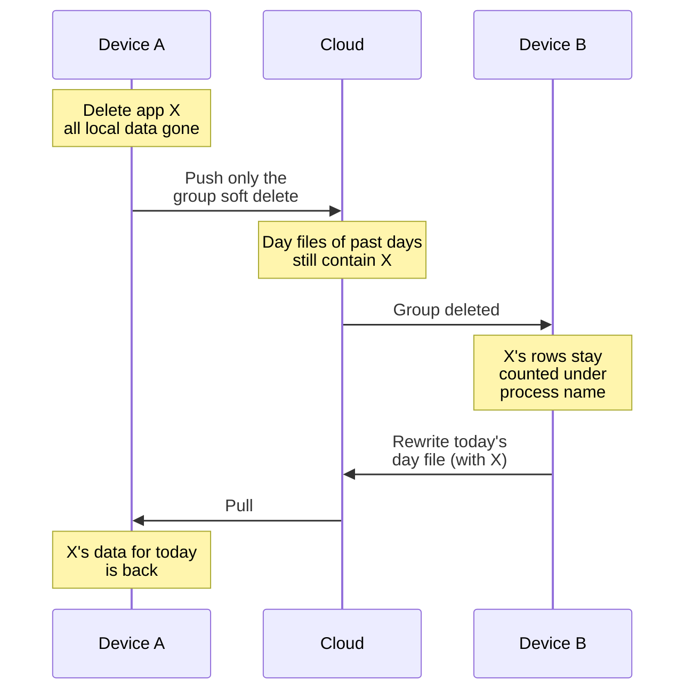

# ADR-0001 · Deleting an app only deletes it on this device

- **Date**: 2026-10-13
- **Status**: Proposed (problem only; no solution yet)
- **Related**: [ADR-0005](0005-push-rewrites-whole-files.md) · [ADR-0012](0012-webdav-device-tombstone.md) · `repo::app_groups::purge_with_data`

In the "Remove" dialog, the "Delete" option says it "deletes this app's recorded time, screenshots and text index". In fact it only deletes them on this device. The data stays in the cloud and on other devices, and it can later come back to this device.

## Flow

Where X's data is after the delete:

| Where | After the delete |
| --- | --- |
| This device: time, screenshots, text index, icons, executable paths | Deleted |
| This device: app group and pairing | Soft deleted, synced to other devices |
| Cloud: `device.<id>.activities.<date>.ndjson` for past days | Still there |
| Cloud: `device.<id>.memory.<date>.ndjson` for past days (when screen-memory sync is on) | Still there |
| Other devices: X's rows they recorded or pulled from this device | Still there, counted in stats under the process name |
| This device: data pulled later | X's data comes back when another device rewrites a day file, or when this device pulls everything again |

## Context

- Sync only carries "create" and "update". A row that disappears from a file is not read as a delete. A delete needs an explicit delete record.
- The app group delete syncs because it is a soft delete: the row stays, with `deleted_at` set.
- Activity rows and screen text have no delete marker. The delete also does not make that day's file get rewritten. Past days rarely get new data, so their files stay as they are.
- Removing a whole device already has a tombstone file, `device.<id>.tombstone.json` (ADR-0012). There is nothing like it for a single app.
- Screen text is the most sensitive part. It is the exact text that appeared in the app's windows. The settings page calls it "Most sensitive".

## Hard parts

This section does not discuss how to fix it. It only lists what any fix must deal with:

- **The delete record leaks information**: to make other devices delete X, we must tell them which app it is. If that record stays in the cloud, it says "X was installed, then deleted".
- **Only the device that wrote a file can rewrite it**: each device pushes only its own files (ADR-0005). Another device's day files change only when that device rewrites them.
- **Older versions and offline devices**: older versions skip file names they do not know. Offline devices receive nothing.
- **New data after the delete must stay**: the dialog says the program will show up again the next time it runs. Data recorded after the delete must not be removed.
- **Two sync services**: it must work with both Google Drive and WebDAV, and with switching between them (ADR-0011).

## What stays even if the delete reaches other devices

- AI daily and weekly reports already generated. They are stored text that names X and how it was used, and they sync too. The dialog already says "Reports already generated are left untouched".
- Places in chat history that mention X. Chat history syncs too.
- X in screenshots taken while another app was in front. That text belongs to the other app's records.
