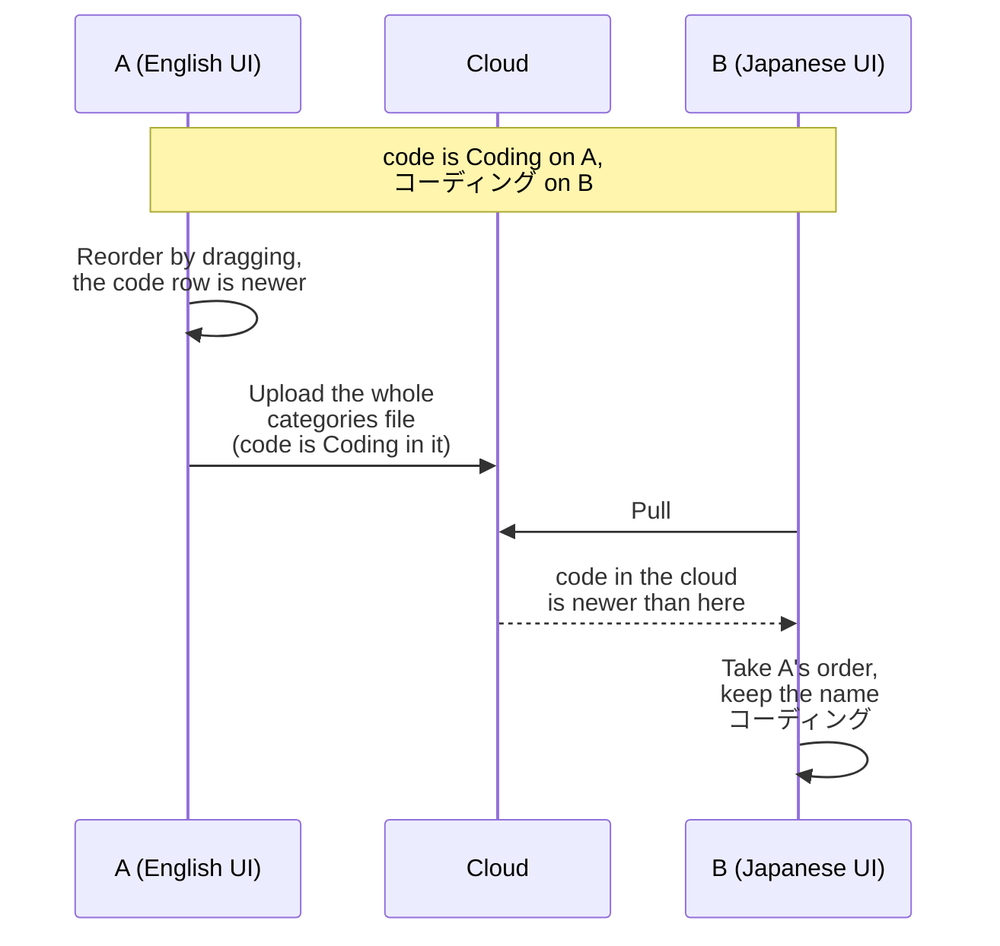

# ADR-0015 · Default category names are translated once into the UI language, and names no longer sync

- **Date**: 2026-10-19
- **Status**: Proposed
- **Related**: [ADR-0005](0005-push-rewrites-whole-files.md)

The database stores the default categories under their original Chinese names. For example, `code` is stored as 编程. The frontend translates a name only when it finds the original Chinese name, so Rust never gets the translation. With an English UI, AI chat still reads 编程, and the rename box also shows 编程.

We decided: at the first start, the original Chinese names of the default categories are translated into the UI language of that moment. After that, names do not change automatically. The frontend shows the names from the database as they are. Names no longer sync, and each computer keeps its own names.

## Flow

### Two computers with different languages

## Decisions and rationale

1. **Translate the names automatically, using the built-in translations.**
   - When: at the first start after an install or an upgrade. Later starts do not translate. New installs are translated too, because the migrations still write the original Chinese names.
   - Which categories: those whose name is still the original Chinese name. Categories the user renamed are not changed.
   - Into what: the UI language, not the system language. Existing users may run a Chinese UI on an English system.
   - How we know: both tables get an `is_default_name` column, which is 1 while the name is still the original Chinese name. Translating sets it to 0, and so does a rename by the user. Only rows with 1 are translated, so each category is translated only once.
2. **Translating does not change `updated_at` and adds nothing to the outbox.** The user did not change the category, so the row must not override real changes from other computers when sync merges it.
3. **Names do not sync.** On pull, a category that already exists here keeps its own name, and the other fields still merge by `updated_at`. A category that does not exist here is created with the name from the cloud. Push still writes the name into the cloud file, because older versions read this field.
4. **The frontend shows the names from the database as they are.** Remove `displayCategoryName`, `displaySuperCategoryName`, and the two tables of original Chinese names.

Default super-categories (`super_categories`) follow the same rules.

## Costs, data, and compatibility

- **Benefit**: the name in the database is the name the UI shows, so Rust code that reads category names does not need to translate them.
- **Names do not change when the user switches the language**: users must rename categories themselves. The current version follows the language, so the release notes must say this.
- **Renames do not sync**: a rename on one computer does not reach the other computers. The release notes must say this too.
- **Existing data**: migration v44 adds an `is_default_name` column to categories and super-categories. Rows whose name is still the original Chinese name get 1, and renamed rows get 0. The first start after the upgrade translates the names. After the upgrade, users see the same names as before.
- **Mixed versions**: when an older version pulls a newer category from the cloud, it still overwrites the whole row, name included. If two computers use different UI languages, the older one may show the other computer's name, for example Coding. The name stays after that computer upgrades, because it is no longer the original Chinese name; the user must rename it. Computers with the same UI language are not affected.
- **Downgrading**: no data is lost, and older versions do not read the new column. Older versions translate only the original Chinese names, so translated names are shown as they are. After the user upgrades again, `is_default_name` is already 0, so nothing is translated again.
- **Default categories missing on a computer**: when the user already had a category with the same name, v29–v31 did not create office, workchat, game, or video. When such a computer receives these categories from another computer, it creates them with the other computer's names.
- **Privacy**: nothing new is uploaded.

## Verification

- First start: categories with `is_default_name` = 1 get the translated name, and the column becomes 0. Categories the user renamed or created are not changed. `updated_at` does not change, and nothing is added to the outbox. Later starts and language switches do not translate again. A rename by the user sets `is_default_name` to 0.
- Pull: a category that exists here keeps its name, and the other fields merge as usual. A category that does not exist here is created with the name from the cloud. Push still writes the name.
- On real computers: try a new install and an upgrade from an older version. The Categories page, the charts, and AI chat all show names in the UI language. After two computers with different UI languages sync, each keeps its own names.
