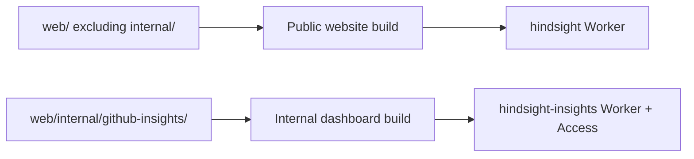

# ADR-0018 · Keep internal web tools under web/internal

- **Date**: 2026-10-25
- **Status**: **Accepted**

Internal web tools belong under `web/internal/`. The GitHub Insights dashboard
uses `web/internal/github-insights/` and its independent deployment workflow.

## Flow

## Context

- Website source is already grouped under `web/`.
- Internal operational pages need a clear location without adding one root
  directory for each tool.
- The public builder recursively copies files from `web/`, so internal source
  must be explicitly excluded from that artifact.

## Decision

Keep the dashboard's page, Worker, tests, and Wrangler configuration together in
`web/internal/github-insights/`. Keep collection scripts and shared statistics in
`scripts/insights/`, and GitHub Actions definitions in `.github/workflows/`.

The public builder excludes the entire `web/internal/` subtree. Its workflow
does not run for internal-only website edits. Internal tools use their own
workflow, Worker, and access controls.

## Alternatives

- **A separate root directory for the dashboard**: adds a parallel website
  source location for one internal tool.
- **`docs/internal/`**: contains ignored local notes, not deployable source.
- **`scripts/insights/web/`**: groups by automation but separates website source
  from the existing `web/` tree.

## Consequences

The source layout is consistent, while deployment paths and exclusions must be
maintained explicitly. The public build regression test verifies both public
asset output and the absence of the internal subtree.

## Data, compatibility, security, and privacy

This is a source migration. The dashboard keeps its Worker identity, route,
Access audience, and private KV binding. No stored data migration is needed.
Rollback restores the source and workflow paths together. Public builds must
exclude internal source before this layout is deployed.

## Verification

- Run the public builder integration test, which uses synthetic site fixtures.
- Confirm the test fails when the internal exclusion is removed.
- Run dashboard and collector tests from their updated paths.
- Build the public website and package the internal Worker independently.
