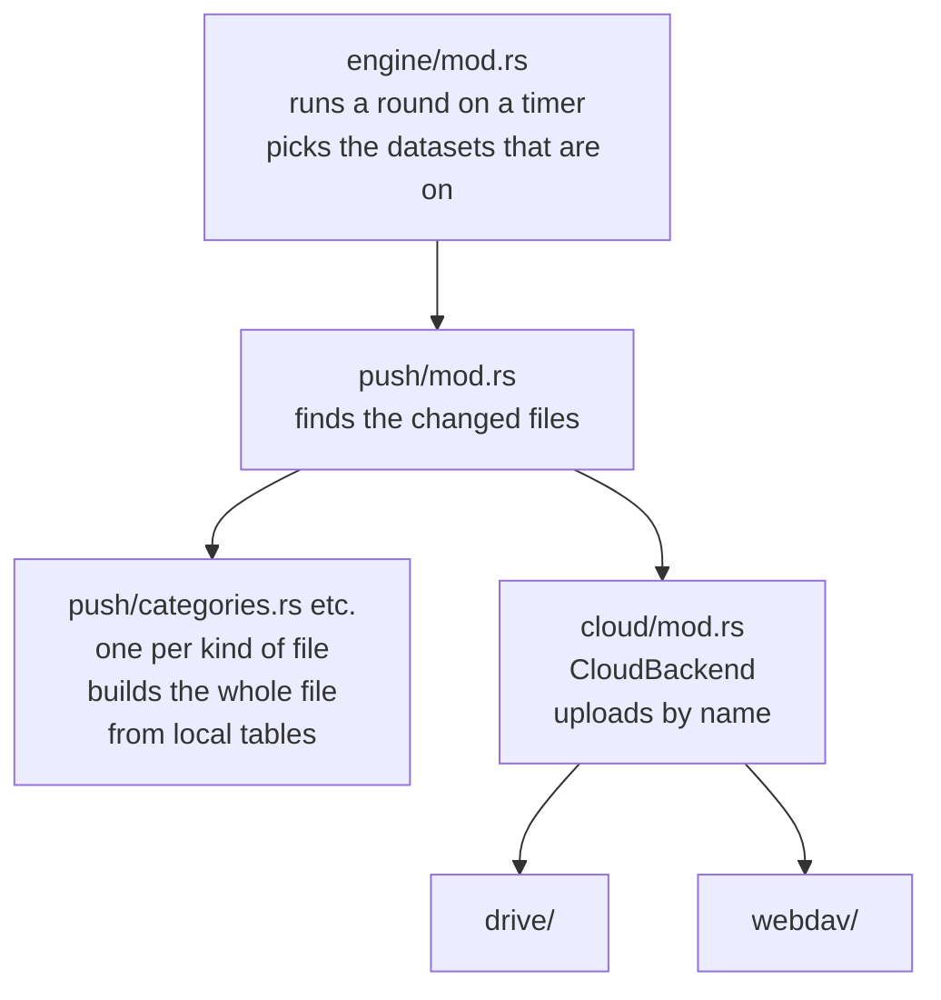
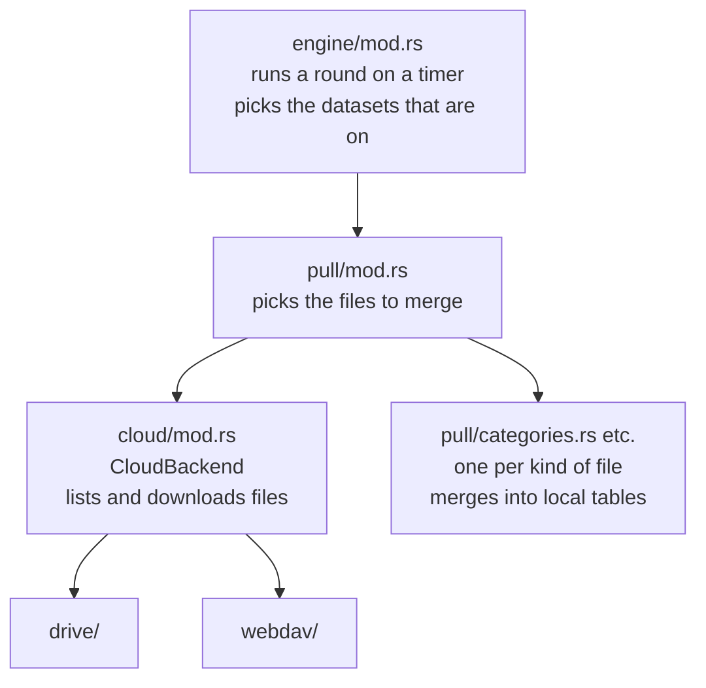

# ADR-0018 · Sync engine split by file kind: one module per kind under `push/` and `pull/`

- **Date**: 2026-11-07
- **Status**: **Accepted**
- **Related**: ADR-0006 · ADR-0007 · ADR-0011 · ADR-0012 · commits `3acc4eb3` to `9a18d9b2`

`push.rs`, `pull.rs` and `datasets.rs` each held both the steps of a sync round and the reads and writes of every table. The code that called the cloud also checked which backend it had. A new synced table needed edits in several places, and some of them still compiled when they were missed. We put the reads and writes of each kind of file in its own module under `push/` and `pull/`. The cloud is reached only through the methods of `CloudBackend`. Where we can, a missed edit is now a compile error.

## Flow

**Dataset**: a group of cloud files that are pulled together and share one cursor. Core (activities, categories, icons and others), website rules and super-categories are always on. AI summaries, chat and screen memory follow their switches in Settings.

### Push

### Pull

## Context

- A new table needed edits in `payload.rs`, `file_name.rs`, `repo/outbox.rs`, three places in `push.rs` and two in `pull.rs`.
- `group_outbox` and `FileKind::dataset()` both ended in a `_` arm. When a new kind was missed, the first one dropped all its changes and logged only one warning. The second one counted it as core, so it was pulled even with its switch off.
- `pull.rs` had about 880 lines, and about 600 of them merged single kinds of file.
- Two commands that clear the cloud each had a copy of Drive's delete steps. Drive's test double was a variant of `CloudBackend`, so the tests never ran `DriveClient`.

## Decision

We **let push and pull know only two interfaces: the kind of file and the backend**. The side that uses an interface does not know which implementation is behind it. Each implementation has its own code.

- **Kind of file**: `push/mod.rs` and `pull/mod.rs` only dispatch on `FileKind`, and know no table. Each kind of file has one implementation: `build` in `push/<kind>.rs` builds the whole file from local tables, and `merge` in `pull/<kind>.rs` merges the file into local tables. An implementation gets only the database it uses, so it cannot reach the cloud, the outbox or the cursors.
- **Backend**: push and pull store and read files only through `CloudBackend`, and do not know if Drive or WebDAV is behind it. Each backend answers for itself: the sync interval, the time precision, and how to remove a device.
- **The interfaces are an enum and a match, not a trait**: async methods cannot go behind `dyn` (E0038), and putting them there needs async-trait. The backends and the kinds are a fixed set. The matches have no `_` arm, so a new kind without an implementation does not compile.

## Follow-up

- Files found by the outbox and by the fingerprints go through one upload path.
- The outbox code moves into one module. Today it is in three places: `repo/outbox.rs`, `engine/io.rs` and `push/mod.rs`.
- `remove_device` for WebDAV (ADR-0012).
- `enqueue_every_file` uses `OutboxEntity::ALL`.
