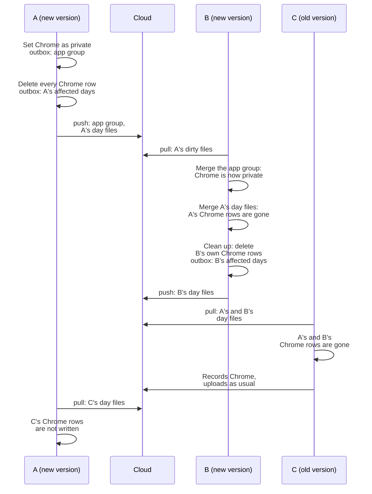

# ADR-0019 · Private category: apps and websites in it are not recorded at all

- **Date**: 2026-11-08
- **Status**: Proposed
- **Related**: issue #246 · ADR-0001 · ADR-0005 · ADR-0015

The data of the Hidden category is still written to the database, and only queries leave it out, so one mistake in a filter lets it out (#246). We add a built-in category, Private (id `private`): apps and websites in it are not written, neither during capture nor during pull. Each device deletes the data it already recorded and rewrites its whole day files, so the other devices delete it too. The old Hidden category is only renamed to Excluded from stats.

## Flow

A can rewrite only its own day files, so only the device that recorded Chrome data can delete it. B learns that Chrome is private when it merges A's app group, and only then deletes its own rows.

Which category a row belongs to:

| App group | Matching website rule | Result |
|---|---|---|
| `private` | Any | `private` |
| Any | `private` | `private` |
| `hidden` | Other | `hidden` |
| Other | Yes | The website rule's category |
| Other | None | The app group's category |

## Context

- The data of the Hidden category is written as usual, and queries leave it out with `IS NOT 'hidden'`. Tor Browser appeared in an AI summary, and the prompt sent to the model still showed `[私密]` placeholders with their times.
- With a cloud model, anything in the prompt leaves this computer.

## Decision

We will **add a built-in Private category whose data is written neither during capture nor during pull. Each device deletes the data it already has, and rewriting whole day files carries the deletion to the other devices**.

- **One rule**: it is in `from_stats_category_sql`, and Private wins over everything. Capture, pull, cleanup and counting all use it.
- **Cleanup keeps no state**: each run deletes all data that is private now, so running it again changes nothing. The five commands that change a category, merge app groups or change website rules run it after they commit. Pull runs it after it merges app groups or website rules.
- **Screen memory**: the days to upload again go through the outbox, as a new entity `memory`. Pull now deletes the sessions that are missing from a file, as it does for activities.
- **When the URL cannot be read, the website counts as not private.**
- **The old Hidden category**: its id stays `hidden`. Only its display name changes.

## Data, compatibility, security, and privacy

- **Existing data and migration**: a migration adds the `private` category, and its name is translated as in ADR-0015. If the name of `hidden` is still an old default name, it becomes 不计入统计 again and is then translated. A name the user changed stays. The schema does not change.
- **Mixed versions**: the sync file formats do not change. Older versions treat `private` as an ordinary category. Older versions do not know the `memory` outbox rows, and delete them.
- **Rollback**: after going back to an older version, the deleted data does not come back, and private apps are recorded again. The release notes must say so.
- **Privacy**: logs give only counts, never app names or domains.

## Follow-up

- Excluded from stats now has two mechanisms: the `hidden` category and ignore rules. Merging them into one is a separate issue.
