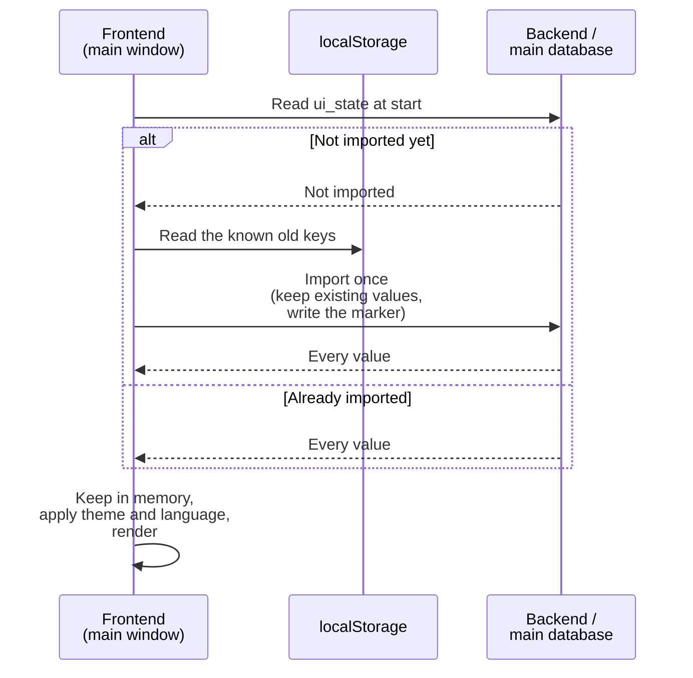

# ADR-0020 · Move the UI state from localStorage to the main database

- **Date**: 2026-11-27
- **Status**: Accepted
- **Related**: issue #335 · PR #342 · ADR-0017

The main window kept its UI preferences in the WebView's `localStorage`: the language, the theme, the selected device, and the views and filters of some pages. On Windows, once the storage under WebView2 is damaged, the values written are lost at every restart (#335). We move this UI state into a `ui_state` table in the main database. The first time the new version opens a main database, it imports the old values from `localStorage` once. After that, it does not read or write `localStorage`.

## Flow

Which value each state takes at start:

| Imported before | In the main database | In `localStorage` | Value used |
|---|---|---|---|
| No | Yes | Any | The database value (not overwritten) |
| No | No | Yes | The `localStorage` value (also written to the database) |
| No | No | No | The default |
| Yes | Yes | Not read | The database value |
| Yes | No | Not read | The default |
| Reading fails | — | — | The default (the start goes on; no marker is written) |
| Import fails | — | Yes | The `localStorage` value, for this start only (no marker; the next start imports again) |

## Context

- **What users see**: on the affected Windows computers, the language and the rest of the UI state reset after a restart. A new WebView2 user data folder fixes it (#335).
- **Cause and limits**: WebView2 keeps `localStorage` in Chromium's LevelDB. If the process is killed in the middle of a write (we think during an update, for example), half a record stays in the log. After that, the check at restart fails and later writes are dropped, and the page gets no error. The runtime owns the user data folder, so the app can neither detect nor repair the damage.
- **For comparison**: the settings in the main database were not affected. SQLite's WAL transactions write all of a change or none of it.

## Decision

We will **keep the frontend's UI state in a `ui_state(key, value)` table in the main database, load it into memory once before the main window first renders, and stop reading and writing `localStorage`**. This replaces the rule in ADR-0017 that the theme choice and the copy of a custom theme are kept in `localStorage`.

- **Writes do not wait**: the frontend always reads the UI state from memory. A change updates memory first, and is then saved without blocking the UI.
- **Only known keys, only once**: the frontend keeps the list of keys to import. The first import copies only the valid entries on that list, and writes the marker in the same transaction. A value is at most 2 MiB, which is enough for the JSON copy of a custom theme with a theme.css of up to 512 KiB. After that, `localStorage` is not used at all.
- **Plugins no longer get the selected device from `localStorage`**: the plugin page and the background script read `localStorage` and passed the selected device to the backend. Now the backend reads it from `ui_state` itself. The plugin API does not change.
- **Not synced; one copy per account database**: each account's main database has its own copy. Switching to another account's database restarts the app, so the copy in memory always belongs to the open database.

## Alternatives

- **The settings JSON in `settings_store`**: a settings update reads the whole JSON and then writes it back. Frequent UI changes and a settings change at the same time would overwrite each other.
- **A JSON file of our own**: another way to keep data next to the database, and we would have to handle half-written and damaged files ourselves.
- **Stay with `localStorage`**: it does not stop WebView2 from dropping writes without an error.

## Consequences

- **Benefits**: the UI state no longer depends on WebView2's `localStorage`, so damaged storage no longer resets it.
- **Costs and risks**:
  - The main window reads from the backend once more before its first render. The target is under 10 ms, so the default theme or language does not show first.
  - Saving does not wait for the write. If the process is killed right after a change, that change can be lost, but existing data is not damaged.

## Data, compatibility, security, and privacy

- **Migration and import**: a database migration adds the `ui_state` table. The first import only reads `localStorage` and does not delete it.
- **Rollback**: older versions (0.12.x) skip the migration versions they do not know, so they open the database as usual and keep reading `localStorage`, which holds the values from before the update. After going back to the new version, the marker is already set, so changes made in the older version are not imported again.
- **Other account databases**: the first time the new version opens an account database that was never imported, it imports the values left in this computer's `localStorage` from before the update.
- **Privacy**: some filters can hold search text the user typed. The UI state is not synced to the cloud. Backend logs give key names and counts, never values.
