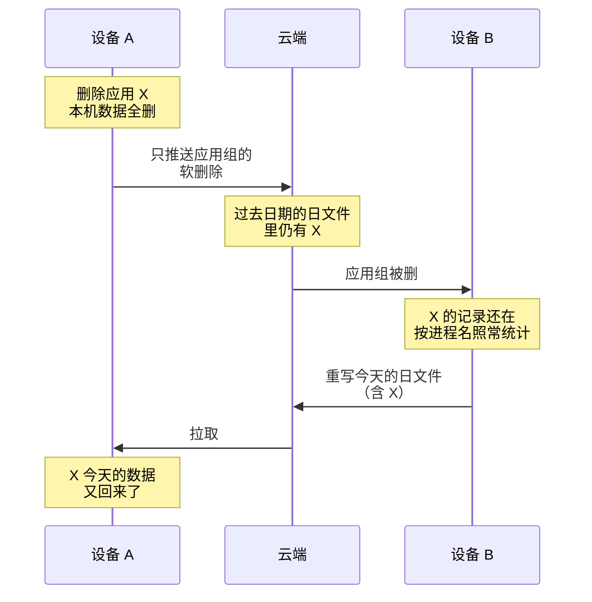

# ADR-0001 · 删除应用只删本机（中文稿）

- **日期**：2026-10-13
- **状态**：提议中（只记问题，方案另议）
- **相关**：[ADR-0005](../0005-push-rewrites-whole-files.md) · [ADR-0012](./0012-webdav-device-tombstone.md) · `repo::app_groups::purge_with_data`

在「移除」对话框里选「删除」，说明写的是「删除该应用的所有时长数据、截图与文字索引」。实际只删了本机：云端和其它设备上的数据都还在，之后还可能被拉回本机。

## 流程

删除后，X 的数据在哪：

| 位置 | 删除后 |
| --- | --- |
| 本机：时长、截图、文字索引、图标、可执行文件路径 | 删掉 |
| 本机：应用组和配对 | 软删除，会同步到其它设备 |
| 云端：过去日期的 `device.<id>.activities.<日期>.ndjson` | 还在 |
| 云端：过去日期的 `device.<id>.memory.<日期>.ndjson`（开了屏幕记忆同步时） | 还在 |
| 其它设备：自己记的、从本机拉过去的 X 的记录 | 还在，按进程名照常计入统计 |
| 本机：之后拉到的数据 | 别的设备重写某天的文件，或本机从头重新拉取时，X 的数据回来 |

## 背景

- 同步只传「新建」和「更新」。一行从文件里消失，对端不会当成删除；要删，必须有一条明确的删除记录。
- 应用组的删除能同步，是因为它是软删除：行还在，带 `deleted_at`。
- 活动记录和屏幕文字没有删除标记。删除也不会让那天的文件重写，而过去的日子通常不会再有新数据，文件就一直留着。
- 删除整台设备已经有墓碑文件 `device.<id>.tombstone.json`（ADR-0012）。删除单个应用没有对应的东西。
- 最敏感的是屏幕文字：它是这个应用窗口里出现过的逐字内容，设置页称它「敏感度最高」。

## 难点

不讨论怎么做，只列任何做法都要面对的问题：

- **删除记录本身会泄露**：要让其它设备删，就得告诉它们删哪个应用。这条记录留在云端，等于写明「装过 X，又删了」。
- **文件只有写它的设备能重写**：每台设备只推送自己的文件（ADR-0005），其它设备的日文件要等那台设备来改。
- **旧版本和不在线的设备**：旧版本不认识的新文件会被跳过，不在线的设备收不到。
- **不能误删之后的新数据**：对话框说这个程序下次运行会重新出现，删除之后记下的数据要留着。
- **两种同步服务**：Google Drive 和 WebDAV 都要支持，还有中途换服务（ADR-0011）。

## 即使删除能传出去，也删不掉的

- 已经生成的 AI 日报、周报：存好的文字，里面有 X 的名字和用法，也会同步。对话框已写明「不影响已经生成的日报与总结」。
- 对话记录里提到 X 的地方，也会同步。
- 别的应用在前台时截到的画面里的 X：这段文字属于另一个应用的记录。
