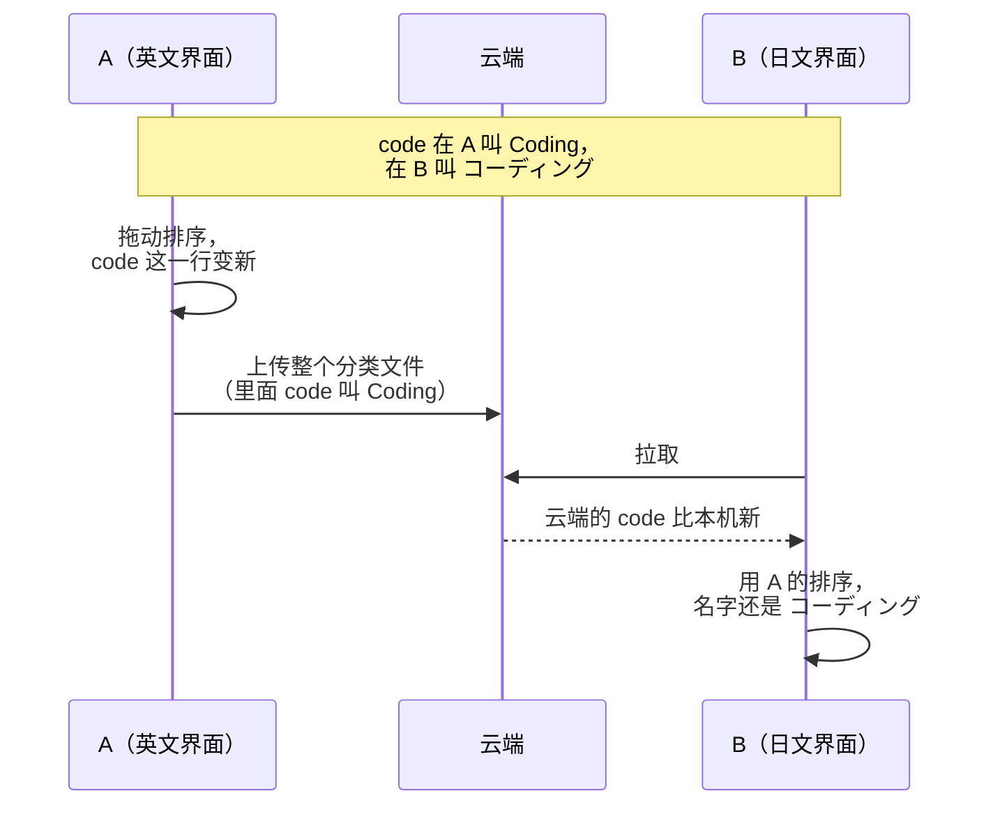

# ADR-0015 · 默认分类按第一次启动时的界面语言换名，名字不再同步（中文稿）

- **日期**：2026-10-19
- **状态**：提议
- **相关**：[ADR-0005](../0005-push-rewrites-whole-files.md)

默认分类在库里存的是中文原名，比如 `code` 存「编程」。前端认出中文原名才翻译，Rust 拿不到翻译：英文界面下，AI 对话读到的还是「编程」，改名框里显示的也是「编程」。

我们决定：第一次启动时，把默认分类的中文原名换成当时界面语言的译名，之后不再自动换；前端直接显示库里的名字。名字不再同步，每台电脑保留自己的名字。

## 流程

### 两台电脑语言不同

## 决定与理由

1. **自动按照预设译文更换名字。**
   - 什么时候换：新装或升级后的第一次启动。以后启动都不换。新装也要换，因为迁移写进去的还是中文原名。
   - 换哪些：名字还是中文原名的分类。用户改过名的不换。
   - 换成什么：界面语言的译名，不用系统语言。老用户可能在英文系统上用中文界面。
   - 怎么认出来：两张表各有一列 `is_default_name`，名字还是中文原名时是 1。换名时改成 0，用户改名也改成 0。只换 1 的行，所以每个分类只换一次。
2. **换名不改 `updated_at`，不进 outbox。** 换名不是用户改了分类，不能让这个分类在同步合并时盖掉别的电脑上的真实改动。
3. **名字不同步。** 拉取时，本机已有的分类保留自己的名字，其他字段照旧按 `updated_at` 合并；本机没有的分类，用云端的名字新建。推送照旧把名字写进云端文件，因为旧版本要读这个字段。
4. **前端直接显示库里的名字。** 删掉 `displayCategoryName`、`displaySuperCategoryName` 和两张中文原名表。

默认大类（`super_categories`）的规则相同。

## 代价、数据与兼容

- **好处**：库里的名字就是界面上显示的名字，Rust 里读分类名的地方不用再翻译。
- **切换语言后名字不变**：用户想换只能自己改名。现在的版本会跟着变，这一条写进发版说明。
- **改名不同步**：在一台电脑上改名，别的电脑不会跟着变。这一条也写进发版说明。
- **存量数据**：迁移 v44 给分类和大类各加一列 `is_default_name`，名字还是中文原名的设成 1，改过名的是 0。升级后第一次启动时换名。用户升级后看到的名字和现在一样。
- **新旧版本混用**：旧版拉到云端较新的分类时，照旧整个覆盖，名字也覆盖。两台电脑界面语言不同时，旧版那台可能显示另一台的译名，比如「Coding」。它升级后也不会变回来，因为这已经不是中文原名，要用户自己改名。界面语言相同就没有影响。
- **退回旧版**：数据不丢，旧版不读新列。旧版只翻译中文原名，换过名的分类原样显示译名。再升级时 `is_default_name` 已经是 0，不会再换名。
- **本机没有的默认分类**：用户已经有同名分类时，v29–v31 不会新建 office、workchat、game、video。这样的电脑从别的电脑收到这几个分类时，用对方的名字新建。
- **隐私**：不新增上传的内容。

## 验证

- 第一次启动：`is_default_name` 为 1 的分类换成译名，并改成 0；改过名的分类和自建分类不动；`updated_at` 不变，没有新的 outbox。再启动或切换语言都不再换名。用户改名后 `is_default_name` 变成 0。
- 拉取：本机已有的分类名字不变，其他字段照常合并；本机没有的分类用云端的名字新建。推送照旧写名字。
- 真机：新装和从旧版升级各试一次，分类页、图表和 AI 对话里显示的都是界面语言的译名；两台界面语言不同的电脑同步后，各自的名字不变。
