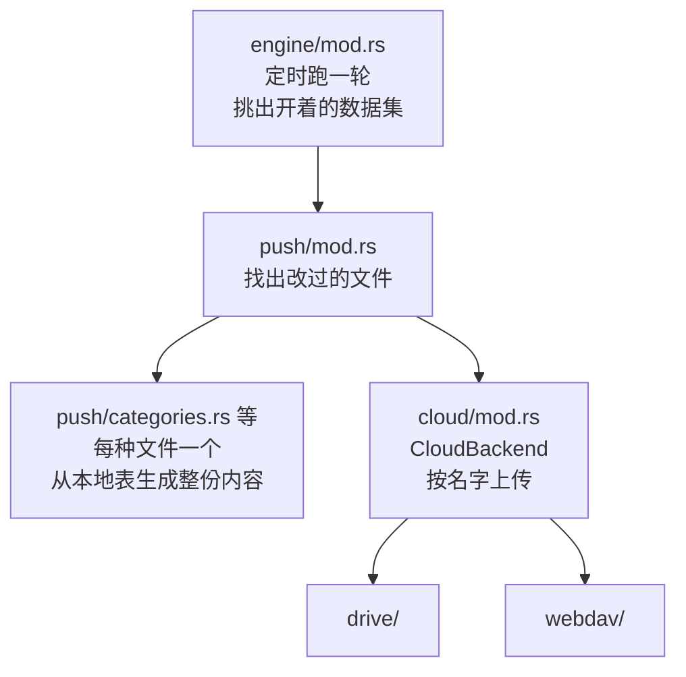
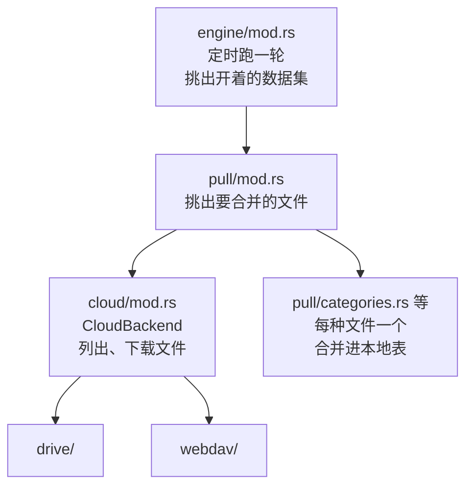

# ADR-0018 · 同步引擎按文件种类拆分：push/ 和 pull/ 下一种文件一个模块

- **日期**：2026-11-07
- **状态**：提议
- **相关**：ADR-0006 · ADR-0007 · ADR-0011 · ADR-0012 · commit `3acc4eb3` 到 `9a18d9b2`

原来 `push.rs`、`pull.rs`、`datasets.rs` 既管一轮同步的步骤，又管每张表的读写；调用云端的代码还会自己判断是哪个后端。新加一张同步的表要改好几处，其中有几处漏写了也能编译。我们把每种文件的读写放进 `push/` 和 `pull/` 下各自的模块，云端只能通过 `CloudBackend` 的方法访问，漏写的地方尽量让编译器报错。

## 流程

**数据集**：一起拉取、共用一个游标的一组云端文件。核心（活动、分类、图标等）、网站规则、大类总是开着；AI 总结、聊天、屏幕记忆看设置里的开关。

### Push

### Pull

## 背景

- 新加一张表要改 `payload.rs`、`file_name.rs`、`repo/outbox.rs`、`push.rs` 三处、`pull.rs` 两处。
- `group_outbox` 和 `FileKind::dataset()` 都以 `_` 分支结尾。漏写一个新种类，前者丢掉它的全部改动，只记一条 warn；后者把它算进核心，开关关着也会拉下来。
- `pull.rs` 约 880 行，其中约 600 行是各种文件的合并。
- 两个清云端的命令各抄了一份 Drive 的删除步骤。Drive 的测试替身是 `CloudBackend` 的一个变体，测试没跑过 `DriveClient`。

## 决定

我们**让 push 和 pull 只认两个接口：文件种类和后端**。用接口的一方不知道底下是哪个实现，每个实现一份代码。

- **文件种类**：`push/mod.rs` 和 `pull/mod.rs` 只按 `FileKind` 分发，不知道任何表。每种文件一份实现：`push/<种类>.rs` 的 `build` 从本地表生成整份内容，`pull/<种类>.rs` 的 `merge` 把内容并进本地表。实现只拿到它用的那个库，碰不到云端、outbox 和游标。
- **后端**：push 和 pull 只通过 `CloudBackend` 存取文件，不知道底下是 Drive 还是 WebDAV。同步间隔、时间精度、怎么移除设备，都由每个后端自己回答。
- **接口是 enum 加 match，不是 trait**：async 方法放不进 `dyn`（E0038），要放就得加 async-trait。后端和种类都是写死的几种；match 不写 `_`，新加一种却漏了实现，就编译不过。

## 后续

- outbox 和指纹找出来的文件走同一条上传路径。
- outbox 的代码收进一个模块，现在分在 `repo/outbox.rs`、`engine/io.rs`、`push/mod.rs` 三处。
- WebDAV 的 `remove_device`（ADR-0012）。
- `enqueue_every_file` 改用 `OutboxEntity::ALL`。
