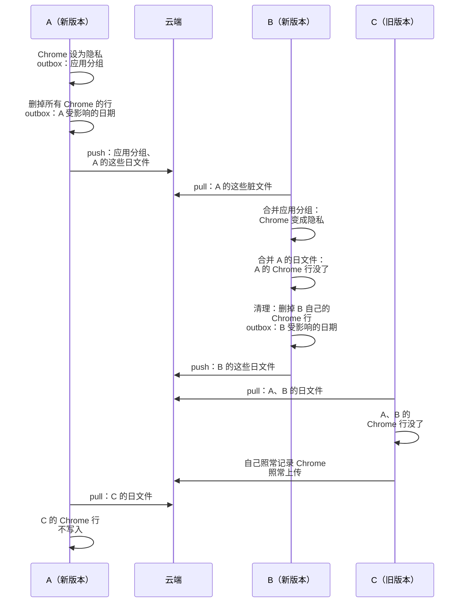

# ADR-0019 · 隐私分类：归到它的应用和网站完全不记录

- **日期**：2026-11-08
- **状态**：提议
- **相关**：issue #246 · ADR-0001 · ADR-0005 · ADR-0015

「隐藏」分类的数据照常写进数据库，只在查询时过滤掉，过滤一出错就会漏出去（#246）。我们加一个内置分类「隐私」（id `private`）：归到它的应用和网站，采集和拉取时都不写入；已经记下的数据，由每台设备各删各的，再靠整份重写日文件，让别的设备跟着删掉。旧的「隐藏」只改名为「不计入统计」。

## 流程

A 只能重写自己的日文件，所以每台设备记下的 Chrome 数据，只能由它自己删。B 合并了 A 的应用分组，才知道 Chrome 是隐私，才会去删自己的那一份。

一行数据算哪个分类：

| 应用分组 | 适用的网站规则 | 结果 |
|---|---|---|
| `private` | 任意 | `private` |
| 任意 | `private` | `private` |
| `hidden` | 其他 | `hidden` |
| 其他 | 有 | 网站规则的分类 |
| 其他 | 没有 | 应用分组的分类 |

## 背景

- 「隐藏」分类的数据照常写入，查询时靠 `IS NOT 'hidden'` 过滤。Tor Browser 出现在了 AI 总结里，交给模型的提示词里还能看到 `[私密]` 占位和对应的时间。
- 用云端模型时，进了提示词的东西就离开了本机。

## 决定

我们**加内置分类「隐私」，采集和拉取都不写入；已有的数据每台设备各删各的，靠整份重写日文件传到别的设备**。

- **只有一条规则**：写在 `from_stats_category_sql` 里，隐私压过一切。采集、拉取、清理、计数都用它。
- **清理不记状态**：每次都把「现在属于隐私的」数据全部删掉，跑几次结果都一样。改分类、合并分组、改网站规则的 5 个命令提交以后调用；拉取时合并过应用分组或网站规则以后也调用。
- **屏幕记忆**：要重传的日期走 outbox，新加一种 entity `memory`。拉取改成删掉文件里没有的会话，跟活动一样。
- **读不到网址时，按不是隐私处理**。
- **旧的「隐藏」**：id 还是 `hidden`，只改显示名。

## 数据、兼容、安全和隐私

- **现有数据和迁移**：迁移加一行 `private` 分类，按 ADR-0015 的方式翻译名字。`hidden` 的名字还是旧默认名的，改回「不计入统计」再翻译；用户改过名的不动。表结构不变。
- **混合版本**：同步文件的格式不变。旧版本把 `private` 当成一个普通分类。旧版本不认识 outbox 里的 `memory` 行，会把它们删掉。
- **回滚**：退回旧版本以后，已经删掉的数据回不来，隐私应用会重新开始被记录。发版说明里要写明。
- **隐私**：日志只记条数，不记应用名和域名。

## 后续

- 「不计入统计」现在有两套机制：`hidden` 分类和忽略规则。合并成一套，另开 issue。
