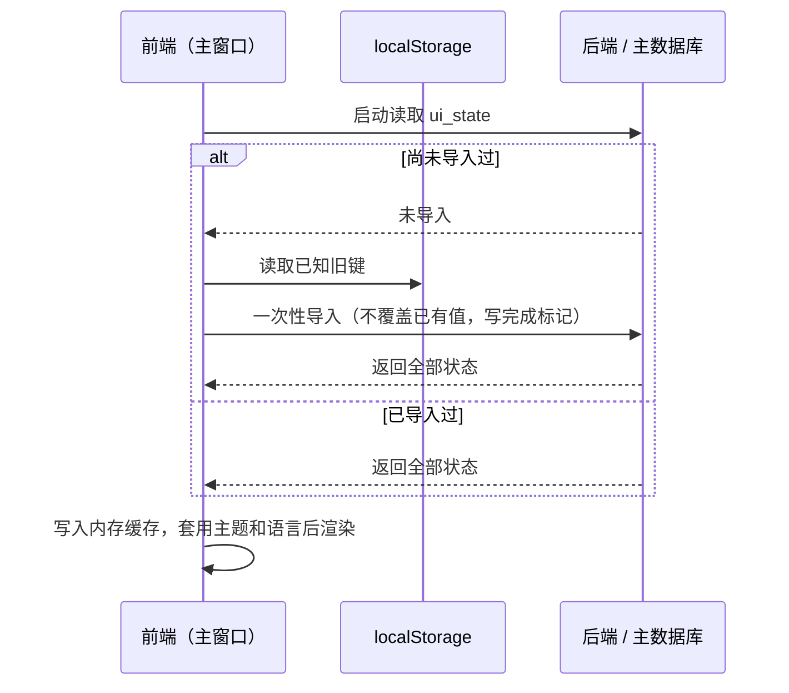

# ADR-0020 · 界面状态从 localStorage 迁入主数据库

- **日期**：2026-11-27
- **状态**：已接受
- **相关**：issue #335 · PR #342 · ADR-0017

主窗口的界面偏好（语言、主题、选中设备、各页视图与筛选等）原本存在 WebView 的 `localStorage` 中。在 Windows 上，WebView2 底层存储一旦损坏，写入的值每次重启都会丢失（#335）。我们决定将这些界面状态迁入主数据库的 `ui_state` 表；新版本首次打开主数据库时一次性从 `localStorage` 导入旧值，此后不再读写 `localStorage`。

## 流程

启动时每项状态的取值规则：

| 是否已导入过 | 主数据库有值 | `localStorage` 有值 | 采用的值 |
|---|---|---|---|
| 否 | 有 | 任意 | 主数据库的值（不覆盖） |
| 否 | 无 | 有 | `localStorage` 的值（同时写入主数据库） |
| 否 | 无 | 无 | 默认值 |
| 是 | 有 | 不再读取 | 主数据库的值 |
| 是 | 无 | 不再读取 | 默认值 |
| 读取失败 | — | — | 默认值（不阻塞启动，不写完成标记） |
| 导入失败 | — | 有 | `localStorage` 的值，只用于本次启动（不写完成标记，下次启动再导入） |

## 背景

- **现象**：在受影响的 Windows 机器上，修改语言等界面状态重启后重置；更换为全新的 WebView2 用户数据目录后恢复正常（#335）。
- **成因与限制**：WebView2 使用 Chromium 的 LevelDB 保存 `localStorage`。写入中途进程被强杀（推断如升级安装覆盖时）会留下半条损坏日志，此后写入在重启校验失败时被静默丢弃，页面收不到任何错误；用户数据目录归运行时管理，应用无法检测也无法修复。
- **对比**：同期存在主数据库里的业务设置未受影响——SQLite 通过 WAL 事务保证写入原子性。

## 决定

我们**把前端界面状态统一迁入主数据库的 `ui_state(key, value)` 表，主窗口首次渲染前一次性加载进内存，此后不再读写 `localStorage`**。本决定覆盖 ADR-0017 中「主题选择与自定义主题副本存于 `localStorage`」的约定。

- **运行期异步写**：前端读界面状态一律同步读内存缓存；修改时先更新内存，再异步落库，不阻塞界面。
- **只导入已知键，只导一次**：前端维护一份需要迁移的键清单，首次导入只复制清单内的合法条目（单值上限 2 MiB，覆盖最大 512 KiB `theme.css` 的自定义主题 JSON 副本）并在单事务中写下完成标记；之后彻底不再访问 `localStorage`。
- **插件不再经 `localStorage` 取选中设备**：原本插件页面与后台脚本直接读 `localStorage` 再把选中设备传给后端；迁入数据库后改由后端直接从 `ui_state` 读取，插件侧 API 不变。
- **不参与同步，按账号数据库隔离**：每个账号的主数据库各存一份；切换账号数据库会重启应用，内存缓存始终对应当前主数据库。

## 备选

- **放进 `settings_store` 设置 JSON**：现有设置更新是整份先读后写，高频的界面状态变更会和并发的设置修改互相覆盖。
- **单独写一份 JSON 文件**：在数据库之外再维护一套持久化，还要自己处理写半截和损坏恢复。
- **留在 `localStorage`**：无法解决 WebView2 存储静默丢写的问题。

## 后果

- **收益**：彻底脱离 WebView2 的 `localStorage`，底层存储损坏后界面状态不再重置。
- **代价与风险**：
  - 主窗口首次渲染前增加一次后端读取（目标 10 ms 以内，避免先闪默认主题或语言）。
  - 写入不等待落盘确认，修改后进程立刻被强杀可能丢失该次改动（但不会损坏已有数据）。

## 数据、兼容、安全和隐私

- **迁移与导入**：通过数据库迁移新建 `ui_state` 表；首次导入只读不删原 `localStorage`。
- **降级回滚**：旧版本（0.12.x）会跳过不认识的新迁移版本，可正常打开数据库并照旧读 `localStorage`（读到升级前的旧值）。再升回新版本时，因完成标记已存在，旧版本期间的界面修改不会再次导入。
- **多账号数据库**：新版本首次打开另一个尚未导入过的账号数据库时，会导入本机 `localStorage` 中升级前遗留的值。
- **隐私**：部分筛选状态可能包含用户输入的搜索词；界面状态不同步到云端，后端日志只记录键名和条数，不记录具体值。
