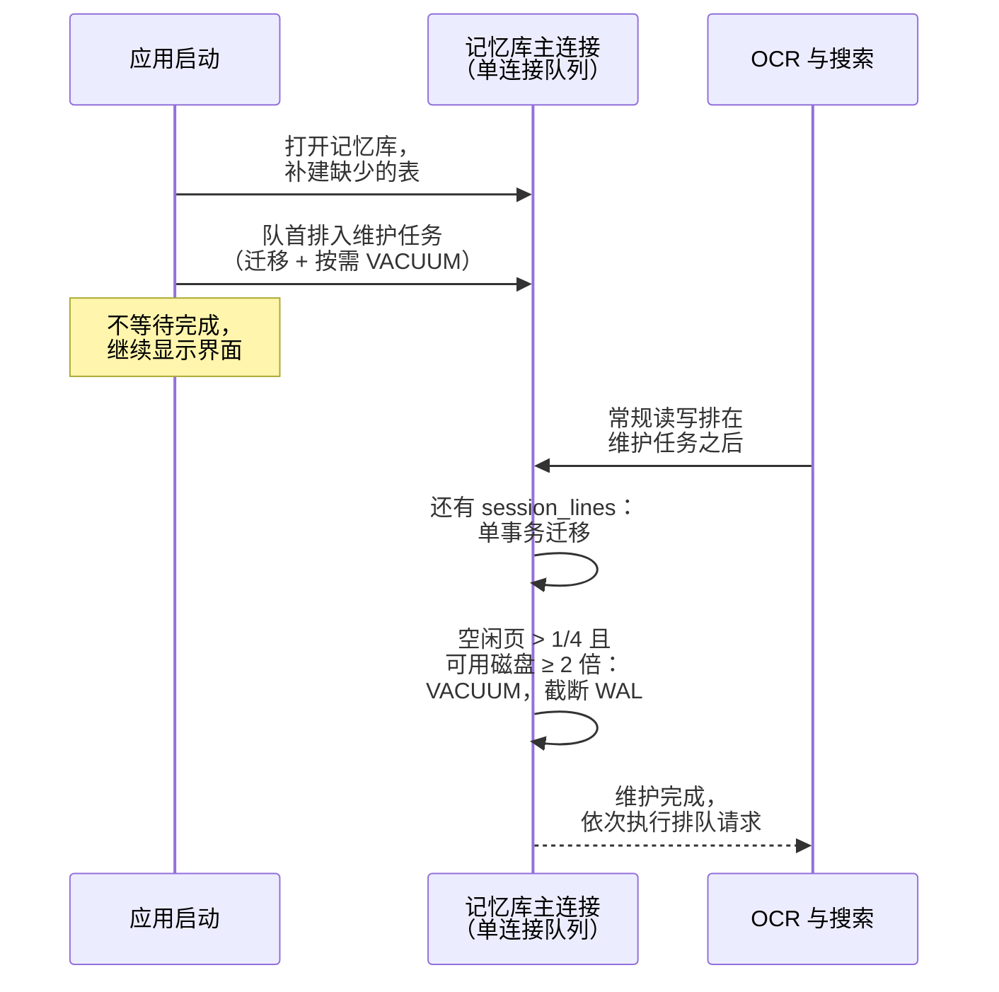

# ADR-0021 · 屏幕记忆库去掉重复数据：`session_lines` 改为 `session_frames`

- **日期**：2026-11-28
- **状态**：已接受
- **相关**：ADR-0016

屏幕记忆库（`hindsight-memory.<uid>.sqlite`）里同一份数据存了多遍：`session_lines` 每行文字都抄一遍截图的路径和拍摄时间，文字本身又和 `text_sessions.text` 重复一份。我们决定：`frames` 增加整数主键 `id`、删除可由 `ts` 得出的 `local_date`；用 `session_frames` 取代 `session_lines`，每个（会话, 截图）只存一行，记录这张截图带来的文字从会话的第几行开始；文字只留在 `text_sessions.text`。新版本首次启动时在后台单事务迁移，空间条件满足时执行 `VACUUM`（本机实测记忆库从 1968 MB 降至 877 MB）。**迁移后不支持退回旧版本。**

## 表结构

| 表 | 改动 | 字段 |
|---|---|---|
| `frames` | 加 `id`，删 `local_date` | `id` 主键、`path` 唯一且可为空、`ts`、`app_id`、`title`、`ocr_state`、`attempts`、`session_id` |
| `text_sessions` | 不变 | 原样 9 个字段；`text` 成为文字唯一的一份 |
| `session_frames` | 取代 `session_lines` | `session_id`、`first_line_no`、`frame_id`；主键 `(session_id, first_line_no)`，`WITHOUT ROWID` |

一张截图负责的行，从它的 `first_line_no` 开始，到同一会话下一条记录的 `first_line_no` 之前为止。查第 k 行来自哪张截图，取 `first_line_no ≤ k` 中最大的那条。

## 流程

维护任务每次启动的动作：

| 库里还有 `session_lines` | 空闲页占比 | 可用磁盘 ≥ 库文件 2 倍 | 动作 |
|---|---|---|---|
| 有 | — | — | 单事务迁移，再按下面三行判断是否 `VACUUM` |
| 没有 | ≤ 1/4 | — | 不做处理 |
| 没有 | > 1/4 | 是 | 执行 `VACUUM` 回收磁盘空间，再截断 WAL |
| 没有 | > 1/4 | 否 | 跳过 `VACUUM` 并记日志，下次启动再检查 |

异常中断时的行为：
- **迁移中途失败或进程被杀**：迁移事务回滚，保持旧结构，下次启动重试迁移。
- **迁移已提交、`VACUUM` 中途失败或进程被杀**：保持新结构（仅空闲页未回收），下次启动跳过迁移、直接重试 `VACUUM`。
- **历史孤儿行**：若某段行指向的截图已不在 `frames` 中，该段的 `frame_id` 存 `NULL`：这几行照样能搜到，只是不显示证据截图。不能直接丢掉这一段，否则这几行会被算到前一张截图头上。

## 背景

- **冗余占盘严重**：本机实测记忆库 1967 MB，其中 `session_lines`（含主键索引）占 1078 MB：路径与时间 686 MB，文字 176 MB 与 `text_sessions.text` 重复；575 万行只对应 14.7 万个（会话, 截图）组合，平均一张截图带来约 39 行。
- **按段记录可行**：本机实测，同一会话里一张截图新增的行号总是连续的一段，行号没有空缺，会话文字的第 k 行就是 `line_no = k` 的那一行（均为 0 例外）。所以只记每段的起始行号，就能还原每一行来自哪张截图。
- **不涉及云同步**：`session_lines` 不参与跨设备同步；参与同步的 `text_sessions` 不改，同步协议不变。
- **引用完整性可控**：目前仅在三处删除 `frames` 行（按时间清除、按应用清除、清空全部），且三处均同步删除对应的行记录；清理过期截图只删磁盘图片文件、不删 `frames` 行。
- **空间回收成本高、不能阻塞启动**：SQLite 删除或重建表只会产生内部空闲页，必须通过 `VACUUM` 才能把空间还给文件系统，而 `VACUUM` 需要额外的可用磁盘且耗时数秒；应用启动在显示界面前阻塞执行初始化，不能把迁移和 `VACUUM` 放进启动阻塞路径。

## 决定

我们**为 `frames` 增加显式主键 `id INTEGER PRIMARY KEY`（`path` 改为 `UNIQUE`）并删除 `local_date`；以 `session_frames` 取代 `session_lines`，文字只存于 `text_sessions.text`；旧库在启动后于后台单事务迁移，空闲页超阈值时执行 `VACUUM`**。

- **按表是否存在判断迁移，不依赖 `user_version`**：库里还有 `session_lines` 就迁移。旧版本每次启动都会把 `user_version` 覆写为 5，版本号不可信。
- **找关键词所在的行改在 Rust 中进行**：读出会话文字按行切开，找到行号后查 `session_frames`。会话文字平均约 2 KB。
- **按时间清除改为逐段删除**：原来靠 `session_lines.text` 重新拼出会话文字，现在没有这份文字了。现在删掉时间点及以后拍的截图带来的那几段行，后面的行往前挪，`first_line_no` 跟着改。不能从第一个被删段起把后面整个截掉：识别失败的截图重试时排在后面，它的行可能排在比它晚拍的截图之后，本机实测有 4 段。截图已不在 `frames` 里的段不知道拍摄时间，保留。
- **维护任务排在主连接队首**：`MemoryDb` 通过单连接队列串行访问；启动时将维护任务排在第一位后立刻返回，既不阻塞界面显示，也保证后续常规 OCR 与搜索不会读到迁移中间态。
- **`path` 允许为空**：本机 96% 的截图图片已过期删除，但 `frames` 里的路径还在。以后另开 PR，在清理过期截图时把 `path` 清成 `NULL`，本机可再省约 26 MB（表和唯一索引各约 13 MB）。SQLite 不能去掉一列的 `NOT NULL`，只能重建表；这次本来就要重建 `frames`，现在放开，以后就不用再迁移。
- **`frames` 必须有显式整数主键**：`VACUUM` 会重排隐式 `rowid`，只有显式 `INTEGER PRIMARY KEY` 才能保证 `VACUUM` 后 `frame_id` 引用稳定。
- **`VACUUM` 无状态触发**：不单独记录"是否已压缩"，每次启动统一按"空闲页占比 > 1/4 且磁盘充足"决定；迁移后、上次 `VACUUM` 被打断后、以及用户手动清除大量数据后都由同一条规则兜底。
- **`VACUUM` 后截断 WAL**：WAL 模式下 `VACUUM` 写出的新页先进 WAL。不执行 `wal_checkpoint(TRUNCATE)` 的话，本机 WAL 会一直占着 964 MB。
- **对外查询结果不变**：前端和 AI 工具仍拿到截图路径与拍摄时间。

## 备选

- **只把路径和时间换成 `frame_id`，文字仍按行存**：改动少，但在同一次命令行试验中，记忆库只降到 1216 MB，本方案为 959 MB，多约 260 MB；以后再改成本方案，用户还要再迁移、再 `VACUUM` 一次。
- **保留 `local_date`、沿用 `session_lines` 表名以兼容旧版本**：只在退回旧版本时有用，省下的改动不多。本次决定不支持退回，选更省、含义更清楚的结构。
- **`frames.path` 改存相对截图目录的路径**：只省约 20 MB（表和唯一索引各约 10 MB）；而截图目录可以在设置里改，改目录前的截图还在原来的目录，相对路径就对不上了。
- **全文索引去掉位置信息（FTS5 `detail='none'`）**：可再省约 330 MB，但会破坏现有短语搜索（改用 `LIKE` 后常见词查询从 0.8 ms 退化到 124 ms），本次不做。

## 后果

- **收益**：本机实测记忆库从 1968 MB 降至 877 MB，减少 1091 MB（−55%）；`session_frames` 只有约 2 MB。
- **代价与风险**：
  - 升级后首次启动，OCR 识别和屏幕文字搜索需等待后台维护完成。本机实测：打开记忆库 4 ms 后返回，迁移 11.1 秒，`VACUUM` 4.4 秒，打开后的第一个调用 15.6 秒后才返回。这是开发构建（主 crate O1、依赖 O2）的数字，发布构建（`opt-level = "z"`）未实测；磁盘较慢的设备会更久。
  - 维护期间会临时多占磁盘：本机峰值 2979 MB（主文件 2014 MB + WAL 964 MB），约为原文件的 1.5 倍。维护结束时截断 WAL，实测回到 0 MB。
  - AI 对话的屏幕文字搜索工具使用独立的只读连接，不经主连接队列；若用户在迁移尚未提交的那几秒内发起提问，该工具可能报错一次。

## 数据、兼容、安全和隐私

- **迁移与不可逆性**：表结构迁移在单个事务内原子完成；迁移后路径、时间只保存在 `frames`，文字只保存在 `text_sessions`，变更不可逆。本机实测迁移出 147,141 段；逐行核对 5,759,707 行，每行来自的截图与旧表 0 处不同，会话文字 0 处改变。
- **不支持退回旧版本（0.12.x）**：旧版本打开迁移后的库，截图登记和取待识别截图都会因 `frames.local_date` 不存在而失败，屏幕记忆停止记录；升级前的会话也不再显示证据截图。发版说明需写明警告：升级后不要退回旧版本。
- **隐私**：维护日志只记录行数、耗时和文件大小，不记录屏幕文字和文件路径。
