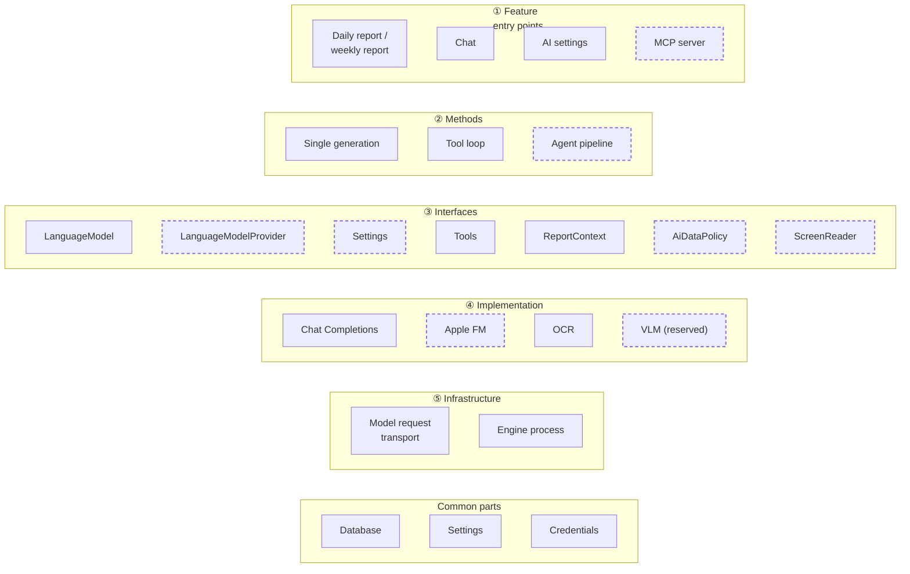

# AI backend architecture

> **Status**: Draft, waiting for approval.
>
> **Scope**: Features that call a language model (daily report, weekly report, chat), model selection and configuration, the new MCP server entry point, and the interface reserved for the screen reader (#16). OCR internals are not in the scope of this document. Model downloads are not in the scope of this document.
>
> **Related**: #245 · #247 · #149 · #259 · #16

This document only covers the main structure: which differences to hide, how many layers there are, and what each layer is in charge of. The details are in separate files:

| File | Content |
|---|---|
| [LanguageModel](3-language-model.md) | The interface for calling a model: the request, the result, the capability description, errors, and the meaning of each item |
| [Adapter specification](4-adapters.md) | What a unified request becomes when it is sent to each vendor |
| [Methods](2-methods.md) | Shared conventions for single generation, the tool loop, and the Agent pipeline |
| [Model selection and configuration](3-settings.md) | Choose a model on the page. Parameters are calculated automatically. Advanced settings |
| [How AI reads data](3-data-access.md) | What to show the model, and what not to show: `ReportContext`, `Tools`, `AiDataPolicy` |
| [Tools](tools/0-overview.md) | Tools the model can call: how one call runs, the shared rules, and what each tool looks up |
| [Daily report](1-daily-report.md) | How one daily report runs, the material the model reads (#245), and two methods for writing a daily report with tools |
| [Apple FM](4-apple-fm.md) | Local Apple Foundation Models (#247) |
| [MCP server](1-mcp-server.md) | Let an external Agent read Hindsight's data and write a daily report back (#259) |
| [Screen reader](3-screen-reader.md) | Use a model to read screenshots. Only the interface is kept (#16) |

---

## 1. Differences to hide

The job of the architecture is to make the upper layer unable to see the differences below. Each interface corresponds to a few of these rows.

**Models are different**

| Difference | Example | Hidden by |
|---|---|---|
| Where it runs, and how it is called | Cloud goes over HTTP. Local is a child process. Apple FM is a system framework | `LanguageModel` |
| Request and response format | Field names, message format, streaming, usage | Adapter |
| Thinking | The on/off field, which strengths exist, whether it can be used with tools, whether it uses the output budget | `Request.reasoning` + adapter |
| Tool calls | Native protocol. Constrained with grammar. None | `Tools` + adapter |
| Context length | From 4K to 1M. Some cannot be customized. Some cannot be looked up | Capability description + automatic configuration |
| Errors | Each vendor describes the same error differently | `ModelError` + adapter |
| Authentication | None; API Key; login | The app's credentials. The adapter only gets the request headers |
| How to install, and how to test | Download a file. Fill in an address and a key. Built into the system | `LanguageModelProvider` |

**Tasks are different**

| Difference | Example | Hidden by |
|---|---|---|
| Requirements for the model | A daily report only needs the model to produce text. Chat needs the model to call tools, because the model has to query the database itself. The screen reader needs the model to see images | Method requirements table + automatic configuration: if the model is not capable enough, it cannot be selected |
| How the model is called | A daily report calls it once. Chat lets the model query the database itself, back and forth for several rounds. The Agent pipeline calls it in several steps | Methods: changing the approach does not require a change to the daily report. It also does not require a change to the model |
| Text sent to the model | A daily report is one day's timeline. Chat is the result that tools looked up | `ReportContext`: text put together in advance for the model. `Tools`: query results the model asks for itself |
| Data that must not be given to the model | Activity that is not in the "categories for AI analysis". Titles that match a privacy keyword. Screenshots are not given to cloud models | `AiDataPolicy`: one set of rules. `ReportContext` and `Tools` both filter by it |

**Machines and users are different**

| Difference | Example | Hidden by |
|---|---|---|
| Machine | Discrete graphics card, unified memory, no GPU | The engine: llama-server's `--fit` sets the context length and the number of GPU layers from this machine's memory |
| The user wants to adjust it | Context, concurrency, output length | `Settings`: items changed in advanced settings replace the calculated values |

The upper layer only asks `Settings` for one run configuration. It cannot see the hardware. It also does not know which item the user changed.

---

## 2. Overall structure



Dashed boxes are the added parts. What is marked "reserved" only keeps the interface. It is not implemented this time. The "common parts of the app" at the bottom do not belong to the AI module. AI only uses them. Five rules:

1. **Dependencies only go downward.** ① does not know any vendor. ② sees the model only through ③. Vendor knowledge is only in ④. The MCP server is an exception. It does not go through ②, because the model is in the external app.
2. **One mechanism for each thing.** One place sends model requests. One Chat Completions adapter. One place manages the engine. One tool definition. One range of what AI can see. One place does automatic configuration.
3. **③ does not change with the vendor or the method.** Adding a vendor only adds to ④. Adding a method only adds to ②. To change ③, write an ADR.
4. **All judgments are in the backend.** Which thinking levels a model has, which parameters are recommended, and whether this model can be used: the frontend asks the backend for all of these. The frontend does not store this knowledge itself.
5. **Existing commands and events do not change.** New UI (model selector, advanced settings) uses new commands.

Module layout (all names are proposals):

```
src-tauri/src/ai/
├── features/     ① daily.rs  weekly.rs  chat.rs
├── mcp/          ① MCP server: search titles, get material, write a daily report back
├── methods/      ② single_pass.rs  tool_loop.rs  pipeline.rs
├── model/        ③ LanguageModel, LanguageModelProvider, request and result types
├── settings/     ③ model selection, automatic configuration, advanced settings
├── tools/        ③ tool definitions, validation, execution
├── context/      ③ ReportContext: timeline, title cleaning, templates for multiple languages
├── policy.rs     ③ AiDataPolicy
├── screen/       ③ ScreenReader
├── providers/    ④ local.rs  cloud.rs  apple_fm/  chat_completions/
├── transport/    ⑤ model request transport: timeouts, retries, splitting SSE events
└── engine/       ⑤ llama-server process and EngineGuard
```

The AI commands in `commands/` only forward the call one layer.

---

## 3. What each layer is in charge of

Take "the user has chosen a model on the daily report page and clicks Start summary" as the example. In each case, the model is cloud DeepSeek, a local 4B model (a Mac with 16 GB), and Apple FM.

### 3.1 Feature entry points

Each AI feature that the user uses is one entry point:

| Entry point | What it does | Details |
|---|---|---|
| Daily report, weekly report | Write one day or one week of activity as a summary | [Daily report](1-daily-report.md) |
| Chat | Answer the user's questions about their own activity | [Methods](2-methods.md) |
| AI settings | Manage models, choose a model, advanced settings | [Model selection and configuration](3-settings.md) |
| MCP server | Let an external Agent look up Hindsight's data and write a daily report back | [MCP server](1-mcp-server.md) |

### 3.2 Methods

A method decides how many times the model is called, and how it is called. See [Methods](2-methods.md). The daily report example uses single generation. It calls once. It gets back one piece of text.

### 3.3 Interfaces

| Interface | What it is in charge of | Details |
|---|---|---|
| `LanguageModelProvider` | The source of models: list which models there are, check whether a model can be used, and open the chosen model | [Model selection and configuration](3-settings.md#22-backend-languagemodelprovider) |
| `LanguageModel` | A model after it is opened: send a request, and get a reply | [LanguageModel](3-language-model.md) |
| `Settings` | Choose a model, and calculate the run configuration | [Model selection and configuration](3-settings.md) |
| `ReportContext` | Material put together in advance for the model | [How AI reads data](3-data-access.md#1-reportcontext) |
| `Tools` | Query tools given to the model. The model decides what to query | [How AI reads data](3-data-access.md#2-tools) |
| `AiDataPolicy` | Which data to filter out before material and query results are given out | [How AI reads data](3-data-access.md#3-aidatapolicy) |
| `ScreenReader` | Get text from a screenshot | [Screen reader](3-screen-reader.md) |

In the daily report example, only a local model needs preparation when the model is opened. If the engine is not running, start it first. The page shows "Loading model". In the run configuration, only a local model comes with requirements for the engine. The context length is known only after the model is opened. For a local model, the engine sets it from this Mac's memory. Apple FM reads it from the system. The timeline is trimmed according to the input budget. Apple FM has the shortest context, so it is trimmed the most.

### 3.4 Implementation

Convert the unified request into each vendor's format. Then convert the reply back.

- Local models and cloud connections share one Chat Completions adapter. Each vendor's differences are written as one dialect table. See [Adapter specification](4-adapters.md).
- Apple FM has a separate adapter. See [Apple FM](4-apple-fm.md).
- The first version of reading screenshots has only OCR. See [Screen reader](3-screen-reader.md).

The same daily report request is sent out like this:

| Model | Request that is sent |
|---|---|
| Cloud DeepSeek | Turn thinking off with `thinking: {type: "disabled"}`. The output limit is called `max_completion_tokens`. Streaming |
| Local 4B model | Turn thinking off with `enable_thinking: false`. The output limit is called `max_tokens`. With temperature. Not streaming |
| Apple FM | It does not go over the network. Create a new session. Ask the system for plain text |

### 3.5 Infrastructure

- **Model request transport**: There is only one layer that sends model requests. It only understands the HTTP and SSE standards. When a protocol is added, this layer does not change. Timeouts, the wait after a rate limit, and retries when the connection drops are all here. The path is given by the adapter. The request headers are given by the credentials. For a streaming reply, it only splits the reply into SSE events. It does not read the content inside the events. How to put the stream together, whether it is complete, and how to change the request on a 400: the adapter answers these. The transport layer defines a trait. The adapter implements it. For the details, see [To be decided](4-adapters.md#4-to-be-decided) 4. A connection test also goes through it. So the test result is the same as real use. For the rules, see [Adapter specification](4-adapters.md#3-chat-completions-dialect-table).
- **Engine process**: A llama-server child process. At one time it loads only one model and one set of parameters. When a local model is opened, ask it for an `EngineGuard`. For the rules, see [Model selection and configuration](3-settings.md#34-local-engine).

| Model | What it uses in this layer |
|---|---|
| Cloud DeepSeek | Model request transport. When it is rate-limited, the transport layer waits a short time and sends the request again by itself. The daily report code cannot see this |
| Local 4B model | Model request transport and the engine process. If the engine cannot start, the daily report receives `Unavailable`. The page shows the reason |
| Apple FM | Uses neither. It does not go over the network, and it also has no engine process |

### 3.6 Common parts of the app

The database, settings, and credentials belong to the whole app. AI only uses them.

- **Database**: `ReportContext` and `Tools` read activity records from here. Daily report results, weekly report results, and chat records are also stored here.
- **Settings**: AI settings are stored in the app's settings. See [Model selection and configuration](3-settings.md#1-data).
- **Credentials**: The API Key and the login token are saved encrypted with the local key that sync already has (`sync/local_key.rs`). A separate set is not built. This code needs to be moved to a common place. The adapter only gets the request headers. It does not know which kind of authentication is used.

---

## 4. To be decided

Only questions that cross files are kept here. Other questions are in their own files.

1. The local engine is occupied by one task. Another task needs a different model, or a larger context. What should be done?
   - Wait for the previous task to finish.
   - A foreground task (chat) has priority. A background task (a scheduled daily report) releases the engine between segments.
   - Directly tell the user "Engine is busy".
2. The condition for reusing the engine is "the model is the same, and the context is not smaller than required". Do you agree?
3. After this is unified into one `AiDataPolicy`, chat will also follow the "categories for AI analysis" and the privacy keywords. Do you agree?
4. #149: Does OpenAI allow a third-party app to log in with ChatGPT? Do not design this before it is confirmed.
5. Names. All of them must be decided when this is approved.
   - Decided: `LanguageModel`, `LanguageModelProvider`, `ReportContext`, `AiDataPolicy`, `EngineGuard`, `context_length`.
   - Not decided: `Settings`, `RunConfig`, `Carry`, `ScreenReader`, and all module names.
