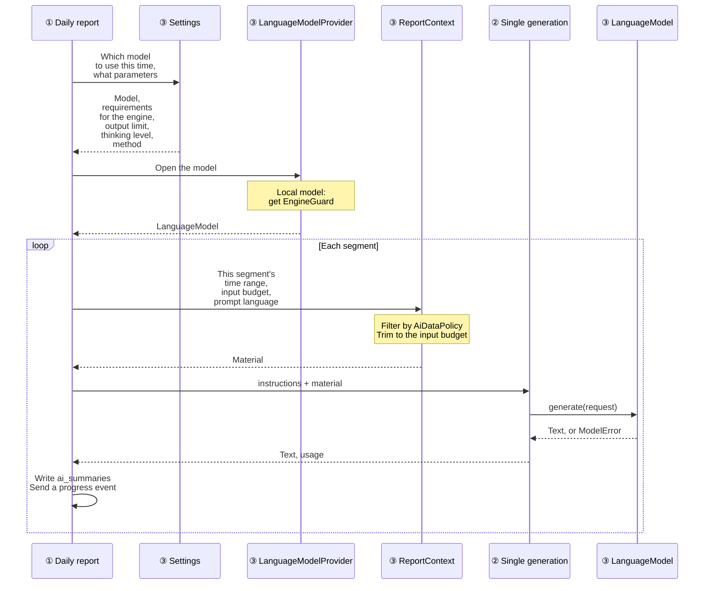

# Daily report

> **Status**: Draft. For the overall structure, see [AI backend architecture](0-ai-architecture.md).
>
> **Related**: #245

The user has chosen a model on the daily report page. The user clicks "Start summary". The backend splits one day into several segments. Each segment reads the activity records. Each segment produces one piece of text. The weekly report reads one week of daily reports. Then it produces one piece of text.

---

## 1. How one daily report runs

- The diagram is only drawn up to ③. ④ Implementation and ⑤ Infrastructure are behind `LanguageModelProvider` and `LanguageModel`. The daily report cannot see them.
- ① decides how many segments to split the day into. It skips segments that are already generated. It reports progress. It writes to the database.
- `Settings` calculates which model to use and what the parameters are (see [Model selection and configuration](3-settings.md#3-logic-automatic-configuration)). `LanguageModelProvider` opens the model with these parameters (see [Model selection and configuration](3-settings.md#22-backend-languagemodelprovider)).
- Each segment is a "write a report" task. It is given to a method (see [Methods](2-methods.md)). The diagram uses single generation. There are three methods for writing a report: single generation, summary + tool loop (see [Methods](2-methods.md#4-summary--tool-loop)), and the Agent pipeline (reserved, not designed yet). Which one is the default will be decided after implementation, based on how well it works. Changing the method only replaces the ② box. A method that uses tools also has to get `Tools`.
- A method that uses tools is also called by segment. Each segment is one call. The result is stored by segment. This is the same as single generation.
- The result of the method includes citations (`ReportOutput.citations`). Citations will be stored in the daily report later. For now, ① does not store them. When they are stored, a field has to be added to `ai_summaries`. This involves migration and sync.

---

## 2. Material the model reads

`ReportContext` generates the timeline for each segment of the daily report. It has to do these things:

- **Units and punctuation follow the prompt language**: In English, write `33 min`. Use half-width punctuation.
- **Record the duration of each title**: For the same title in the same app, add the durations together.
- **Pick titles by duration**: Give the titles used for the longest time first. How many titles to give is set by the input budget. The method calculates the budget. When the budget is not enough, remove the titles used for the least time first.
- **Titles that match a privacy keyword**: Do not send them to the model. Do not leave a placeholder.
- **Decorations in the title**: For example, the unsaved mark and the zoom level (#245). Whether to handle them, see [To be decided](#3-to-be-decided) 2.

#245 also mentions two points. They do not belong to `ReportContext`, but they are also in the daily report:

- The model receives two pieces of text. instructions are the writing requirements. The user can change them. We put prompt together. The material is in it. prompt only describes the material. It does not control what the output looks like. So it does not conflict with instructions that the user has changed. For exactly which sentences to keep, see [To be decided](#3-to-be-decided) 1.
- It must be possible to set the output length. It is in the advanced settings (see [Model selection and configuration](3-settings.md#11-structure-in-the-settings)).

---

## 3. To be decided

1. Exactly which sentences should be kept in the prompt? Sentences that control what the output looks like (for example, write in time order, or start writing from the first sentence) need to be moved into the built-in instructions. Existing users who have changed instructions will lose these sentences. This needs to be written in the release notes.
2. Should decorations in the title be handled? The same file will appear several times because the zoom level is different (#245). Candidates: do not handle them; tell the model in the prompt not to copy them exactly; a rule table. Before deciding, two kinds of data are needed: how long titles usually are, and how much repetition there is; for the same material, whether a small model and a large model will copy them exactly.
