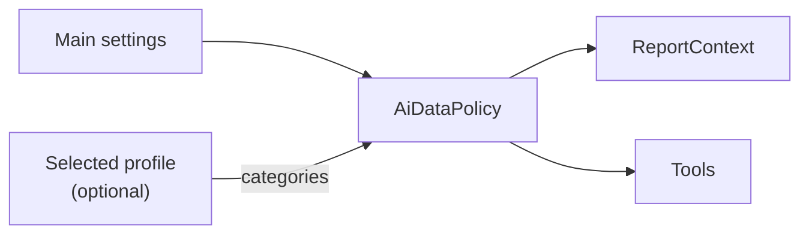

# How AI reads data

> **Status**: Draft. For the overall structure, see [AI backend architecture](0-ai-architecture.md).

The model cannot see the database. We turn the user's data into text. We give the text to the model. There are two ways to give it:

- `ReportContext` gives the material before the model is called. Our code decides what to give. For example, the daily report gives the activity timeline for a period of time. The daily report, the weekly report, and the MCP server use it.
- `Tools` gives query results while the model is answering. The model decides what to query. For example, the model wants to see the full timeline of a certain hour. It calls a tool once. Chat, summary + tool loop, and the MCP server use it.

Both ways go through `AiDataPolicy` first. It decides which data must not be given to the model.

---

## 1. ReportContext

In the daily report and the weekly report, text for the model to read is put together in advance.

```rust
/// Functions that the material for every kind of report must implement.
pub trait ReportContextOps {
    /// Which period of time the material is for.
    fn range(&self) -> TimeRange;
    /// Provides the material, no more than max_tokens. Uses model to count tokens.
    async fn material(&self, max_tokens: u32, model: &LanguageModel) -> Result<String>;
}

/// One branch for each kind of report.
pub enum ReportContext {
    Daily(DailyContext),    // One segment of a day
    Weekly(WeeklyContext),  // One week
    #[cfg(test)]
    Fixed(String),          // For tests. Returns it unchanged.
}

/// A period of local time. The start is included. The end is not included.
pub struct TimeRange { pub start: NaiveDateTime, pub end: NaiveDateTime }
```

| Branch | `range()` | Material |
|---|---|---|
| `Daily` | 09:00 to 12:00 on that day | The activity timeline for this period |
| `Weekly` | Monday 00:00 to the following Monday 00:00 | The full text of the seven daily reports |

- It is written the same way as `LanguageModel`. See "Dispatch" in [LanguageModel](3-language-model.md#9-other-conventions).
- Each branch holds what it needs: the time range, the database, `AiDataPolicy`, and the prompt language. ① builds them.
- Each branch decides how to pick within the limit. For the rules of the daily report, see [Daily report](1-daily-report.md#2-material-the-model-reads).
- To add a kind of report, such as a monthly report, add a branch. The methods do not change.

---

## 2. Tools

This is for the model to query the database by itself. There is only one implementation. So it is a normal struct. For what each tool queries, and what the result looks like, see [Tools](tools/0-overview.md).

```rust
pub struct Tools { /* read-only database connection, AiDataPolicy, prompt language */ }

impl Tools {
    /// All tools shown to the model.
    pub fn specs(&self) -> Vec<ToolSpec>;
    /// Checks the call sent by the model. If it is not valid, the error reason is returned to the model.
    pub fn validate(&self, call: &ToolCall) -> Result<Query, ToolError>;
    /// Executes. Citation numbers start at next_citation. The result is no more than max_chars characters.
    pub async fn execute(&self, query: &Query, next_citation: usize, max_chars: usize)
        -> Result<ToolOutput>;
}

/// A call that has been checked. One branch per tool. For the tool list, see tools/0-overview.md.
pub enum Query { /* … */ }

/// The reason the parameters are not valid. Written for the model to read. The text is in the prompt language.
pub struct ToolError(pub String);

/// The result of one query.
pub struct ToolOutput {
    pub content: String,               // Text put into Message::ToolResult
    pub citations: Vec<Citation>,      // Data citations
}

/// One piece of evidence. The model writes [index] in the answer to cite it.
pub struct Citation {
    pub index: usize,
    pub app: String,
    pub title: String,
    pub started_ts: String,
    pub ended_ts: String,
    pub frame_path: Option<String>,    // The screenshot may already have been removed
}
```

- `ToolSpec` and `ToolCall` are defined in [LanguageModel](3-language-model.md#1-types). One is the tool description given to the model. The other is the call sent by the model. `Query` is a call that has been checked. Progress reports this `Query`.
- Each tool is defined only once: `ToolSpec`, validation, and execution. For how it is translated when given to the model, see [Adapter specification](4-adapters.md#2-chat-completions-protocol-layer-rules). For how it is given to an external app, see [MCP server](1-mcp-server.md).
- The length limit of each result is set from the input budget.
- `Citation` is stored in the chat message. It is also synced. The field names and the JSON format must not be changed.

---

## 3. AiDataPolicy

`AiDataPolicy` decides what data AI can see. There is one set of profiles, and the daily report, the weekly report and chat all pick from it. A profile records only which categories AI can see. With no profile selected, the main settings apply. `ReportContext` and `Tools` filter only by `AiDataPolicy`. They do not write rules themselves.



### 3.1 Requirements

Each feature (daily report, weekly report, chat) can pick its own data filter rules. There is one set of rules, and all features share it. The daily and weekly reports each pick one for automatic generation. By default, these rules follow the main settings (such as the privacy settings and the web privacy settings).

### 3.2 Data

Profiles are stored in `ai.visibility` in the settings JSON. A profile stores only the selected categories. AI cannot see the categories that are not selected.

```jsonc
"visibility": {
  "profiles": {
    "p_8f2a": { "name": "Work", "categories": ["work", "code"] }  // the key is a generated id, so renaming does not break references
  },
  "auto": {
    "daily": "p_8f2a",  // the profile for automatic daily reports; null means the main settings
    "weekly": null      // the same for weekly reports. Chat has no automatic generation
  }
}
```

For manual generation and chat, the frontend passes the selected profile as a parameter. It is not stored.

**To be removed**: the items below are design tradeoffs, not architecture. At delivery, they go into the PR, and then they are removed from this document.

- `excludedCategories` is removed with no migration, because there is no stable release yet.
- The settings JSON is not synced.
- Old and new versions can read each other's settings without errors. An old version does not know `visibility`. When `excludedCategories` is missing, it uses the default (exclude "Other"). A new version does not know `excludedCategories`, and follows the main settings.
- Ignore rules and privacy keywords cannot be overridden. They always follow the main settings.
- When a profile is created, its selection is copied from the main settings. Later changes to the main settings do not change the profile.
- Categories created later are not selected in existing profiles.
- If a profile that `auto` points to is deleted, the main settings apply.
- Development builds kept profiles per feature (daily report, weekly report, chat). They were never released, so they are not migrated. They are read as empty.

### 3.3 Interface

```rust
/// A report that runs automatically. Each one picks its own profile.
pub enum Report { Daily, Weekly }

/// Which profile a run uses.
pub enum ProfileChoice {
    /// The main settings.
    Main,
    /// The profile this report uses when it runs automatically.
    Auto(Report),
    /// The profile the user picked on the page. The value is its id.
    Picked(String),
}

/// What AI can see.
pub struct AiDataPolicy {
    /// Categories AI can see.
    shown_categories: BTreeSet<String>,
    /// Privacy keywords from the main settings. If a process name or a title contains one, AI does not see it.
    privacy_keywords: Vec<String>,
    /// Ignore rules from the main settings.
    ignore_rules: Vec<IgnoreRule>,
}

impl AiDataPolicy {
    /// Reads the main settings and the selected profile, and returns what AI can see. If profile is Main, the main settings apply.
    /// If the profile the user picked is gone, it is an error.
    pub async fn load(main: &Connection, profile: &ProfileChoice) -> Result<Self>;
    /// Returns the WHERE condition to add to a main database query.
    pub fn main_filter(&self) -> String;
    /// Returns the filter for the memory database: the processes in apps that AI can see, and the windows to drop.
    /// apps holds each process name in the memory database with the category it counts toward. The caller looks them up.
    pub fn memory_filter(&self, apps: Vec<(String, String)>) -> SessionFilter;
}
```

### 3.4 Decided

1. When a title matches a privacy keyword, AI cannot see the whole activity (and its time does not count).
2. Website rules cannot be overridden. Profiles override only categories.
3. When the settings cannot be read, it is an error, and this run does not happen.
