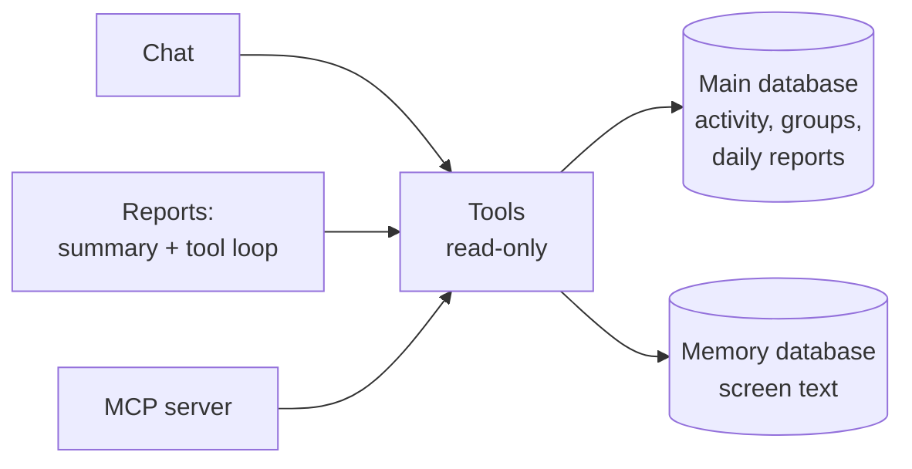
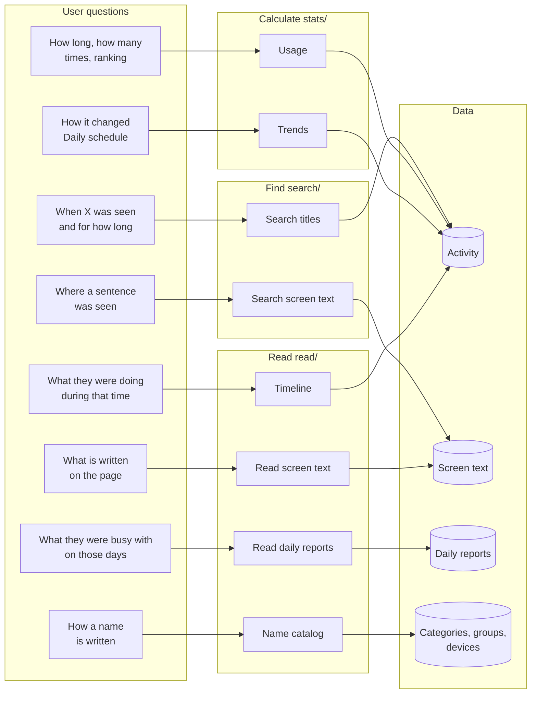
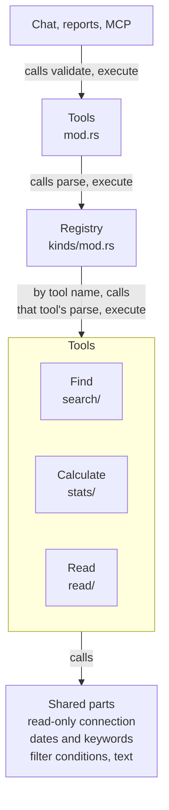
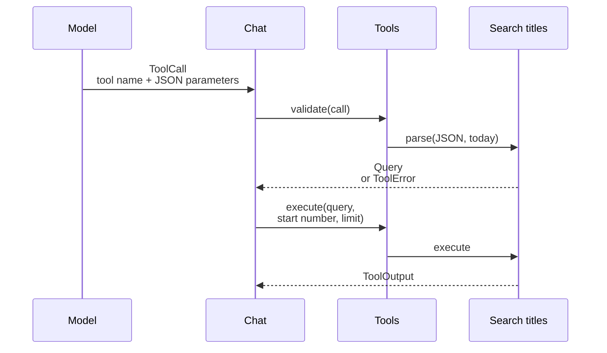
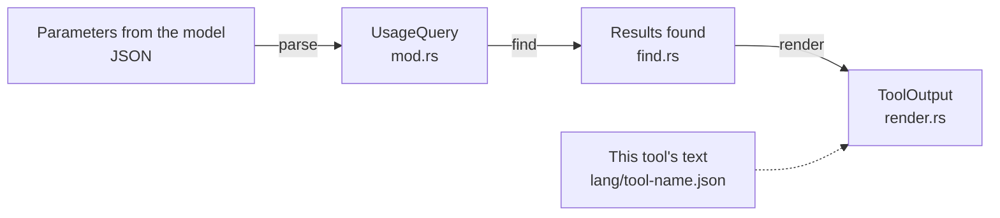
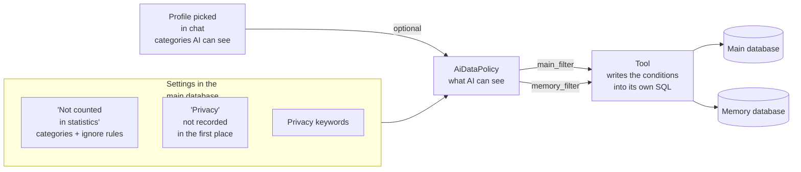
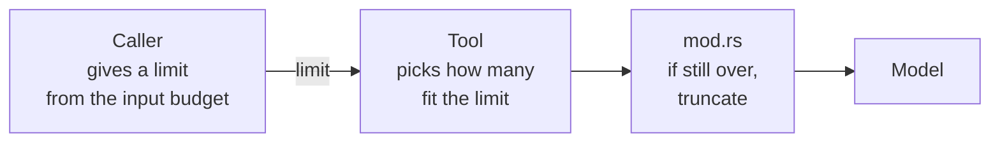

# Tools

> **Status**: Draft, waiting for approval. For the overall structure, see [AI backend architecture](../0-ai-architecture.md).
>
> **Scope**: The `src-tauri/src/ai/tools/` module. It covers which tools there are, the structure of the module, the rules for adding a tool, and the rules all tools share. The details of each tool are in its own document.

| File | Content |
|---|---|
| [Features](1-features.md) | What users will ask, and what each tool must do |
| [Search titles](search/activity.md) | Search window titles by keyword: when X was seen, and for how long |
| [Search screen text](search/ocr.md) | Search screen text by keyword: which windows X appeared in |
| [Search parameters](search/params.md) | Parameters shared by search titles and search screen text |
| Usage, trends | The calculate kind. Write it when we build it |
| Timeline, read screen text, read daily reports, name catalog | The read kind. Write it when we build it |

---

## 1. What a tool is, and who uses it

The model cannot see the database. It must use tools to query the database. The model decides what to query. We decide what can be found. We decide how to write the result.



---

## 2. Which tools there are

### 2.1 How to split them

1. **Split by the questions users ask, not by database tables.**
2. **One tool gives only one shape of answer**: a series of time spans, a set of numbers, one time series, or one block of text. Parameters must not change what the tool means.
3. **Few parameters, and plain names.** A small local model must also be able to choose the right tool and fill in the right values. Each tool's description uses context.
4. **The result itself says whether it is complete**: include the total count.

### 2.2 Three kinds

The 8 tools are split into three kinds, by what each tool does. Each kind has one folder:

| Kind | Folder | What it does | Code shared by the same kind |
|---|---|---|---|
| Find | `kinds/search/` | Find where X appears, by keyword | Parameters `SearchParams` |
| Calculate | `kinds/stats/` | Add records up into numbers | How to calculate duration and the number of times |
| Read | `kinds/read/` | Return what is in the database as it is. If it is long, leave some out and say so | None |

- Splitting into kinds only decides where the code goes. `Query` is still one branch per tool. See 3.3.
- Every model is given all 8 tools. Tools are not picked by kind.
- A new tool goes in the folder for its kind. If none of the three kinds fits, first look at what its answer looks like (item 2 in 2.1). Then decide whether to add a kind.

### 2.3 Tool list



| Kind | Tool | What it returns | Where |
|---|---|---|---|
| Find | Search titles | Windows with X in the title: duration, number of days, earliest and most recent. See [Search titles](search/activity.md) | `kinds/search/activity.rs` |
| Find | Search screen text | Windows and snippets where X appeared on the screen. It does not give a time. See [Search screen text](search/ocr.md) | `kinds/search/ocr.rs` |
| Calculate | Usage | One name per row: duration, number of times, first time, and last time. It can rank by app, category, window, or website. It can filter by a keyword in the title | `kinds/stats/usage/` |
| Calculate | Trends | A time series: by day, week, month, hour of the day, or day of the week | `kinds/stats/trend/` |
| Read | Timeline | Split by time. Each part gives the app, the title, and the duration | `kinds/read/timeline.rs` |
| Read | Read screen text | The full text of one piece of screen text, with a length limit | `kinds/read/screen.rs` |
| Read | Read daily reports | Daily reports that are already generated | `kinds/read/reports.rs` |
| Read | Name catalog | The names of categories, apps, and devices | `kinds/read/catalog.rs` |

- For each tool's parameters and acceptance criteria, see [Features](1-features.md).
- Search titles and search screen text are two independent tools. They share parameters. A title is the foreground window's own name. It can be trusted. It can be used to calculate time. Screen text only says that something appeared. It does not give a time.
- Usage gives the duration, the number of times, the first time, and the last time in one result. It does not use a parameter to switch "what to calculate".
- Usage and trends have different answer shapes, so they are two tools. One is a set of names and numbers. The other is one time series.
- App, category, title, website, and device are filter conditions. Usage, trends, and timeline share them. Search titles and search screen text use the app and category filters among them. Tools of several kinds use these filters, so they are in `kinds/filter.rs`. They are not placed in any one kind's folder.

---

## 3. Structure

### 3.1 Who knows who

Chat, reports, MCP, and `Tools` know only `Query`. Only the registry knows all the tools. So adding a tool changes only the registry. See 3.2.

Read every arrow in the diagram as "calls". The text on an arrow says which function is called.



| Part | Location | Knows | Does not know |
|---|---|---|---|
| Chat, reports, MCP | Outside the module | `Tools` | Any tool |
| `Tools` | `mod.rs` | `Query` | Any tool |
| Registry | `kinds/mod.rs` | All tools | — |
| Each tool | `kinds/search/`, `kinds/stats/`, `kinds/read/` | The shared parts, and the `mod.rs` of its own kind | Other tools |
| Shared parts | `ctx.rs`, `lang/`, `kinds/params.rs`, `kinds/filter.rs` | — | Any tool |

`Tools` opens the read-only connection. The connection is passed to the tool with `execute`. For the signature of `Tools`, see [How AI reads data](../3-data-access.md#2-tools).

### 3.2 The tool list is written in one place

To add a tool, change only the registry (`kinds/mod.rs`) and the new tool itself. Do not change `mod.rs` or the shared layer.

The list is written by hand. It is not collected automatically. Automatic collection would need macros or an added dependency. For 8 tools, that is not worth it. If one hand-written line is missing, the `execute` line fails to compile. A missing `specs` line or `parse` line is caught by the registry's tests.

### 3.3 The `Tool` trait and the registry

Every tool implements `Tool`. The type that implements it is that tool's checked parameters, for example `ActivityQuery` for search titles.

```rust
// kinds/mod.rs
trait Tool: Sized {
    /// Tool name shown to the model.
    const NAME: &'static str;
    /// Description and parameter format shown to the model, written in the prompt language.
    fn spec(lang: ChatLang) -> ToolSpec;
    /// Parse and check the parameters from the model. If they are not valid, return a reason written for the model.
    fn parse(args: &Value, today: NaiveDate, lang: ChatLang) -> Result<Self, ToolError>;
    /// Query the database, and write text and evidence. Citation numbers start at next_citation.
    /// Use max_chars to work out how many items can be listed. If they do not fit, list fewer.
    async fn execute(&self, ctx: &ToolCtx, next_citation: usize, max_chars: usize,
                     lang: ChatLang) -> Result<ToolOutput>;
}

/// A checked call. One branch per tool, not split by kind.
pub enum Query {
    SearchActivity(ActivityQuery),   // find
    SearchOcr(OcrQuery),
    Usage(UsageQuery),               // calculate
    Trend(TrendQuery),
    Timeline(TimelineQuery),         // read
    ReadScreen(ScreenQuery),
    ReadReports(ReportsQuery),
    Catalog(CatalogQuery),
}

/// All tools shown to the model.
pub(super) fn specs(lang: ChatLang) -> Vec<ToolSpec>;
/// Find the tool by name, and let it parse the parameters.
pub(super) fn parse(call: &ToolCall, today: NaiveDate, lang: ChatLang) -> Result<Query, ToolError>;

impl Query {
    /// Pass it to the matching tool to run.
    pub(super) async fn execute(&self, ctx: &ToolCtx, next_citation: usize, max_chars: usize,
                                lang: ChatLang) -> Result<ToolOutput>;
}
```

### 3.4 One call

Take search titles as the example. One call goes out and comes back twice: check first, then run. Between `Tools` and the registry, the call is only passed on. See 3.1.



What the parameters look like at each step:

| Step | What the parameters look like |
|---|---|
| The model's reply | JSON, for example `{"keywords": ["expenses"], "date_from": "2026-07-01"}` |
| `arguments` of `ToolCall` | The same JSON, not checked |
| The tool's `parse` | Read into this tool's parameter type, for example `ActivityQuery`. Dates become `NaiveDate`. The count, the number of characters, and the dates are all checked |
| Held by chat | `Query`. Chat only holds it. Chat does not look inside |
| The tool's `execute` | Take fields from `self`, and write them into the SQL conditions |

Three values do not come from the model. Today's date is given by `Tools` during `parse`. It is used to reject future dates. The starting number and the length limit are given by chat during `execute`.

Check and run are two steps because the two failures are handled differently. If the parameters are not valid, give the reason to the model, so it can change the parameters and call again. If the run fails, only tell the model "Tool execution failed".

### 3.5 Inside one tool



- If a tool is small, use one file. If it gets big, split it into a folder as in the diagram above. Each of those folders has the same structure.
- Querying the database (`find`) and writing the text (`render`) are separate. A test can check the numbers that were found, directly. It does not have to look for words inside a sentence. Changing the language also changes only `render.rs` and the JSON.
- A tool's text is in the `lang/` folder on the same level as its code. One tool has one JSON file. For the format, see 4.4.

---

## 4. Shared rules

### 4.1 What AI can see

[AiDataPolicy](../3-data-access.md#3-aidatapolicy) decides what AI can see. With no profile selected, it follows the main database settings. With a profile selected, it follows the categories in the profile. Tools do not write the rules themselves.



- **No profile, follow the main settings**: What the main database settings hide, AI cannot see either. Then the durations AI reports match the statistics page. With a profile, AI sees only the categories selected in it. AI cannot see "Privacy" even if it is selected. Ignore rules and privacy keywords always come from the main settings. A profile cannot change them.
- **One set of conditions per database**: The two databases store different things. The same rule is written differently in the two databases. For the main database, the condition is a piece of SQL from `main_filter`. The memory database has no categories. So the tool first looks up the category of each process, then gives them to `memory_filter`.
- **"Privacy" must be filtered too**: It is not recorded in the first place. But deleting old data can fail. Then the old data stays in the database (ADR-0019).

Other rules:

| Rule | How it is handled |
|---|---|
| Privacy keywords | If the process name or the title matches, the whole activity is dropped, and its time does not count |
| Device | To be decided |

### 4.2 Evidence

Three rules a tool must follow:

- Each row listed in the result has one `Citation`. Which record to use, and which screenshot, is written in each tool's own document.
- The numbers start at `next_citation`, given by the caller.
- `Citation` is stored in the chat history. It is also included in sync. Field names and the JSON format must not change. Only optional fields can be added.

How the numbering continues, and how evidence cards are drawn, are chat's job. They are not written here.

### 4.3 Result length



- The caller gives the limit on the total length. The tool uses this limit to work out how many items fit. If they do not fit, it lists fewer, and says how many are not listed. The model can use a parameter to ask for more items.
- The truncation in `mod.rs` is only a fallback. In normal cases, it should not be reached.
- The limit must follow the model. When measured, Apple FM's context is only 8192 tokens. A cloud model's context is much larger.

### 4.4 Language

Result text and tool descriptions are both written in the prompt language (`ChatLang`). There are 6 languages.

- Sentences are placed next to the code that reads them. Durations and days of the week are in `tools/lang/time.json`, and chat uses that file too. Parameter errors are in `kinds/lang/errors.json`. Text shared by the two search tools is in `kinds/search/lang/search.json`. Each tool's own text is in `lang/tool-name.json` next to that tool.
- One sentence has one key. The 6 languages are next to each other: `{"more": {"zh-Hans": "还有 {rest} 个没列。", "en": "…"}}`.
- They are read into a struct. If one language is missing, reading fails. If a sentence name is wrong, the code does not compile. Each JSON file has one test. The test checks that the placeholders are the same in all 6 languages.

---

## 5. To be decided

1. Names: search titles is called `search_titles`, and search screen text is called `search_screen_text`. These are decided. For the other 6 tools, the names shown to the model and the branch names of `Query` will be decided when those tools are built.
2. How many tokens do the descriptions of the 8 tools take in total? Measure this after implementation. If they take too much of Apple FM's context, add a list in the registry that filters tools by model.
3. Segments in the memory database have no website domain. For a website that is put into a category, how do we recognize its screen text in the memory database? What AI can see ("Privacy", "Not counted in statistics"), and filtering search screen text by category, are both affected.
4. Should `ChatLang` be renamed? Daily report text is in `ai/prompt.rs`. It is also written by language. Should the two sets be combined into one?
