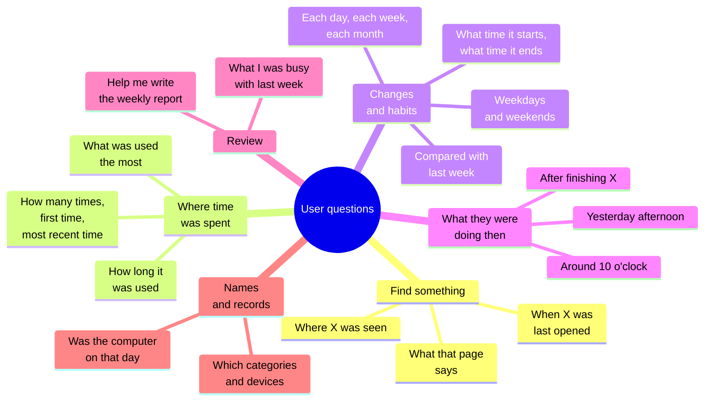
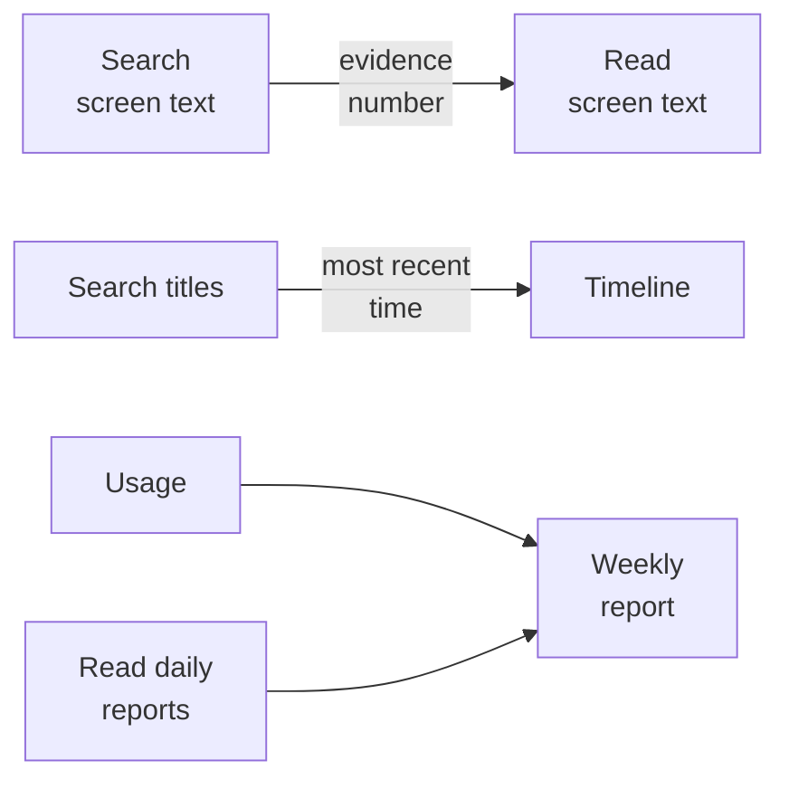

# Features of the tools

> **Status**: Draft, waiting for approval.
>
> **Scope**: This document states the requirements. It says what users will ask. It says what each tool must do. For the module structure and the shared rules, see [Overview](0-overview.md).

---

## 1. What users will ask

The model itself converts relative dates, such as "yesterday" and "last week", into specific dates. The system prompt says today's date. It also says the day of the week. A week starts on Monday.

---

## 2. Which tool answers each question

| Question | Tool | How it answers |
|---|---|---|
| **Find something** | | |
| When did I see X? In which window? | Search titles | The start gives the earliest and the most recent. Each row is one window, with the duration and the number of days |
| When was the last time I opened X? And the first time? | Search titles | The start gives the earliest and the most recent |
| How long did I look at X? | Search titles | The total duration of windows that have X in the title |
| Where did I see a certain sentence, or a certain order number? | Search screen text | The windows and snippets where it appeared on the screen. It does not give a time |
| Did I see X in WeChat? | Search screen text | Filter by app |
| Where did I see X while I was working? | Search screen text | Filter by category |
| What is written on that page? | Search screen text → Read screen text | First find that piece. Then read the full text |
| **Where time was spent** | | |
| How long did I use the computer today? | Usage | Do not group. Give the total duration |
| How long did I spend on X? | Usage | Filter by app |
| How long did work and entertainment each take? | Usage | Group by category |
| Which apps, websites, and windows were used the most? | Usage | Group by app, website, or window. Take the top few |
| How long did a certain video or a certain document take? | Usage | Filter by title keywords |
| How many times have I opened X? | Usage | Every row includes the number of times |
| When was the first time I used X, and the most recent time? | Usage | Every row includes the first time and the most recent time |
| How long did I use it on another computer? | Usage | Filter by device |
| Was the computer on that day? | Usage | A total duration of 0 means there is no record |
| **Changes and habits** | | |
| Is this week more than last week, or less? | Usage | Query the two ranges once each |
| For the last month, how long was it used each day? | Trends | By day |
| What time do I usually start, and what time do I usually end? | Trends | By day. Each day includes the earliest start and the latest end |
| How many days did I stay up late this month? | Trends | By day. Look at the latest end time of each day |
| What time do I usually play games? | Trends | By hour of the day. Filter by category |
| What is different between weekdays and weekends? | Trends | By day of the week |
| **What they were doing then** | | |
| What was I doing yesterday afternoon? | Timeline | Split by time. Each part gives the app, the title, and the duration |
| What was I looking at around 10 o'clock? | Timeline | Exact to the minute |
| What did I do after I finished looking at X? | Search titles → Timeline | First find the time of the most recent one. Then look at what came after that |
| What did I do that day? (There is no daily report) | Timeline | Read the original records |
| **Review** | | |
| What was I busy with last week? | Read daily reports | The daily reports for those days |
| Help me write this week's weekly report | Read daily reports + Usage | The daily reports give the content. Usage gives the numbers |
| **Names and records** | | |
| Which categories do I have? Which category does X belong to? | Name catalog | The category, and the apps under it |
| How many devices do I have? | Name catalog | A list of devices |

Questions that need two tools in sequence:

---

## 3. What we do not do

| Not done | Why |
|---|---|
| Change data | All tools are read-only. MCP writing a daily report back does not go through the tools |
| Look at the screenshot itself | Using a model to look at an image has a separate design. See the screen reader (#16) |
| Search by meaning | It searches only by the characters. A search by meaning needs its own index |
| Give a score or a judgment, for example "Is efficiency high?" | Tools only give facts. The judgment is left to the model |

---

## 4. What each tool must do

All tools follow the shared rules in [Overview section 4](0-overview.md#4-shared-rules): what AI can see, evidence, result length, and language. Those rules are not repeated below.

The text below is in the order of the three kinds: find, calculate, and read. For the kinds, see [Overview 2.2](0-overview.md#22-three-kinds).

### 4.1 Search titles and search screen text

Two independent tools. The parameters are the same:

- [Search titles](search/activity.md): It searches only window titles in the main database. It gives the duration, the number of days, and the earliest and the most recent.
- [Search screen text](search/ocr.md): It searches only screen text. It only says that the text appeared. It gives snippets. It does not give a time.

For the parameters and what is returned, see each tool's own document.

### 4.2 Usage

| Parameter | Required | Description |
|---|---|---|
| Date range | At least one end | If only the start is given, count up to today. If only the end is given, count from the earliest. It can search back to the earliest record |
| Filter | No | App, category, title keywords, website, and device. They can be combined. There are 1 to 3 title keywords. All of them must appear |
| Group | No | No grouping, or group by app, category, window, website, or device. A window is an app plus a title |
| Top few | No | Used when grouping. The default is 5. The maximum is 10 |

**Returns**: Each row is one name. It gives the duration, the number of times, the first time, and the most recent time. The start gives the total duration and the total number of times. It also gives how many groups there are in total, and how many groups are listed. Groups that are not listed are put together as one row, "The rest".

**How "one time" is counted**: If the time away in the middle is more than 30 minutes, it counts as a new time. This number is fixed. The result states it.

**Title keywords**: Use the same match function as search titles. The durations calculated on the two sides are the same.

**Acceptance**:

1. When there is no grouping, give the total duration, the total number of times, the first time, and the most recent time.
2. When grouping, list the top N groups, from the longest duration to the shortest. The start says how many groups there are in total. Groups that are not listed are added up as "The rest".
3. When several filter conditions are given at the same time, all of them must be met.
4. The date range can cover all records.
5. When several title keywords are given, all of them must appear in the title. A word of two characters can be found. A word of one character can be found. For English, capital letters and small letters are the same.
6. When grouping by window, the same app and the same title count as one window.

### 4.3 Trends

| Parameter | Required | Description |
|---|---|---|
| Date range | At least one end | The same as usage |
| Filter | No | The same as usage |
| Bucket | Yes | By day, week, month, hour of the day, or day of the week |

**Returns**: One row per bucket. It gives the duration and the number of times. When the buckets are by day, each row also gives that day's earliest start time and latest end time. The start says how many buckets there are in total. It also says the sum.

**Acceptance**:

1. Buckets with no records are listed too. The duration is written as 0.
2. When the buckets are by day, each row includes that day's earliest start time and latest end time.
3. If the number of buckets is over the limit, it changes automatically to the next larger step (day becomes week, week becomes month). The start says so.
4. When the buckets are by week, a week starts on Monday.

### 4.4 Timeline

| Parameter | Required | Description |
|---|---|---|
| Start time, end time | Yes | Exact to the minute. The span is at most ⟨2 days⟩ |
| Device | No | |

**Returns**: Split by time. Each part gives the start time, the end time, and the total duration. It also gives how long each app was used, and how long each title was used. The ones used for longer come first. A gap in the middle with no records is written as its own row.

**It uses the same timeline material as the daily report.** See [Daily report section 2](../1-daily-report.md#2-material-the-model-reads).

**Acceptance**:

1. Give only the records inside the range. A record that crosses the edge of the range counts only the part that falls inside the range.
2. For records under the same app with the same title, add the durations together.
3. When the length is over the limit, first remove the titles that were used the least. The start says how much was left out.
4. A gap of more than 30 minutes with no records is written as its own row.
5. When the span is over the limit, return an error. Suggest trends or read daily reports instead.

### 4.5 Read screen text

| Parameter | Required | Description |
|---|---|---|
| Evidence number | Yes | The `[number]` in a search screen text result |

**Returns**: The full text of that piece of screen text, with the app, the title, and the time.

**Acceptance**:

1. If a number from a search screen text result is given, return the full text of that piece.
2. When it is too long, keep the content before and after the line that contains the keyword. Say how much was left out.
3. If the number does not point to screen text evidence, return an error and say why.

### 4.6 Read daily reports

| Parameter | Required | Description |
|---|---|---|
| Date range | Yes | At most ⟨31 days⟩ |

**Returns**: Give each day's daily report, in date order.

**Acceptance**:

1. In date order, give the full text of each day's daily report.
2. Days with no daily report must be listed. Suggest using the timeline instead.
3. When the length is over the limit, give each day an equal share of the length. Say how much was cut off.

### 4.7 Name catalog

| Parameter | Required | Description |
|---|---|---|
| Which type | Yes | Categories, apps, devices, websites |
| Keyword | No | List only names that contain it |

**Returns**: A list of names. An app includes the category it belongs to. A category includes how many apps it contains. The start says how many there are in total.

**Acceptance**:

1. Return the category names the user gave, and the display names of the apps.
2. Apps in the "Privacy" and "Not counted in statistics" categories do not appear.
3. When a keyword is given, list only the names that contain this keyword.

---

## 5. Performance

On ⟨how large a database⟩, each tool must return within ⟨how many milliseconds⟩. You decide the numbers. The suggestion is to first measure, on your database, how long the current tools take.

---

## 6. To be decided

1. For what is still to be decided about search titles and search screen text, see section 7 of each document.
2. For usage, "one time" is fixed as being away for 30 minutes. The model no longer fills this in. Is that all right?
3. The upper limit of the timeline span: 2 days is suggested. The size of each part: splitting by hour is suggested.
4. Does read screen text use an evidence number to say which piece to read? Then `Tools` must remember, within one question, the evidence it sent out.
5. How many days, at most, can read daily reports read at one time? 31 days is suggested.
6. Should the "top few" parameter of usage also be called `limit`, the same name as "how many to list" in search? The current statistics tool calls it `top_n`.
7. Should features about focus be built, for example how long the longest continuous focus was, and how many times a switch interrupted it? If they are built, should they be put in trends or in usage?
