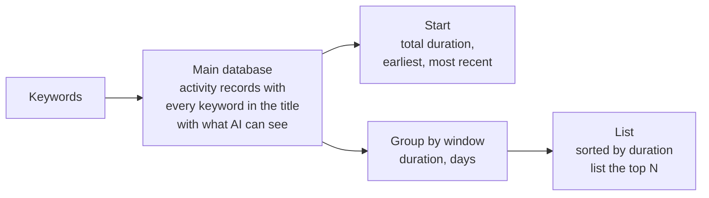
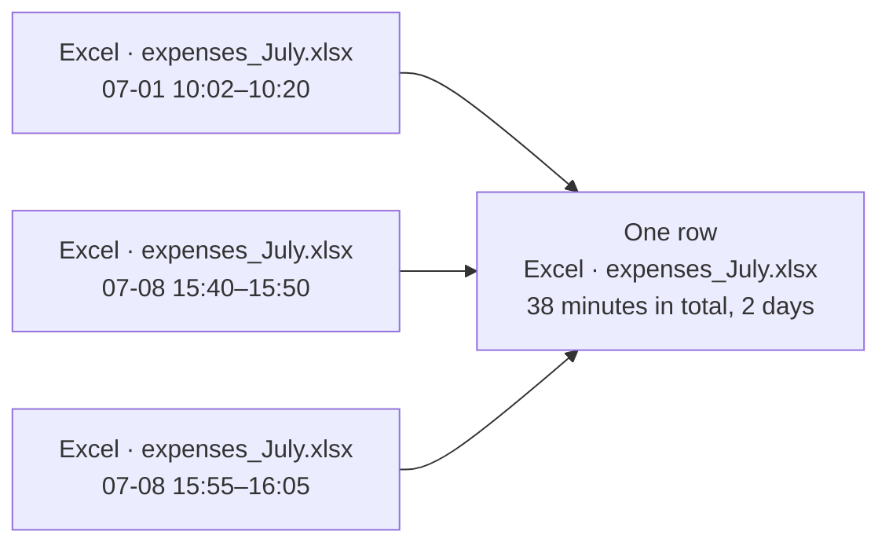

# Search titles

> **Status**: Draft, waiting for approval. For the shared rules, see [Overview](../0-overview.md).
>
> **Scope**: One tool. The name shown to the model is `search_titles`. It queries only the main database. It searches window titles of activity records by keyword. It answers when X was seen, in which window, and for how long.
>
> Another tool searches for text that appeared on the screen. See [Search screen text](ocr.md). The two tools do not depend on each other.

---

## 1. What it returns

**Users will ask**: When was X seen? In which window? For how long? When was the first time, and the most recent time?

**What the model sees**:

```
Windows with X in the title: 12 windows, 3 hours and 10 minutes in total.
Earliest 07-01 10:02 (Excel | expenses_July.xlsx), most recent 07-08 15:55 (Excel | expenses_July.xlsx).
First 8 by duration:
[1] Google Chrome | Expense report instructions - Internal Wiki｜64 minutes in total, 2 days
[2] Excel | expenses_July.xlsx｜38 minutes in total, 2 days
[3] WeChat | Expenses group｜26 minutes in total, 3 days
...
4 are not listed. To see more, list more, or narrow the date range, or filter by app or category.
```

| Part | What it answers |
|---|---|
| Start | Time: how many windows, the total duration, and the start time and window of the earliest and the most recent. All of these are based on every match |
| List | Where. Each row has one evidence card. This lets the model see which windows matched, and whether they are relevant. Sorted by duration, because the window used the longest is the most representative, and it also makes up most of the total duration |
| End | Only when the list is not complete: how many are not listed, and how to see more |

**Evidence card**: Use the activity record of this window's most recent match, and its screenshot.

**Length**: The caller gives the limit on the total length. See [Overview 4.3](../0-overview.md#43-result-length). The title on each row is at most 60 characters, so each row has a length limit. The tool can work out how many fit. If they do not fit, list fewer. Do not truncate.

**Special cases**:

| Case | What the model sees |
|---|---|
| No matches | Say that no title contains X. Suggest different words, or use search screen text to find text that appeared on the screen |
| More matches than are listed | At the end, say how many are not listed. Suggest listing more, narrowing the date range, or filtering by app or category |
| What should be listed does not fit | List fewer, within the length limit. At the end, also say how many are not listed |

---

## 2. How it searches



### 2.1 One row per window



### 2.2 How keywords match

Every keyword must appear in the title. Matching uses `LIKE`, character by character. English letters match in either case.

---

## 3. Interface

The parameters are shared with search screen text. See [Search parameters](params.md).

**Rust** (all names are proposals):

```rust
// kinds/search/activity.rs
/// Checked parameters for search titles.
pub struct ActivityQuery(pub SearchParams);

/// Results that were found, before they are written as text.
struct Found {
    windows: Vec<WindowUse>,           // listed windows, longest duration first
    count: usize,                      // number of windows in all matches
    secs: i64,                         // duration of all matches
    first: Option<(String, String)>,   // earliest: start time, window
    last: Option<(String, String)>,    // most recent: start time, window
}

/// One window with X in the title.
struct WindowUse {
    app: String,
    title: String,
    secs: i64,                         // sum of the durations of matching activity records
    days: usize,                       // number of days it appeared
    last: (String, String),            // start and end of the most recent, for the evidence card
    screenshot: Option<String>,        // screenshot of the most recent
}
```

---

## 4. Data

- Read only the main database: activity and groups.
- Do not add a table. Do not migrate. Do not take part in sync. `Citation` does not change.
- What AI can see is written in the SQL. `ToolCtx` gives the conditions. See [Overview 4.1](../0-overview.md#41-what-ai-can-see).

---

## 5. Logic

1. **Get activity**: Activity records whose titles contain every keyword. The SQL includes what AI can see, and the app and category filters.
2. **Group by window**: Group by app plus title. For each group, calculate the duration, the number of days, and the most recent one. The grouping is done in SQL.
3. **Calculate the start**: How many windows matched, the total duration, and the start time and window of the earliest and the most recent.
4. **Choose what to list**: Sort by duration. Take the first "how many to list". If they do not fit in the length limit, list fewer. Then take the screenshot of the most recent match for these windows.
5. **Write the text**: Write the start. Write one row for each window. When the list is not complete, write one more row at the end. The numbers start at `next_citation`.

---

## 6. File layout

```
kinds/search/
├── mod.rs       SearchParams shared by the two tools, and the checks. See params.md
├── activity.rs  search titles: ActivityQuery, impl Tool
├── ocr.rs       search screen text. See ocr.md
└── lang/
    ├── search.json    parameter descriptions and the last line shared by the two tools, 6 languages
    ├── activity.json  text and the tool description for search titles, 6 languages
    └── ocr.json       for search screen text. See ocr.md
```

---

## 7. To be decided

1. Should records from other devices be searched too? If two devices are in use at the same time, is the total duration counted once, or twice?
2. Parts of a title that change, such as the unread count and the unsaved mark, split the same window into several rows. Should they be removed first? Decide this together with [To be decided in the daily report](../../1-daily-report.md#3-to-be-decided) item 2.
3. When the usage tool filters by a keyword in the title, it must use the same matching function as here. Then the durations from the two sides match.
4. Type names in section 3: should the parameter type be called `TitleSearch` or `TitleQuery`? Change `Found` to `TitleHits`. Change `WindowUse` to `WindowHit`. Put the fields used by the evidence card into `Evidence`, shared by both tools. For the earliest and the most recent in the start, use `Moment` (time, app, title). Do not use a tuple of two `String`s.
