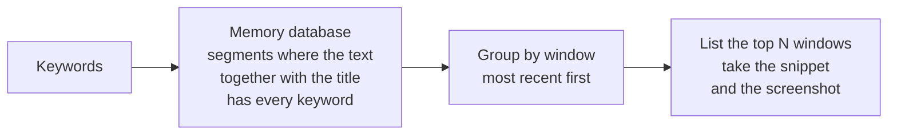

# Search screen text

> **Status**: Draft, waiting for approval. For the shared rules, see [Overview](../0-overview.md).
>
> **Scope**: One tool. The name shown to the model is `search_screen_text`. It queries only the memory database. It searches text recognized on the screen by keyword. It answers in which windows X appeared on the screen.
>
> Another tool searches for when it was seen, and for how long. See [Search titles](activity.md). The two tools do not depend on each other.

---

## 1. Returned content

**Users will ask**: Where was a sentence, an order number, or a piece of code seen? In which group was that message seen?

**What the model sees**:

```
Windows where X appeared on the screen: 14 windows. This only says that it appeared. It does not count time. First 8 by the most recent time:
[1] WeChat | Finance group｜...Please submit the expense report before Friday...
[2] Excel | expenses_July.xlsx｜...Expense report totals 3,280 yuan...
[3] Google Chrome | July itinerary - Shared document｜...Remember to submit expenses after the business trip...
...
6 are not listed. To see more, list more, or narrow the date range, or filter by app or category.
```

| Part | What it answers |
|---|---|
| Start | How many windows X appeared in, based on every match |
| List | Where. Each row has a one-line snippet and one evidence card. Sorted by the most recent time, because there is no duration to sort by |
| End | Only when the list is not complete: how many are not listed, and how to see more |

**Why time is not written**: Screen text means "these characters appeared in this window". It does not mean the user is looking at it.

- Text in the bookmarks bar, the tab bar, and the sidebar is recognized too. If a website name is in the bookmarks bar, it is in the screen text of every browser window.
- On macOS, when the same app has several windows open, the captured window is the one with the largest area. It is not necessarily the window the user is using.

The snippet is given unchanged. The model itself can decide whether it is the main text, or a name in the bookmarks bar.

**Evidence card**: Use the screenshot from the first time the snippet's line appeared. The time on the card is when this screenshot was taken. It describes only this image. It is not included in the result text.

**Length**: The caller gives the limit on the total length. See [Overview 4.3](../0-overview.md#43-result-length). The title on each row is at most 60 characters. The snippet is at most 120 characters. So each row has a length limit. The tool can calculate how many fit. If they do not fit, list fewer. Do not truncate.

**Special cases**:

| Case | What the model sees |
|---|---|
| No matches | Say that there are no matches. Suggest shorter words, synonyms, or English |
| Screen memory is not turned on | Say "there is no screen text index" |
| More matches than are listed | At the end, say how many are not listed. Suggest listing more, narrowing the date range, or filtering by app or category |
| What should be listed does not fit | List fewer, within the length limit. At the end, also say how many are not listed |

---

## 2. Query flow



- Each keyword counts if it appears in the text of this segment, or in its window title. For example, "Finance group expenses": "Finance group" is in the title, and "expenses" is in the message.

---

## 3. Interface

The parameters are shared with search titles. See [Search parameters](params.md). In the description given to the model, write clearly: this tool only says that something appeared. For the time and the duration, use search titles.

**Rust** (all names are proposals):

```rust
// kinds/search/ocr.rs
/// Checked parameters for search screen text.
pub struct OcrQuery(pub SearchParams);

/// Results that were found, before they are written as text.
struct Found {
    windows: Vec<ScreenWindow>,        // listed windows, most recent first
    count: usize,                      // number of windows in all matches
}

/// One window where X appeared on the screen.
struct ScreenWindow {
    app: String,
    title: String,
    latest: String,                    // time of the most recent segment, used only for sorting
    line: String,                      // snippet
    screenshot: Option<String>,        // screenshot from the first time the snippet's line appeared, for the evidence card
    screenshot_ts: String,             // time this screenshot was taken, for the evidence card
}
```

There is only one search for screen text. The search page uses it too:

```rust
// memory/search.rs
/// Find segments whose text, together with the title, has every keyword, from most recent to oldest.
/// The search page does not pass filter. The tool passes what AI can see, the app, and the category.
pub fn find_sessions(conn: &Connection, words: &[String], range: Option<(NaiveDate, NaiveDate)>,
                     filter: Option<&SessionFilter>) -> DbResult<Vec<SessionSpan>>;
```

---

## 4. Data

- Read only the memory database: segments, lines, and screenshots of screen text.
- Do not add a table. Do not migrate. Do not take part in sync. `Citation` does not change.
- What AI can see and the category filter are written in the SQL. `ToolCtx` gives the conditions. See [Overview 4.1](../0-overview.md#41-what-ai-can-see). `ToolCtx` also gives the display name of the app.
- A website that is put into a category cannot be recognized, because the memory database has no website domain. See [To be decided in the overview](../0-overview.md#5-to-be-decided) item 3.

---

## 5. Logic

1. **Get segments**: Use `find_sessions` to get the matching segments, with what AI can see, and the app and category filters.
2. **Group by window**: Group by app plus title. Record the time of the most recent segment in each group. The grouping is done in Rust: the search page also uses `find_sessions`, and `find_sessions` returns only segments.
3. **Calculate the start**: How many windows matched.
4. **Choose what to list**: Sort by the most recent segment. Take the first "how many to list". If they do not fit in the length limit, list fewer. Then take the snippet and the screenshot from this line: the line in the most recent segment that contains the first keyword that appears in the text.
5. **Write the text**: One row for the start. One row for each window. When the list is not complete, write one more row at the end. The numbers start at `next_citation`.

When screen memory is not turned on, do not search. Only say that there is no screen text index.

---

## 6. File layout

```
kinds/search/
├── mod.rs       SearchParams shared by the two tools, and the checks. See params.md
├── activity.rs  search titles. See activity.md
├── ocr.rs       search screen text: OcrQuery, impl Tool
└── lang/
    ├── search.json    parameter descriptions and the last line shared by the two tools, 6 languages
    ├── activity.json  for search titles. See activity.md
    └── ocr.json       text and the tool description for search screen text, 6 languages

memory/search.rs   find_sessions. The search page uses it too
```

---

## 7. To be decided

1. Should screen text from other devices be searched too?
2. Unify the written form. When storing screen text, remove spaces between Chinese and Japanese characters. Make full-width and half-width characters the same. When OCR reads "报销" as "报 销", a search can still find it. This will change storage. Old data must be processed again. An ADR must be written.
3. Parts of a title that change, such as the unread count and the unsaved mark, split the same window into several rows. Should they be removed first? Decide this together with [To be decided in the daily report](../../1-daily-report.md#3-to-be-decided) item 2.
4. Type names in section 3: decide this together with search titles. Replace `screenshot` and `screenshot_ts` with `Evidence`, shared by both tools.
