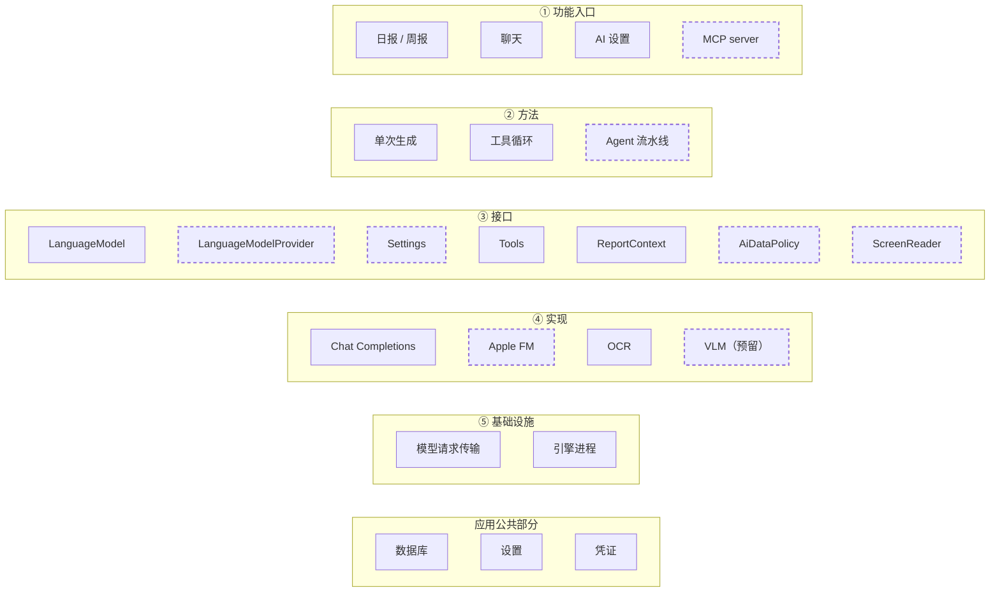

# AI 后端架构

> **状态**：草稿，待批准。英文版见 [en/0-ai-architecture.md](../en/0-ai-architecture.md)。
>
> **范围**：调用语言模型的功能（日报、周报、聊天），模型的选择和配置，新入口 MCP server，以及给读屏（#16）预留的接口。OCR 内部和模型下载不在本文范围。
>
> **相关**：#245 · #247 · #149 · #259 · #16

本文只讲大框架：要抽象掉哪些差异，分几层，每层管什么。细节在单独的文件里：

| 文件 | 内容 |
|---|---|
| [LanguageModel](3-language-model.md) | 调模型的接口：请求、结果、能力描述、错误，以及每一项的含义 |
| [适配规格](4-adapters.md) | 统一的请求发给每一家时变成什么 |
| [方法](2-methods.md) | 单次生成、工具循环、Agent 流水线的共同约定 |
| [模型选择和配置](3-settings.md) | 在页面上选模型，参数自动算，高级设置 |
| [AI 怎么读数据](3-data-access.md) | 给模型看什么，不给看什么：`ReportContext`、`Tools`、`AiDataPolicy` |
| [工具](tools/0-overview.md) | 模型能调的工具：一次调用怎么走，共用的规矩，每个工具查什么 |
| [日报](1-daily-report.md) | 一次日报怎么走，模型读到的材料（#245），用工具写日报的两种方法 |
| [Apple FM](4-apple-fm.md) | 本机的 Apple Foundation Models（#247） |
| [MCP server](1-mcp-server.md) | 让外部 Agent 读 Hindsight 的数据，写回日报（#259） |
| [读屏](3-screen-reader.md) | 用模型读截图，只留接口（#16） |

---

## 1. 要抽象掉的差异

架构要做的事，就是让上层看不到下面这些差异。每个接口都对应其中几行。

**模型不一样**

| 差异 | 例子 | 谁挡住 |
|---|---|---|
| 在哪跑、怎么调 | 云端走 HTTP；本机是一个子进程；Apple FM 是系统框架 | `LanguageModel` |
| 请求和响应的格式 | 字段名、消息格式、流式、用量 | 适配器 |
| 思考 | 开关的字段、有哪些强度、带工具时能不能用、占不占输出预算 | `Request.reasoning` + 适配器 |
| 工具调用 | 原生协议；用 grammar 约束；没有 | `Tools` + 适配器 |
| 上下文长度 | 从 4K 到 1M；有的没法自定义，有的查不到 | 能力描述 + 自动配置 |
| 报错 | 同一种错，各家的说法不同 | `ModelError` + 适配器 |
| 鉴权 | 没有；API Key；登录 | 应用的凭证：适配器只拿到请求头 |
| 怎么装、怎么测 | 下载文件；填地址和 Key；系统自带 | `LanguageModelProvider` |

**任务不一样**

| 差异 | 例子 | 谁挡住 |
|---|---|---|
| 对模型的要求 | 日报只要模型能出文字。聊天要它会调工具，因为它要自己查库。读屏要它能看图 | 方法需求表 + 自动配置：模型不够格就选不了 |
| 调模型的方式 | 日报调一次。聊天让模型自己查库，来回几轮。Agent 流水线分几步调 | 方法：换做法不用改日报，也不用改模型 |
| 发给模型的文字 | 日报是一天的时间线。聊天是工具查出来的结果 | `ReportContext`：事先拼好给模型的文字。`Tools`：模型自己要的查询结果 |
| 不能给模型的数据 | 不在「AI 分析的分类」里的活动；命中隐私关键词的标题；截图不给云端模型 | `AiDataPolicy`：一份规则，`ReportContext` 和 `Tools` 都照它过滤 |

**机器和用户不一样**

| 差异 | 例子 | 谁挡住 |
|---|---|---|
| 机器 | 独立显卡、统一内存、没有 GPU | 引擎：llama-server 的 `--fit` 按这台机器的内存定上下文长度和 GPU 层数 |
| 用户想自己调 | 上下文、并发、输出长度 | `Settings`：高级设置里改过的项，替换算出来的值 |

上层只向 `Settings` 要一份运行配置。它看不到硬件，也不知道哪一项是用户改的。

---

## 2. 总体结构



虚线框是新增的部分。标「预留」的只留接口，这次不实现。最下面的「应用公共部分」不属于 AI 模块，AI 只是使用它。五条规矩：

1. **依赖只向下。** ① 不认识任何厂商。② 只通过 ③ 看模型。厂商知识只放在 ④。MCP server 是例外：它不经过 ②，因为模型在外部应用那边。
2. **一件事一套机制。** 一处发模型请求，一个 Chat Completions 适配器，一处管引擎，一份工具定义，一份 AI 可见范围，一处自动配置。
3. **③ 不随厂商和方法变。** 加厂商只加 ④，加方法只加 ②。要改 ③ 就写 ADR。
4. **判断都在后端。** 哪个模型有哪些思考档位、推荐什么参数、这个模型能不能用，前端都问后端，自己不存这些知识。
5. **已有的命令和事件不变。** 新界面（模型选择器、高级设置）用新命令。

模块布局（名字都是提议）：

```
src-tauri/src/ai/
├── features/     ① report/（日报、周报）  chat/
├── mcp/          ① MCP server：查数据、拿材料、写回日报
├── methods/      ② single_pass.rs  tool_loop.rs  pipeline.rs
├── model/        ③ LanguageModel、LanguageModelProvider、请求和结果类型
├── settings/     ③ 模型选择、自动配置、高级设置
├── tools/        ③ 工具定义、校验、执行
├── context/      ③ ReportContext：时间线、标题清洗、多语言模板
├── policy.rs     ③ AiDataPolicy
├── screen/       ③ ScreenReader
├── providers/    ④ local.rs  cloud.rs  apple_fm/  chat_completions/
├── transport/    ⑤ 模型请求传输：超时、重试、拆 SSE 事件
└── engine/       ⑤ llama-server 进程和 EngineGuard
```

`commands/` 里的 AI 命令只做一层转调。

---

## 3. 各层管什么

以「用户在日报页选好模型，点开始总结」为例。模型分别选云端 DeepSeek、本机 4B 模型（16 GB 的 Mac）、Apple FM。

### 3.1 功能入口

用户用到的 AI 功能，每个是一个入口：

| 入口 | 做什么 | 详细 |
|---|---|---|
| 日报、周报 | 把一天或一周的活动写成总结 | [日报](1-daily-report.md) |
| 聊天 | 回答用户关于自己活动的问题 | [方法](2-methods.md) |
| AI 设置 | 管理模型，选模型，高级设置 | [模型选择和配置](3-settings.md) |
| MCP server | 让外部 Agent 查 Hindsight 的数据，写回日报 | [MCP server](1-mcp-server.md) |

### 3.2 方法

方法决定调几次模型、怎么调，见[方法](2-methods.md)。在日报的例子里用的是单次生成：调一次，拿回一段文字。

### 3.3 接口

| 接口 | 管什么 | 详细 |
|---|---|---|
| `LanguageModelProvider` | 模型的出处：列出有哪些模型，检查能不能用，把选中的打开 | [模型选择和配置](3-settings.md#22-后端languagemodelprovider) |
| `LanguageModel` | 打开以后的一个模型：发请求，拿回复 | [LanguageModel](3-language-model.md) |
| `Settings` | 选模型，算运行配置 | [模型选择和配置](3-settings.md) |
| `ReportContext` | 事先拼好给模型的材料 | [AI 怎么读数据](3-data-access.md#1-reportcontext) |
| `Tools` | 给模型的查询工具，查什么由模型决定 | [AI 怎么读数据](3-data-access.md#2-tools) |
| `AiDataPolicy` | 材料和查询结果给出去之前，要过滤掉哪些数据 | [AI 怎么读数据](3-data-access.md#3-aidatapolicy) |
| `ScreenReader` | 从截图里拿文字 | [读屏](3-screen-reader.md) |

在日报的例子里：打开模型时只有本机模型要准备，引擎没在跑就先启动，页面显示「加载模型中」。运行配置里只有本机模型带对引擎的要求。上下文长度打开以后才知道：本机模型由引擎按这台 Mac 的内存定，Apple FM 向系统读。时间线按输入预算裁剪，Apple FM 的上下文最短，裁得最多。

### 3.4 实现

把统一的请求翻成各家的格式，再把回复翻回来。

- 本机模型和云端连接共用一个 Chat Completions 适配器，各家的差异写成一张方言表，见[适配规格](4-adapters.md)。
- Apple FM 单独一个适配器，见 [Apple FM](4-apple-fm.md)。
- 读截图第一版只有 OCR，见[读屏](3-screen-reader.md)。

同一个日报请求，发出去是这样：

| 模型 | 发出去的请求 |
|---|---|
| 云端 DeepSeek | 关思考用 `thinking: {type: "disabled"}`，输出上限叫 `max_completion_tokens`，流式 |
| 本机 4B 模型 | 关思考用 `enable_thinking: false`，输出上限叫 `max_tokens`，带温度，不流式 |
| Apple FM | 不走网络。新建一个会话，向系统要纯文字 |

### 3.5 基础设施

- **模型请求传输**：发模型请求的那一层，只有一个。它只懂 HTTP 和 SSE 标准，加协议时不用改。超时、限流退避、断线重试都在这里。路径由适配器给，请求头由凭证给。流式回复，它只拆成 SSE 事件，不读事件里的内容。流怎么拼、完不完整，400 怎么改请求，由适配器回答：传输层定义一个 trait，适配器实现它，细节见[待决定](4-adapters.md#4-待决定) 4。测试连接也走它，所以测试结果和真用时一致。规则见[适配规格](4-adapters.md#3-chat-completions方言表)。
- **引擎进程**：llama-server 子进程，同一时刻只加载一个模型、一组参数。本机模型打开时向它要一个 `EngineGuard`，规则见[模型选择和配置](3-settings.md#34-本机引擎)。

| 模型 | 用到这一层的什么 |
|---|---|
| 云端 DeepSeek | 模型请求传输。被限流时，传输层等一会儿自己重发，日报的代码看不到这件事 |
| 本机 4B 模型 | 模型请求传输和引擎进程。引擎起不来时，日报收到 `Unavailable`，页面显示原因 |
| Apple FM | 都不用：它不走网络，也没有引擎进程 |

### 3.6 应用公共部分

数据库、设置、凭证是整个应用的，AI 只是使用。

- **数据库**：`ReportContext` 和 `Tools` 从这里读活动记录。日报、周报的结果和聊天记录也存在这里。
- **设置**：AI 的设置存在应用的设置里，见[模型选择和配置](3-settings.md#1-数据)。
- **凭证**：API Key 和登录的 token 用 sync 已有的本机密钥加密（`sync/local_key.rs`）保存，不另建一套。这段代码要挪到公共的位置。适配器只拿到请求头，不知道用的是哪种鉴权。

---

## 4. 待决定

这里只留跨文件的问题。其他问题在各自的文件里。

1. 本机引擎被一个任务占着，另一个任务要不同的模型或更大的上下文时，怎么办？
   - 等前一个任务结束。
   - 前台的任务（聊天）优先，后台的任务（定时日报）在段和段之间让出引擎。
   - 直接告诉用户「引擎正忙」。
2. 引擎复用的条件是「模型相同、上下文不小于要求」。同意吗？
3. 统一成一个 `AiDataPolicy` 以后，聊天也会遵守「AI 分析的分类」和隐私关键词。同意吗？
4. #149：OpenAI 是否允许第三方 app 用 ChatGPT 登录？确认之前不设计。
5. 名字，批准时都要定下来。
   - 已定：`LanguageModel`、`LanguageModelProvider`、`ReportContext`、`AiDataPolicy`、`EngineGuard`、`context_length`。
   - 没定：`Settings`、`RunConfig`、`Carry`、`ScreenReader`，以及所有模块名。
