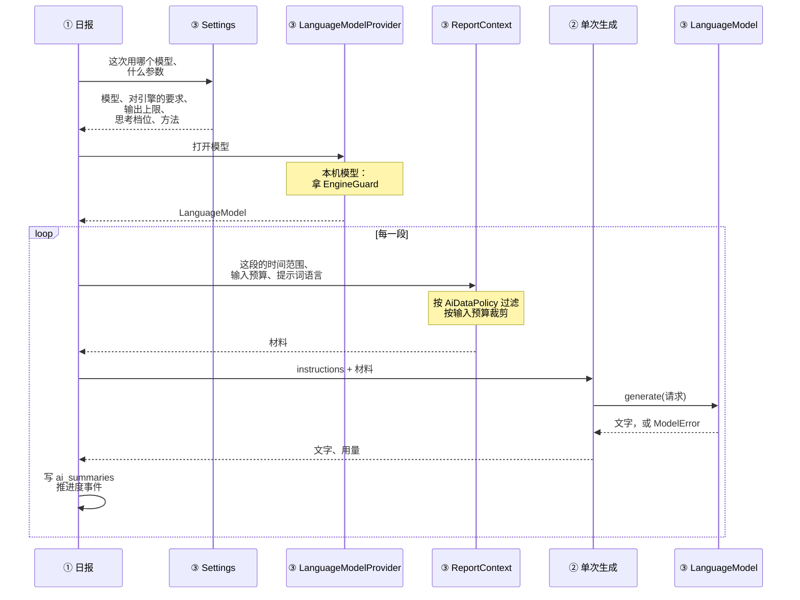

# 日报

> **状态**：草稿。总体结构见 [AI 后端架构](0-ai-architecture.md)。
>
> **相关**：#245

用户在日报页选好模型，点「开始总结」。后端把一天切成几段，每段读活动记录，生成一段文字。周报读一周的日报，再生成一段。

---

## 1. 一次日报怎么走

- 图里只画到 ③。④ 实现和 ⑤ 基础设施在 `LanguageModelProvider` 和 `LanguageModel` 后面，日报看不到。
- ① 决定切几段、跳过已经生成的段、推进度、写库。
- 用哪个模型、什么参数，由 `Settings` 算（见[模型选择和配置](3-settings.md#3-逻辑自动配置)）。`LanguageModelProvider` 按这些参数打开模型（见[模型选择和配置](3-settings.md#22-后端languagemodelprovider)）。
- 每一段是一个「写报告」的任务，交给方法（见[方法](2-methods.md)）。图里用的是单次生成。写报告有三种方法：单次生成、摘要 + 工具循环（见[方法](2-methods.md#4-摘要--工具循环)）、Agent 流水线（预留，还没设计）。默认用哪个，实现以后看效果再定。换方法时只换 ② 这一格；用工具的方法还要拿到 `Tools`。
- 用工具的方法也按段调用，一段一次，结果按段存，和单次生成一样。
- 方法的结果带着引用（`ReportOutput.citations`）。引用以后存进日报，现在 ① 先不存。存的时候要给 `ai_summaries` 加字段，涉及迁移和同步。

---

## 2. 模型读到的材料

`ReportContext` 为日报生成每段的时间线。它要做这些：

- **单位和标点跟着提示词语言走**：英文写 `33 min`，用半角标点。
- **每条标题记时长**：同一应用下相同的标题，时长相加。
- **按时长挑标题**：先给用得最久的。给几条由输入预算定，预算由方法算。预算不够时，先去掉用得最少的标题。
- **命中隐私关键词的标题**：不发给模型，也不留占位。
- **标题里的装饰**：比如未保存标记、缩放比例（#245）。要不要处理，见[待决定](#3-待决定) 2。

#245 还提了两点，不属于 `ReportContext`，但也在日报里：

- 模型收到两段文字：instructions 是写作要求，用户能改；prompt 是我们拼的，里面是材料。prompt 只说明材料，不管输出长什么样，所以不会和用户改过的 instructions 冲突。具体留哪些句子，见[待决定](#3-待决定) 1。
- 输出长度要能设置。它在高级设置里（见[模型选择和配置](3-settings.md#11-设置里的结构)）。

---

## 3. 待决定

1. prompt 里具体留哪些句子？管输出样子的句子（比如按时间顺序写、从第一句开始写）要挪进内置的 instructions。改过 instructions 的老用户会失去这些句子，要写进发版说明。
2. 标题里的装饰要不要处理？同一个文件会因为缩放比例不同出现几次（#245）。候选：不处理；在 prompt 里告诉模型不要照抄；规则表。定之前要两样数据：标题一般多长、重复多少；同一份材料，小模型和大模型会不会照抄。
