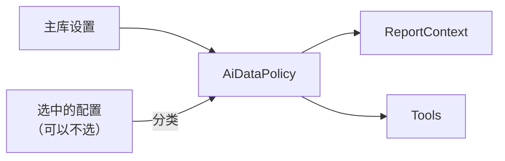

# AI 怎么读数据

> **状态**：草稿。总体结构见 [AI 后端架构](0-ai-architecture.md)。

模型看不到数据库。我们把用户的数据变成文字交给模型，有两种给法：

- `ReportContext` 在调模型之前给材料。给什么由我们的代码定，比如日报给一段时间的活动时间线。日报、周报和 MCP server 用它。
- `Tools` 在模型回答的过程中给查询结果。查什么由模型定，比如模型想看某一小时的完整时间线，就调一次工具。聊天、摘要 + 工具循环和 MCP server 用它。

两种给法都先经过 `AiDataPolicy`。它决定哪些数据不能给模型。

---

## 1. ReportContext

日报、周报里，事先拼好给模型读的文字。

```rust
/// 每种报告的材料都要实现的函数。
pub trait ReportContextOps {
    /// 材料是哪段时间的。
    fn range(&self) -> TimeRange;
    /// 给材料，不超过 max_tokens。用 model 数 token。
    async fn material(&self, max_tokens: u32, model: &LanguageModel) -> Result<String>;
}

/// 一种报告一个分支。
pub enum ReportContext {
    Daily(DailyContext),    // 某天的一段
    Weekly(WeeklyContext),  // 一周
    #[cfg(test)]
    Fixed(String),          // 测试用，原样返回
}

/// 一段本地时间，含开始，不含结束。
pub struct TimeRange { pub start: NaiveDateTime, pub end: NaiveDateTime }
```

| 分支 | `range()` | 材料 |
|---|---|---|
| `Daily` | 当天 09:00 到 12:00 | 这段时间的活动时间线 |
| `Weekly` | 周一 00:00 到下周一 00:00 | 七天的日报全文 |

- 写法和 `LanguageModel` 一样，见 [LanguageModel](3-language-model.md#9-其他约定) 的「分发」。
- 每个分支自己带着要用的东西：时间范围、数据库、`AiDataPolicy`、提示词语言。由 ① 建好。
- 上限之内怎么挑，每个分支自己定。日报的规则见[日报](1-daily-report.md#2-模型读到的材料)。
- 加一种报告，比如月报，就加一个分支。方法不用改。

---

## 2. Tools

模型自己查库用。只有一个实现，所以是普通的结构体。每个工具查什么、结果长什么样，见[工具](tools/0-overview.md)。

```rust
pub struct Tools { /* 只读的数据库连接、AiDataPolicy、提示词语言 */ }

impl Tools {
    /// 给模型看的全部工具。
    pub fn specs(&self) -> Vec<ToolSpec>;
    /// 检查模型发来的调用。不合法时，错误原因还给模型。
    pub fn validate(&self, call: &ToolCall) -> Result<Query, ToolError>;
    /// 执行。引用编号从 next_citation 开始，结果不超过 max_chars 个字。
    pub async fn execute(&self, query: &Query, next_citation: usize, max_chars: usize)
        -> Result<ToolOutput>;
}

/// 检查过的调用。一个工具一个分支，工具清单见 tools/0-overview.md。
pub enum Query { /* … */ }

/// 参数不合法的原因。写给模型看，按提示词语言写。
pub struct ToolError(pub String);

/// 一次查询的结果。
pub struct ToolOutput {
    pub content: String,               // 放进 Message::ToolResult 的文字
    pub citations: Vec<Citation>,      // 数据引用
}

/// 一条证据。模型在答案里写 [index] 引用它。
pub struct Citation {
    pub index: usize,
    pub app: String,
    pub title: String,
    pub started_ts: String,
    pub ended_ts: String,
    pub frame_path: Option<String>,    // 截图可能已经被清理
}
```

- `ToolSpec` 和 `ToolCall` 定义在 [LanguageModel](3-language-model.md#1-类型)：一个是给模型的工具说明，一个是模型发来的调用。`Query` 是检查过的调用，进度里报的就是它。
- 每个工具只写一份定义：`ToolSpec`、校验、执行。交给模型时怎么翻译，见[适配规格](4-adapters.md#2-chat-completions协议层的规则)；交给外部应用，见 [MCP server](1-mcp-server.md)。
- 每条结果的长度上限，按输入预算定。
- `Citation` 存在聊天消息里，还参与同步。字段名和 JSON 格式不能改。

---

## 3. AiDataPolicy

`AiDataPolicy` 决定 AI 能看到哪些数据。配置只存一组，日报、周报、聊天都从里面选；一套配置只记 AI 能看到哪些分类；不选配置就按主库设置。`ReportContext` 和 `Tools` 只按 `AiDataPolicy` 过滤，自己不写规则。



### 3.1 需求

各个功能（日报、周报、聊天）能选不同的数据过滤规则。规则只存一组，各个功能共用；日报、周报自动生成时各选一套。这些规则默认继承于主库设置（如隐私设置、网页隐私设置）

### 3.2 数据

配置存在设置 JSON 的 `ai.visibility` 里。一套配置只存选中了哪些分类，没选中的 AI 看不到。

```jsonc
"visibility": {
  "profiles": {
    "p_8f2a": { "name": "工作", "categories": ["work", "code"] }  // key 是生成的 id，改名不影响引用
  },
  "auto": {
    "daily": "p_8f2a",  // 日报自动生成用哪套；null 就是按主库设置
    "weekly": null      // 周报同上。聊天没有自动生成
  }
}
```

手动生成和聊天时，前端把选中的配置作为参数传进来，不存。

**待删除**：下面几条是设计取舍，不是架构。交付时写进 PR，再从本文删掉。

- 删掉 `excludedCategories`，不迁移，因为现在还不是稳定版。
- 设置 JSON 不参与同步。
- 新旧版本互相读设置都不报错。旧版本不认识 `visibility`，`excludedCategories` 缺失时用默认值（排除「其他」）。新版本不认识 `excludedCategories`，按主库设置。
- 忽略规则和隐私关键词不能覆盖，一律按主库设置。
- 新建配置时，选中状态从主库设置复制过来；之后主库设置再改，配置不跟着变。
- 以后新建的分类，在已有配置里都是没选中。
- `auto` 里指向的配置被删了，按主库设置。
- 开发版按日报、周报、聊天分开存配置，没发过版，不迁移：读到当空的。

### 3.3 接口

```rust
/// 会自动生成的报告，各自选一套配置。
pub enum Report { Daily, Weekly }

/// 这次运行用哪套配置。
pub enum ProfileChoice {
    /// 主库设置。
    Main,
    /// 这种报告自动生成时用的那套。
    Auto(Report),
    /// 用户在页面上选的那套，值是 id。
    Picked(String),
}

/// AI 能看到什么。
pub struct AiDataPolicy {
    /// AI 能看到的分类。
    shown_categories: BTreeSet<String>,
    /// 主库设置里的隐私关键词。进程名或标题里有，就不给看。
    privacy_keywords: Vec<String>,
    /// 主库设置里的忽略规则。
    ignore_rules: Vec<IgnoreRule>,
}

impl AiDataPolicy {
    /// 读主库设置和选中的配置，返回 AI 能看到什么。profile 是 Main 就全按主库设置；
    /// 用户选的那套不在了就报错。
    pub async fn load(main: &Connection, profile: &ProfileChoice) -> Result<Self>;
    /// 返回主库查询要加的 WHERE 条件。
    pub fn main_filter(&self) -> String;
    /// 返回记忆库的过滤条件：apps 里 AI 能看到的进程，还有要去掉的窗口。
    /// apps 是记忆库里的进程名和它算进的分类，由调用方查好。
    pub fn memory_filter(&self, apps: Vec<(String, String)>) -> SessionFilter;
}
```

### 3.4 已决定

1. 标题命中隐私关键词时，AI 看不到整条活动（时长也不算）
2. 网站规则不能覆盖，只按分类进行覆盖
3. 读设置失败时，报错，这次不运行。
