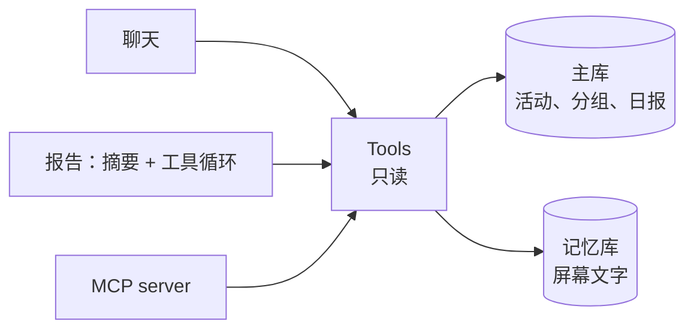
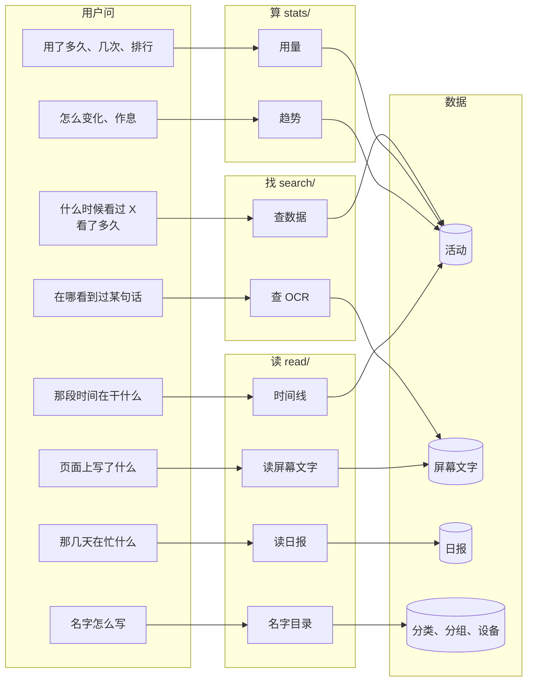
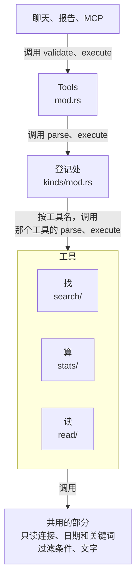
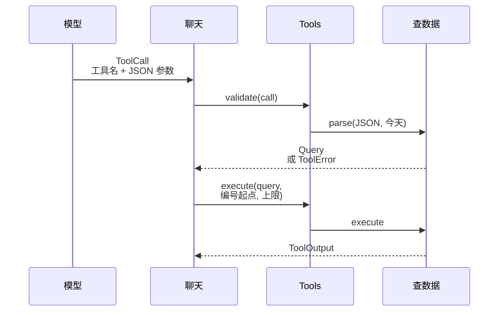
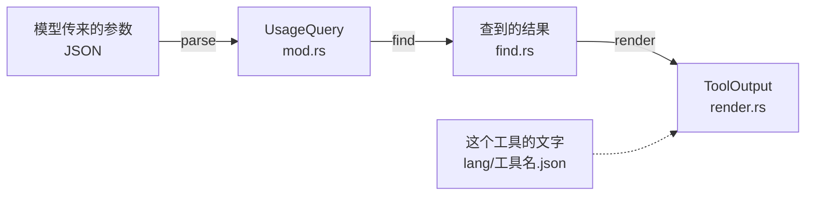
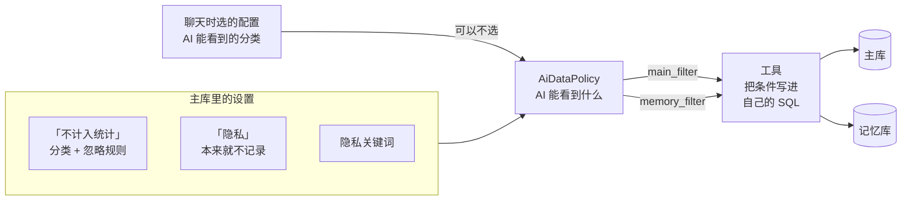

# 工具

> **状态**：草稿，待批准。总体结构见 [AI 后端架构](../0-ai-architecture.md)。
>
> **范围**：`src-tauri/src/ai/tools/` 这个模块，包括有哪些工具、模块的结构、加工具的规矩，以及所有工具共用的规矩。每个工具的细节在它自己的文档里。

| 文件 | 内容 |
|---|---|
| [功能](1-features.md) | 用户会问什么，每个工具要做到什么 |
| [查数据](search/activity.md) | 按关键词搜窗口标题：什么时候看过 X、看了多久 |
| [查 OCR](search/ocr.md) | 按关键词搜屏幕文字：X 在哪些窗口出现过 |
| [搜索的参数](search/params.md) | 查数据和查 OCR 共用的参数 |
| 用量、趋势 | 算这一类，做到时再写 |
| 时间线、读屏幕文字、读日报、名字目录 | 读这一类，做到时再写 |

---

## 1. 工具是什么，谁在用

模型看不到数据库，要靠工具自己查库。查什么由模型定；能查到什么、结果怎么写，由我们定。



---

## 2. 有哪些工具

### 2.1 怎么分

1. **按用户会问的问题分，不按数据表分。**
2. **一个工具只给一种形状的答案**：一串时间段、一组数字、一条时间序列、一段文字。参数不能改变工具的意思。
3. **参数少，名字直白。** 本机的小模型也要能选对、填对。每个工具的说明都占上下文。
4. **结果自己说明全不全**：带总数。

### 2.2 三类

按工具干什么，8 个工具分成三类，一类一个文件夹：

| 类 | 文件夹 | 干什么 | 同一类共用的代码 |
|---|---|---|---|
| 找 | `kinds/search/` | 按关键词找 X 出现在哪 | 参数 `SearchParams` |
| 算 | `kinds/stats/` | 把记录加总成数字 | 时长、次数怎么算 |
| 读 | `kinds/read/` | 原样给出库里的东西，长了就省略并写明 | 没有 |

- 分类只决定代码放在哪。`Query` 还是一个工具一个分支，见 3.3。
- 所有模型都给全部 8 个工具，不按类挑。
- 新工具放进它那一类的文件夹。三类都不合适时，先看它的答案是什么样子（2.1 第 2 条），再定要不要加一类。

### 2.3 工具清单



| 类 | 工具 | 返回什么 | 位置 |
|---|---|---|---|
| 找 | 查数据 | 标题里有 X 的窗口：时长、天数、最早和最近一次。见[查数据](search/activity.md) | `kinds/search/activity.rs` |
| 找 | 查 OCR | 屏幕上出现过 X 的窗口和片段，不给时间。见[查 OCR](search/ocr.md) | `kinds/search/ocr.rs` |
| 算 | 用量 | 每行一个名字：时长、次数、第一次、最后一次。可按应用、分类、窗口、网站排行，可按标题关键词过滤 | `kinds/stats/usage/` |
| 算 | 趋势 | 时间序列：按天、周、月、一天里的几点、星期几 | `kinds/stats/trend/` |
| 读 | 时间线 | 按时间分段，每段写应用、标题和时长 | `kinds/read/timeline.rs` |
| 读 | 读屏幕文字 | 一段屏幕文字的全文，有长度上限 | `kinds/read/screen.rs` |
| 读 | 读日报 | 已经生成的日报 | `kinds/read/reports.rs` |
| 读 | 名字目录 | 分类、应用、设备的名字 | `kinds/read/catalog.rs` |

- 每个工具的参数和验收标准见[功能](1-features.md)。
- 查数据和查 OCR 是两个独立的工具，共用参数。标题是前台窗口自己的名字，可信，能算时间；屏幕文字只说明出现过，不给时间。
- 用量一次给出时长、次数、第一次和最后一次，不用参数切换「算什么」。
- 用量和趋势的答案形状不同，所以分成两个工具：一个是一组名字和数字，一个是一条时间序列。
- 应用、分类、标题、网站、设备是过滤条件，用量、趋势、时间线共用，查数据和查 OCR 用其中的应用和分类。几类工具都用，所以放在 `kinds/filter.rs`，不放进哪一类的文件夹。

---

## 3. 结构

### 3.1 谁认识谁

聊天、报告、MCP 和 `Tools` 都只认识 `Query`，只有登记处认识全部工具。所以加一个工具，只改登记处，见 3.2。

图里的箭头都读作「调用」，箭头上写的是调用哪个函数。



| 部分 | 位置 | 认识 | 不认识 |
|---|---|---|---|
| 聊天、报告、MCP | 模块外 | `Tools` | 任何一个工具 |
| `Tools` | `mod.rs` | `Query` | 任何一个工具 |
| 登记处 | `kinds/mod.rs` | 全部工具 | — |
| 每个工具 | `kinds/search/`、`kinds/stats/`、`kinds/read/` | 共用的部分、自己那一类的 `mod.rs` | 别的工具 |
| 共用的部分 | `ctx.rs`、`lang/`、`kinds/params.rs`、`kinds/filter.rs` | — | 任何一个工具 |

只读连接由 `Tools` 打开，跟着 `execute` 传给工具。`Tools` 的签名见 [AI 怎么读数据](../3-data-access.md#2-tools)。

### 3.2 工具名单只写在一处

加一个工具，只改登记处（`kinds/mod.rs`）和新工具自己。`mod.rs` 和共用的那一层都不改。

名单是手写的，不自动收集：自动收集要用宏或者加依赖，8 个工具不值得。手写漏了一行时，`execute` 那一行编译会报错，`specs` 和 `parse` 那两行由登记处的测试发现。

### 3.3 `Tool` trait 和登记处

每个工具都实现 `Tool`。实现它的是这个工具检查过的参数，比如查数据的 `ActivityQuery`。

```rust
// kinds/mod.rs
trait Tool: Sized {
    /// 给模型看的工具名。
    const NAME: &'static str;
    /// 给模型看的说明和参数格式，按提示词语言写。
    fn spec(lang: ChatLang) -> ToolSpec;
    /// 解析、检查模型传来的参数。不合法就返回写给模型看的原因。
    fn parse(args: &Value, today: NaiveDate, lang: ChatLang) -> Result<Self, ToolError>;
    /// 查库，写成文字和证据。引用编号从 next_citation 开始；
    /// 按 max_chars 算能列几条，放不下就少列。
    async fn execute(&self, ctx: &ToolCtx, next_citation: usize, max_chars: usize,
                     lang: ChatLang) -> Result<ToolOutput>;
}

/// 检查过的调用。一个工具一个分支，不按类分。
pub enum Query {
    SearchActivity(ActivityQuery),   // 找
    SearchOcr(OcrQuery),
    Usage(UsageQuery),               // 算
    Trend(TrendQuery),
    Timeline(TimelineQuery),         // 读
    ReadScreen(ScreenQuery),
    ReadReports(ReportsQuery),
    Catalog(CatalogQuery),
}

/// 给模型看的全部工具。
pub(super) fn specs(lang: ChatLang) -> Vec<ToolSpec>;
/// 按工具名找到工具，交给它解析参数。
pub(super) fn parse(call: &ToolCall, today: NaiveDate, lang: ChatLang) -> Result<Query, ToolError>;

impl Query {
    /// 交给对应的工具执行。
    pub(super) async fn execute(&self, ctx: &ToolCtx, next_citation: usize, max_chars: usize,
                                lang: ChatLang) -> Result<ToolOutput>;
}
```

### 3.4 一次调用

以查数据为例。一次调用是两次往返：先检查，再执行。`Tools` 和登记处中间只是转手，见 3.1。



参数在每一步的样子：

| 在哪一步 | 参数的样子 |
|---|---|
| 模型的回复 | JSON，比如 `{"keywords": ["报销"], "date_from": "2026-07-01"}` |
| `ToolCall` 的 `arguments` | 同一份 JSON，没检查过 |
| 工具的 `parse` | 读成这个工具的参数类型，比如 `ActivityQuery`。日期变成 `NaiveDate`，个数、字数、日期都检查过 |
| 聊天手里 | `Query`。聊天只拿着，不看里面 |
| 工具的 `execute` | 从 `self` 取字段，写进 SQL 条件 |

有三个值不是模型给的：今天的日期，`parse` 时由 `Tools` 给，用来拒绝未来的日期；编号起点和长度上限，`execute` 时由聊天给。

分成检查和执行两步，是因为两种失败的处理不一样：参数不合法，把原因交给模型，让它改了参数再调；执行失败，只告诉模型「工具执行失败」。

### 3.5 一个工具里面



- 工具小，就用一个文件。大了就按上图拆成文件夹，每个文件夹的结构都一样。
- 查库（find）和写文字（render）分开。测试可以直接检查查到的数字，不用在句子里找字；换语言也只改 `render.rs` 和 JSON。
- 工具的文字放在和它的代码同一层的 `lang/` 文件夹里，一个工具一个 JSON，格式见 4.4。

---

## 4. 共用的规矩

### 4.1 可见范围

AI 能看到什么由 [AiDataPolicy](../3-data-access.md#3-aidatapolicy) 决定：不选配置就照主库设置，选了配置就按配置里的分类。工具不自己写规则。



- **不选配置，照主库设置**：主库设置里藏起来的，AI 也看不到，这时 AI 说的时长和统计页对得上。选了配置，AI 只看配置里选中的分类。「隐私」选了也看不到。忽略规则和隐私关键词只看主库设置，配置改不了。
- **每个库一份条件**：两个库存的东西不一样，同一条规则在两个库里写法不同。主库的条件是 `main_filter` 给的一段 SQL。记忆库没有分类，工具先查好每个进程的分类，再交给 `memory_filter`。
- **「隐私」也要过滤**：它本来不记录，但删除旧数据可能失败，旧数据就留在库里了（ADR-0019）。

其他规则：

| 规则 | 怎么处理 |
|---|---|
| 隐私关键词 | 进程名或标题命中的活动，整条不给，时长也不算 |
| 设备 | 待决定 |

### 4.2 证据

工具要守的三条：

- 结果里列出来的每一行，配一条 `Citation`。用哪条记录、哪张截图，写在各工具自己的文档里。
- 编号从调用方给的 `next_citation` 开始。
- `Citation` 存在聊天记录里，还参与同步。字段名和 JSON 格式都不能改，只能加可选的字段。

编号怎么接着编、证据卡怎么画，是聊天的事，不在这里写。

### 4.3 结果长度


- 总长度的上限由调用方给。工具按这个上限算能放下几条，放不下就少列，并写明还有几条没列；模型可以用参数要求多列几条。
- `mod.rs` 的截断只是保底，正常情况下不该走到。
- 上限要跟着模型走：Apple FM 的上下文实测只有 8192 token，云端模型大得多。

### 4.4 语言

结果文字和工具说明都按提示词语言（`ChatLang`）写，一共 6 种。

- 句子放在读它的代码旁边：时长和星期在 `tools/lang/time.json`，聊天也用；参数报错在 `kinds/lang/errors.json`；两个搜索工具共用的在 `kinds/search/lang/search.json`；每个工具自己的在它旁边的 `lang/工具名.json`。
- 一句话一个键，6 种语言挨在一起：`{"more": {"zh-Hans": "还有 {rest} 个没列。", "en": "…"}}`。
- 读成结构体：漏一种语言，读取失败；句子名写错，编译不过。每个 JSON 一个测试，检查 6 种语言的占位符一样。

---

## 5. 待决定

1. 名字：查数据叫 `search_titles`，查 OCR 叫 `search_screen_text`，已定。其余 6 个工具给模型看的名字和 `Query` 的分支名，做到时再定。
2. 8 个工具的说明一共占多少 token？实现后量。占 Apple FM 的上下文太多，再在登记处加一张按模型筛选工具的名单。
3. 记忆库的段没有网站域名。归进分类的网站，它的屏幕文字在记忆库里怎么认出来？可见范围（「隐私」「不计入统计」）和查 OCR 按分类过滤，都受影响。
4. `ChatLang` 要不要改名？日报的文字在 `ai/prompt.rs`，也按语言写，两套要不要合成一套？
