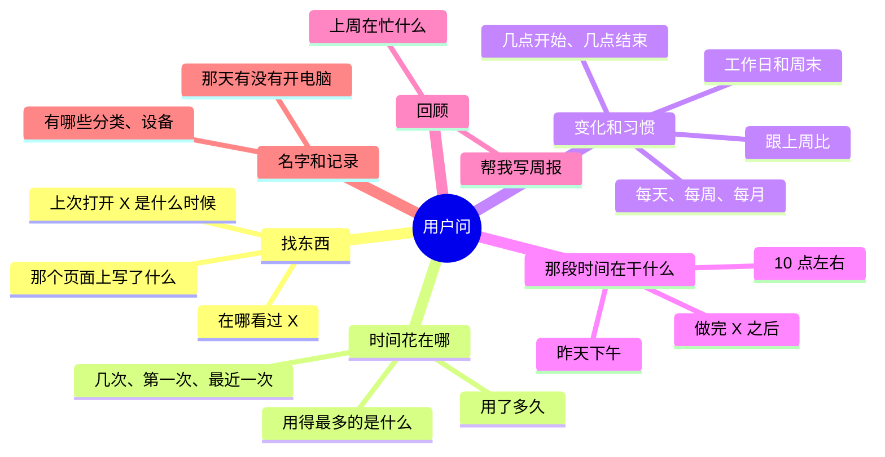
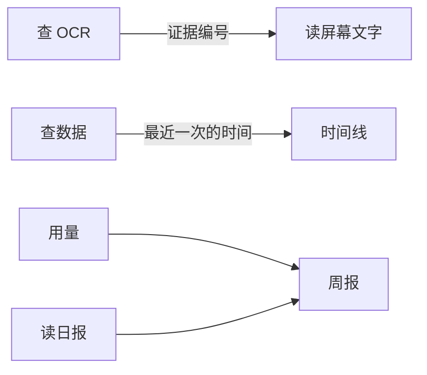

# 工具的功能

> **状态**：草稿，待批准。
>
> **范围**：这份是需求，写用户会问什么、每个工具要做到什么。模块结构和共用的规矩见[总览](0-overview.md)。

---

## 1. 用户会问什么

「昨天」「上周」这类相对日期由模型自己换算成具体日期，系统提示词里写着今天是几号、星期几。一周从周一开始。

---

## 2. 每个问题由哪个工具来答

| 问题 | 工具 | 怎么答 |
|---|---|---|
| **找东西** | | |
| 我什么时候看过 X？在哪个窗口？ | 查数据 | 开头写最早和最近一次；每行一个窗口，带时长和天数 |
| 上次打开 X 是什么时候？第一次呢？ | 查数据 | 开头写最早和最近一次 |
| 我看 X 看了多久？ | 查数据 | 标题里有 X 的窗口的总时长 |
| 我在哪看到过某句话、某个订单号？ | 查 OCR | 屏幕上出现过的窗口和片段，不给时间 |
| 我在微信里看到过 X 吗？ | 查 OCR | 按应用过滤 |
| 工作的时候在哪看到过 X？ | 查 OCR | 按分类过滤 |
| 那个页面上写了什么？ | 查 OCR → 读屏幕文字 | 先找到那一段，再读全文 |
| **时间花在哪** | | |
| 今天用了多久电脑？ | 用量 | 不分组，给总时长 |
| 在 X 上花了多久？ | 用量 | 按应用过滤 |
| 工作和娱乐各花了多久？ | 用量 | 按分类分组 |
| 用得最多的应用、网站、窗口是什么？ | 用量 | 按应用、网站或窗口分组，取前几名 |
| 某个视频、某份文档花了多久？ | 用量 | 按标题关键词过滤 |
| 打开 X 几次了？ | 用量 | 每行都带次数 |
| 第一次、最近一次用 X 是什么时候？ | 用量 | 每行都带第一次和最近一次 |
| 在另一台电脑上用了多久？ | 用量 | 按设备过滤 |
| 那天开电脑了吗？ | 用量 | 总时长是 0 就是没有记录 |
| **变化和习惯** | | |
| 这周比上周多还是少？ | 用量 | 两个范围各查一次 |
| 最近一个月每天用多久？ | 趋势 | 按天 |
| 我一般几点开始、几点结束？ | 趋势 | 按天，每天带最早开始和最晚结束 |
| 这个月熬夜了几天？ | 趋势 | 按天，看每天最晚结束的时间 |
| 一般几点玩游戏？ | 趋势 | 按一天里的几点，过滤分类 |
| 工作日和周末有什么不同？ | 趋势 | 按星期几 |
| **那段时间在干什么** | | |
| 昨天下午在干什么？ | 时间线 | 按时间分段，每段写应用、标题和时长 |
| 10 点左右在看什么？ | 时间线 | 范围精确到分钟 |
| 看完 X 之后干了什么？ | 查数据 → 时间线 | 先找到最近一次的时间，再看那之后 |
| 那天做了什么？（没有日报） | 时间线 | 读原始记录 |
| **回顾** | | |
| 上周在忙什么？ | 读日报 | 那几天的日报 |
| 帮我写这周的周报 | 读日报 + 用量 | 日报给内容，用量给数字 |
| **名字和记录** | | |
| 我有哪些分类？X 属于哪个分类？ | 名字目录 | 分类和它下面的应用 |
| 我有几台设备？ | 名字目录 | 设备列表 |

要连着调两个工具的问题：

---

## 3. 不做的

| 不做 | 为什么 |
|---|---|
| 改数据 | 工具都只读。MCP 写回日报不走工具 |
| 看截图本身 | 用模型看图另有设计，见读屏（#16） |
| 按意思搜 | 只按字搜。按意思搜要另建索引 |
| 打分、评价，比如「效率高不高」 | 工具只给事实，评价交给模型 |

---

## 4. 每个工具要做到什么

所有工具都遵守[总览第 4 节](0-overview.md#4-共用的规矩)的共用规矩：可见范围、证据、结果长度、语言。下面不再重复。

下面按找、算、读三类的顺序写，分类见[总览 2.2](0-overview.md#22-三类)。

### 4.1 查数据、查 OCR

两个独立的工具，参数一样：

- [查数据](search/activity.md)：只查主库的窗口标题。给时长、天数、最早和最近一次。
- [查 OCR](search/ocr.md)：只查屏幕文字。只说明出现过，给片段，不给时间。

参数和返回见各自的文档。

### 4.2 用量

| 参数 | 必填 | 说明 |
|---|---|---|
| 日期范围 | 至少给一头 | 只给开始，算到今天；只给结束，从最早算起。可以一直往前查到最早的记录 |
| 过滤 | 否 | 应用、分类、标题关键词、网站、设备，可以组合。标题关键词 1 到 3 个，都要出现 |
| 分组 | 否 | 不分组，或按应用、分类、窗口、网站、设备分组。窗口是应用加标题 |
| 前几名 | 否 | 分组时用。默认 5，最多 10 |

**返回**：每行一个名字，写时长、次数、第一次和最近一次。开头写总时长、总次数，以及一共几组、列了几组。没列出来的组，合起来算一行「其余」。

**「一次」怎么算**：中间离开超过 30 分钟，就算新的一次。这个数是固定的，结果里会写明。

**标题关键词**：和查数据用同一个匹配函数，两边算出来的时长一致。

**验收**：

1. 不分组时，给出总时长、总次数、第一次和最近一次。
2. 分组时按时长从多到少，列前 N 组。开头写一共几组；没列出来的组，合计成「其余」。
3. 几个过滤条件同时给出时，要同时满足。
4. 日期范围可以覆盖全部记录。
5. 给了几个标题关键词，标题里就要都出现。两个字、一个字的词也能查到，英文不分大小写。
6. 按窗口分组时，同一个应用、同一个标题算一个窗口。

### 4.3 趋势

| 参数 | 必填 | 说明 |
|---|---|---|
| 日期范围 | 至少给一头 | 跟用量一样 |
| 过滤 | 否 | 跟用量一样 |
| 分桶 | 是 | 按天、周、月、一天里的几点、星期几 |

**返回**：每个桶一行，写时长和次数。按天分桶时，每行还要写当天最早开始和最晚结束的时间。开头写一共几个桶，以及合计。

**验收**：

1. 没有记录的桶也要列出来，时长写 0。
2. 按天分桶时，每行带当天最早开始和最晚结束的时间。
3. 桶数超过上限，就自动换成粗一级（天换成周，周换成月），并在开头写明。
4. 按周分桶时，一周从周一开始。

### 4.4 时间线

| 参数 | 必填 | 说明 |
|---|---|---|
| 开始时间、结束时间 | 是 | 精确到分钟，跨度最多 ⟨2 天⟩ |
| 设备 | 否 | |

**返回**：按时间分段。每段写起止时间、总时长，以及各个应用和标题分别用了多久，用得久的排在前面。中间没有记录的空档，单独写一行。

**和日报用同一套时间线材料**，见[日报第 2 节](../1-daily-report.md#2-模型读到的材料)。

**验收**：

1. 只给范围内的记录。跨在范围边界上的记录，只算落在范围内的那部分。
2. 同一个应用下标题相同的记录，时长相加。
3. 超过长度上限时，先去掉用得最少的标题，并在开头写明省略了多少。
4. 超过 30 分钟没有记录的空档，单独写一行。
5. 跨度超过上限时报错，建议改用趋势或读日报。

### 4.5 读屏幕文字

| 参数 | 必填 | 说明 |
|---|---|---|
| 证据编号 | 是 | 查 OCR 结果里的 `[编号]` |

**返回**：那一段屏幕文字的全文，带应用、标题和时间。

**验收**：

1. 给出查 OCR 结果里的编号，就返回那一段的全文。
2. 太长时，保留关键词所在行前后的内容，并写明省略了多少。
3. 编号对应的不是屏幕文字的证据时，报错说明原因。

### 4.6 读日报

| 参数 | 必填 | 说明 |
|---|---|---|
| 日期范围 | 是 | 最多 ⟨31 天⟩ |

**返回**：按日期顺序给出每天的日报。

**验收**：

1. 按日期顺序，给出每天的日报全文。
2. 没有日报的日子要列出来，建议改用时间线。
3. 超过长度上限时，每天平均分配长度，并写明截掉了多少。

### 4.7 名字目录

| 参数 | 必填 | 说明 |
|---|---|---|
| 哪一类 | 是 | 分类、应用、设备、网站 |
| 关键词 | 否 | 只列包含它的名字 |

**返回**：名字列表。应用要带上它所属的分类，分类要带上它包含几个应用。开头写一共有几个。

**验收**：

1. 返回用户自己起的分类名和应用的显示名。
2. 「隐私」「不计入统计」分类里的应用不出现。
3. 给了关键词时，只列包含这个关键词的名字。

---

## 5. 性能

每个工具在 ⟨多大的库⟩ 上，要在 ⟨多少毫秒⟩ 内返回。数字由你定，建议先在你的库上量一下现在的工具要多久。

---

## 6. 待决定

1. 查数据、查 OCR 的待决定，见各自文档的第 7 节。
2. 用量的「一次」固定按离开 30 分钟算，不再让模型填，可以吗？
3. 时间线的跨度上限：建议 2 天。分段的粒度：建议按小时分。
4. 读屏幕文字用证据编号来指定读哪一段吗？这样 `Tools` 要在一次提问里记住自己发出去的证据。
5. 读日报一次最多读几天？建议 31 天。
6. 用量的「前几名」参数也叫 `limit`，和搜索的「列几个」用同一个名字？现在的统计工具叫 `top_n`。
7. 专注相关的功能要不要做，比如最长连续专注了多久、被切换打断了几次？做的话，放进趋势还是用量？
