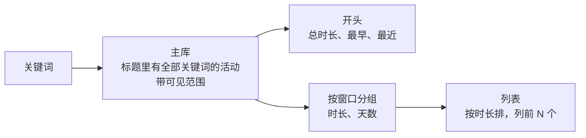
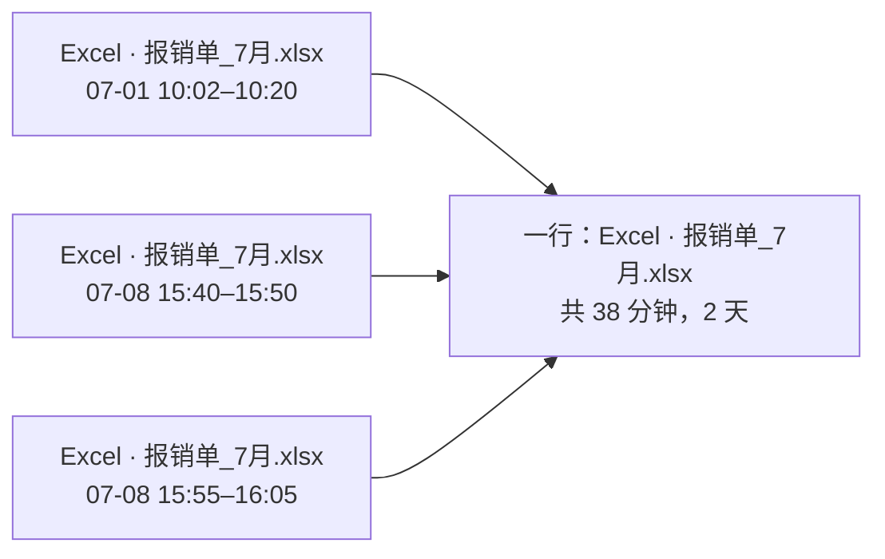

# 查数据

> **状态**：草稿，待批准。共用的规矩见[总览](../0-overview.md)。
>
> **范围**：一个工具，给模型看的名字是 `search_titles`。只查主库：按关键词搜活动记录的窗口标题。回答什么时候看过 X、在哪个窗口、看了多久。
>
> 屏幕上出现过的字由另一个工具查，见[查 OCR](ocr.md)。两个工具互不依赖。

---

## 1. 返回什么

**用户会问**：什么时候看过 X？在哪个窗口？看了多久？第一次、最近一次是什么时候？

**模型看到的**：

```
标题里有 X 的窗口：12 个，共 3 小时 10 分钟。
最早 07-01 10:02（Excel | 报销单_7月.xlsx），最近 07-08 15:55（Excel | 报销单_7月.xlsx）。
按时长列前 8 个：
[1] Google Chrome | 报销单填写说明 - 内部 Wiki｜共 64 分钟，2 天
[2] Excel | 报销单_7月.xlsx｜共 38 分钟，2 天
[3] 微信 | 报销群｜共 26 分钟，3 天
……
还有 4 个没列。要看更多，多列几个，或者缩小日期范围、按应用或分类过滤。
```

| 部分 | 回答什么 |
|---|---|
| 开头 | 时间：几个窗口、总时长、最早和最近一次的开始时刻和窗口。都按全部命中算 |
| 列表 | 在哪；每行一张证据卡；让模型看清命中了哪些窗口、相不相关。按时长排，因为用得最久的窗口最有代表性，也占总时长的大头 |
| 末尾 | 没列全时才有：还有几个没列，怎么看更多 |

**证据卡**：用这个窗口最近一次命中的那条活动记录，以及它的截图。

**长度**：总长度的上限由调用方给，见[总览 4.3](../0-overview.md#43-结果长度)。每行的标题最多 60 字，所以每行的长度有上限，工具能算出放得下几个。放不下就少列，不截断。

**特殊情况**：

| 情况 | 模型看到什么 |
|---|---|
| 没有命中 | 写明标题里没有 X。建议换词，或者用查 OCR 找屏幕上出现过的 |
| 命中比列出来的多 | 末尾写还有几个没列，提示多列几个、缩小日期范围或按应用、分类过滤 |
| 要列的放不下 | 按长度上限少列几个，末尾同样写还有几个没列 |

---

## 2. 怎么查



### 2.1 一个窗口一行



### 2.2 关键词怎么匹配

每个关键词都要出现在标题里，用 `LIKE` 逐字比对。英文不分大小写。

---

## 3. 接口

参数和查 OCR 共用，见[搜索的参数](params.md)。

**Rust**（名字都是提议）：

```rust
// kinds/search/activity.rs
/// 查数据检查过的参数。
pub struct ActivityQuery(pub SearchParams);

/// 查到的结果，写成文字之前。
struct Found {
    windows: Vec<WindowUse>,           // 列出来的窗口，时长从多到少
    count: usize,                      // 全部命中的窗口数
    secs: i64,                         // 全部命中的时长
    first: Option<(String, String)>,   // 最早一次：开始时刻、窗口
    last: Option<(String, String)>,    // 最近一次：开始时刻、窗口
}

/// 标题里有 X 的一个窗口。
struct WindowUse {
    app: String,
    title: String,
    secs: i64,                         // 命中的活动记录时长相加
    days: usize,                       // 几天里出现过
    last: (String, String),            // 最近一次的起止，证据卡用
    screenshot: Option<String>,        // 最近一次的截图
}
```

---

## 4. 数据

- 只读主库：活动和分组。
- 不加表，不迁移，不参与同步。`Citation` 不变。
- 可见范围写在 SQL 里，条件由 `ToolCtx` 给，见[总览 4.1](../0-overview.md#41-可见范围)。

---

## 5. 逻辑

1. **取活动**：标题里有全部关键词的活动，SQL 里带可见范围、应用和分类过滤。
2. **按窗口分组**：按应用加标题分组，每组算时长、天数、最近一次。分组在 SQL 里做。
3. **算开头**：命中了几个窗口、总时长，以及最早和最近一次的开始时刻和窗口。
4. **挑要列的**：按时长排，取前「列几个」个；长度上限放不下就少列。再取这几个窗口最近一次的截图。
5. **写文字**：开头，每个窗口一行，没列全时末尾再写一行。编号从 `next_citation` 开始。

---

## 6. 文件层级

```
kinds/search/
├── mod.rs       两个工具共用的参数 SearchParams 和检查，见 params.md
├── activity.rs  查数据：ActivityQuery、impl Tool
├── ocr.rs       查 OCR，见 ocr.md
└── lang/
    ├── activity.json  查数据的文字和工具说明，6 种语言
    └── ocr.json       查 OCR 的，见 ocr.md
```

---

## 7. 待决定

1. 别的设备的记录也搜吗？两台设备同一时间都在用，总时长算一次还是两次？
2. 标题里会变的部分，比如未读数、未保存标记，会把同一个窗口拆成几行。要不要先去掉？跟[日报的待决定](../../1-daily-report.md#3-待决定) 2 一起定。
3. 用量工具按标题关键词过滤时，要和这里用同一个匹配函数，两边算出来的时长才一致。
4. 第 3 节的类型命名：参数类型叫 `TitleSearch` 还是 `TitleQuery`；`Found` 改成 `TitleHits`，`WindowUse` 改成 `WindowHit`；证据卡用的字段收进两边共用的 `Evidence`；开头的最早、最近用 `Moment`（时刻、应用、标题），不用两个 `String` 的元组。
