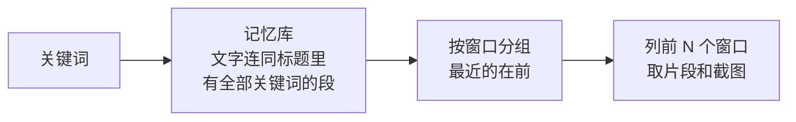

# 查 OCR

> **状态**：草稿，待批准。共用的规矩见[总览](../0-overview.md)。
>
> **范围**：一个工具，给模型看的名字是 `search_screen_text`。只查记忆库：按关键词搜屏幕上识别出的文字。回答 X 在哪些窗口的屏幕上出现过。
>
> 什么时候看过、看了多久由另一个工具查，见[查数据](activity.md)。两个工具互不依赖。

---

## 1. 返回内容

**用户会问**：在哪看到过某句话、某个订单号、某段代码？那条消息是在哪个群里看到的？

**模型看到的**：

```
屏幕上出现过 X 的窗口：14 个。只说明出现过，不算时间。按最近一次列前 8 个：
[1] 微信 | 财务群｜…请在周五前提交报销单…
[2] Excel | 报销单_7月.xlsx｜…报销单合计 3,280 元…
[3] Google Chrome | 7 月行程 - 共享文档｜…出差回来记得报销…
……
还有 6 个没列。要看更多，多列几个，或者缩小日期范围、按应用或分类过滤。
```

| 部分 | 回答什么 |
|---|---|
| 开头 | 几个窗口出现过 X，按全部命中算 |
| 列表 | 在哪；每行一行片段和一张证据卡。按最近一次排，因为没有时长可排 |
| 末尾 | 没列全时才有：还有几个没列，怎么看更多 |

**为什么不写时间**：屏幕文字说明的是「这个窗口里出现过这些字」，不等于用户在看。

- 书签栏、标签栏、侧栏里的字也会被识别。书签栏里有某个网站名，那每个浏览器窗口的屏幕文字里都有它。
- macOS 上同一个应用开着几个窗口时，截到的是面积最大的那个，不一定是用户在用的。

片段原样给出，模型能自己判断那是正文，还是书签栏里的一个名字。

**证据卡**：用片段那一行第一次出现时的那张截图。卡片上的时间是这张截图拍下的时刻，只说明这张图，不进结果文字。

**长度**：总长度的上限由调用方给，见[总览 4.3](../0-overview.md#43-结果长度)。每行的标题最多 60 字、片段最多 120 字，所以每行的长度有上限，工具能算出放得下几个。放不下就少列，不截断。

**特殊情况**：

| 情况 | 模型看到什么 |
|---|---|
| 没有命中 | 写明没有命中，建议换更短的词、同义词或英文 |
| 没开屏幕记忆 | 写明「没有屏幕文字索引」 |
| 命中比列出来的多 | 末尾写还有几个没列，提示多列几个、缩小日期范围或按应用、分类过滤 |
| 要列的放不下 | 按长度上限少列几个，末尾同样写还有几个没列 |

---

## 2. 查询流程



- 每个关键词出现在这一段的文字里，或者它的窗口标题里，都算。比如「财务群 报销」：「财务群」在标题里，「报销」在消息里。

---

## 3. 接口

参数和查数据共用，见[搜索的参数](params.md)。给模型的说明里写清：这个工具只说明出现过；要时间和时长，用查数据。

**Rust**（名字都是提议）：

```rust
// kinds/search/ocr.rs
/// 查 OCR 检查过的参数。
pub struct OcrQuery(pub SearchParams);

/// 查到的结果，写成文字之前。
struct Found {
    windows: Vec<ScreenWindow>,        // 列出来的窗口，最近的在前
    count: usize,                      // 全部命中的窗口数
}

/// 屏幕上出现过 X 的一个窗口。
struct ScreenWindow {
    app: String,
    title: String,
    latest: String,                    // 最近一段的时刻，只用来排序
    line: String,                      // 片段
    screenshot: Option<String>,        // 片段那一行第一次出现时的截图，证据卡用
    screenshot_ts: String,             // 这张截图拍下的时刻，证据卡用
}
```

屏幕文字的搜索只有一套，搜索页也用它：

```rust
// memory/search.rs
/// 找出文字连同标题里有全部关键词的段，从近到远。
/// 搜索页不传 filter；工具传可见范围、应用和分类。
pub fn find_sessions(conn: &Connection, words: &[String], range: Option<(NaiveDate, NaiveDate)>,
                     filter: Option<&SessionFilter>) -> DbResult<Vec<SessionSpan>>;
```

---

## 4. 数据

- 只读记忆库：屏幕文字的段、行和截图。
- 不加表，不迁移，不参与同步。`Citation` 不变。
- 可见范围和分类过滤写在 SQL 里，条件由 `ToolCtx` 给，见[总览 4.1](../0-overview.md#41-可见范围)。应用的显示名也由 `ToolCtx` 给。
- 归进分类的网站认不出来，因为记忆库没有网站域名，见[总览待决定](../0-overview.md#5-待决定) 3。

---

## 5. 逻辑

1. **取段**：用 `find_sessions` 取命中的段，带可见范围、应用和分类过滤。
2. **按窗口分组**：按应用加标题分组，记下每组最近一段的时刻。分组在 SQL 里做。
3. **算开头**：命中了几个窗口。
4. **挑要列的**：按最近一段排，取前「列几个」个；长度上限放不下就少列。再取片段和截图：最近一段里，第一个出现在文字里的关键词所在的那一行。
5. **写文字**：开头一行，每个窗口一行，没列全时末尾再写一行。编号从 `next_citation` 开始。

没开屏幕记忆时，不查，只写明没有屏幕文字索引。

---

## 6. 文件层级

```
kinds/search/
├── mod.rs       两个工具共用的参数 SearchParams 和检查，见 params.md
├── activity.rs  查数据，见 activity.md
├── ocr.rs       查 OCR：OcrQuery、impl Tool
└── lang/
    ├── activity.json  查数据的，见 activity.md
    └── ocr.json       查 OCR 的文字和工具说明，6 种语言

memory/search.rs   find_sessions，搜索页也用
```

---

## 7. 待决定

1. 别的设备的屏幕文字也搜吗？
2. 统一写法：存屏幕文字时，去掉中日文字之间的空格，统一全角和半角。OCR 把「报销」认成「报 销」时也能搜到。这会改变存储，旧数据要重新处理，要写 ADR。
3. 标题里会变的部分，比如未读数、未保存标记，会把同一个窗口拆成几行。要不要先去掉？跟[日报的待决定](../../1-daily-report.md#3-待决定) 2 一起定。
4. 第 3 节的类型命名：跟查数据一起定，`screenshot`、`screenshot_ts` 换成两边共用的 `Evidence`。
