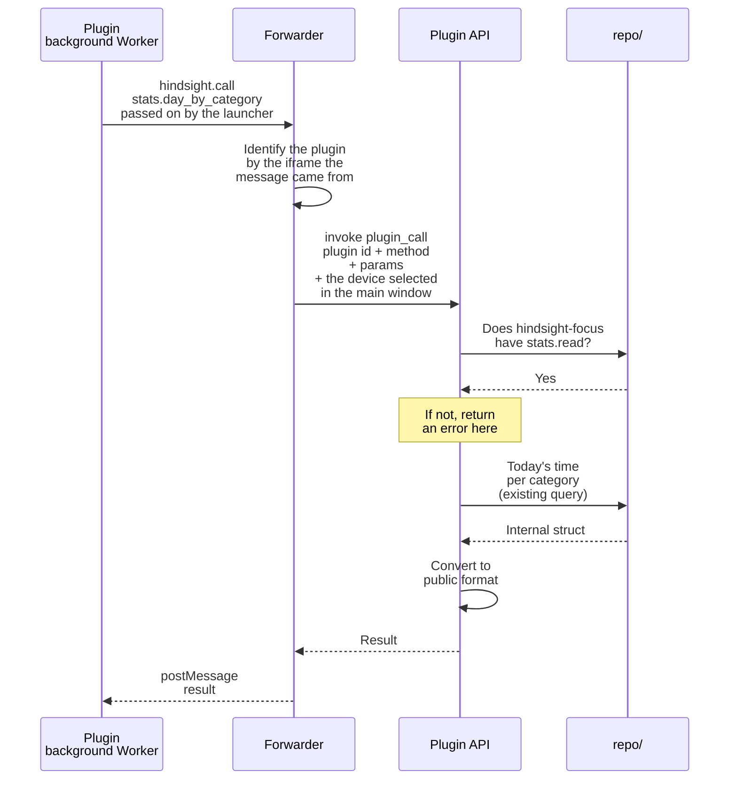

# ③ Requesting data

Overview: [Plugin backend architecture](plugins-architecture.md).

**This doc designs**: how a plugin requests data from the app. It covers three things:

- how a plugin's request reaches Rust;
- how to tell which plugin is calling, so a plugin cannot pretend to be another plugin or skip the forwarder;
- how to check permissions, and what format the returned data has.

Example: the focus plugin asks "how long was each category used today".

- All plugin calls go through one command, `plugin_call`. The method name says what to do:
  - read Hindsight data: `stats.day_by_category`, `categories.list`, `super_categories.list`
  - send a notification: `notifications.send`, using the existing `tauri-plugin-notification`
  - read and write the plugin's own database: `db.execute`, `db.query`; see [Plugin data](data.md)
- The method names are the public API for plugins. Permissions are checked in one place, and a new API does not need a new command.
- A plugin calls `hindsight.call(method, params)`. Hindsight defines this function in the Worker first, then loads the plugin's `background.js`. The plugin does not number its messages itself. The message format is an internal detail and can change together with Hindsight.
- The forwarder adds the plugin id: it looks at which iframe the message came from. The browser sets this, and the plugin cannot change it. The plugin does not report its own id. If it did, it could pretend to be another plugin.
- To stop a plugin from skipping the forwarder and calling `invoke` directly, we rely on Tauri's invoke key.
- Reading data reuses the existing functions in `repo/`. We do not write a separate set of SQL for plugins.
- Convert to the public format before returning. Then renaming internal structs or adding fields to them later will not break published plugins.

## Methods in the first version

| Method | Permissions needed | Parameters | Returns |
|---|---|---|---|
| `stats.day_by_category` | `stats.read` and one range | `{ "date": "2026-10-19", "devices": "selected" }`; `devices` is optional | `[{ "id": "code", "name": "Coding", "color": "#a78bfa", "icon": "Code", "seconds": 12600, "superCategory": { "id": "work", "name": "Work", "color": "#8b5cf6", "icon": "Briefcase" } }]`, longest first. For a category in no super-category, `superCategory` is `null` |
| `categories.list` | `categories.read` | None | `[{ "id": "code", "name": "Coding", "color": "#a78bfa", "icon": "Code", "superCategory": { "id": "work", "name": "Work", "color": "#8b5cf6", "icon": "Briefcase" } }]`, in the order of the main window. For a category in no super-category, `superCategory` is `null` |
| `super_categories.list` | `super_categories.read` | None | `[{ "id": "work", "name": "Work", "color": "#8b5cf6", "icon": "Briefcase" }]`, in the order of the main window |
| `notifications.send` | `notifications` | `{ "body": "10 minutes on YouTube already" }` | Nothing |
| `db.execute` | No permission; needs the disk space the user approved | `{ "sql": "INSERT INTO pomodoro VALUES (?, ?)", "params": ["2026-10-19", 25] }`; `params` is optional | `{ "changes": 1, "lastInsertRowid": 1 }` |
| `db.query` | Same as above | `{ "sql": "SELECT date, minutes FROM pomodoro" }` | `[{ "date": "2026-10-19", "minutes": 25 }]`, one object per row, keyed by column name; at most 10 MB |

- A plugin adds up super-category times itself by `superCategory`, the same way the main window does.
- `categories.list` and `super_categories.list` let a plugin's settings page list every category and super-category for the user to choose from. Statistics show only the categories that were used.
- Categories and super-categories each need their own permission, so a plugin that uses only super-categories cannot see all of the user's categories.
- The range decides which days a plugin can read (see [Plugin permissions](permissions.md)). "Today", "this week" and "this month" use this computer's date. If the plugin cannot read a day, the call fails, and the error names the range that can read it.
- The plugin says which devices to count. If `devices` is missing or `"this"`, only this computer counts. If it is `"selected"`, the devices selected in the main window count. This needs `devices.read`, and the call fails without it. The range is never changed quietly, so the plugin always gets the numbers it asked for.
- The forwarder adds the device selected in the main window to every call. The plugin cannot change it.
- The notification title is always the plugin name, so a plugin cannot pose as Hindsight. There is no rate limit. If a plugin sends too many, the user can turn it off.
