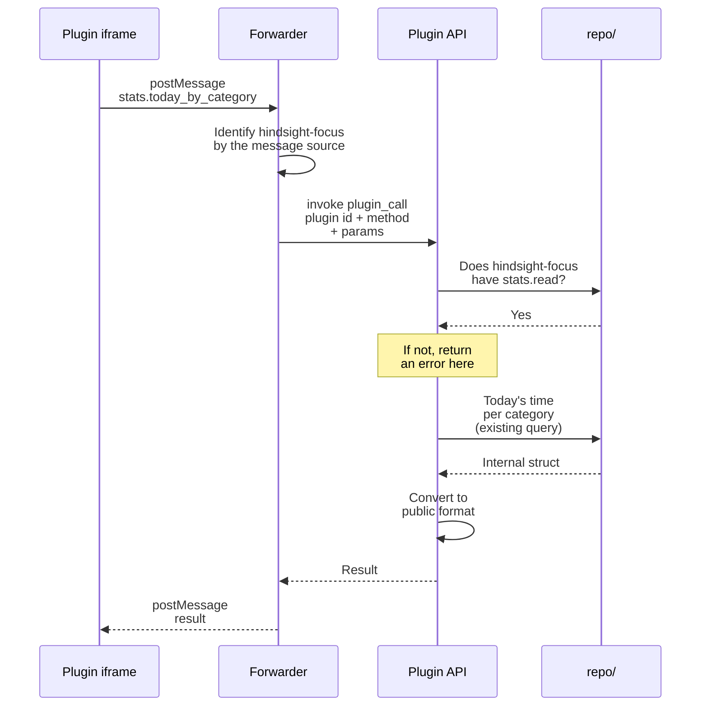

# ③ Requesting data

Overview: [Plugin backend architecture](plugins-architecture.md).

**This doc designs**: how a plugin requests data from the app. It covers three things:

- how a plugin's request reaches Rust;
- how to tell which plugin is calling, so a plugin cannot pretend to be another plugin or skip the forwarder;
- how to check permissions, and what format the returned data has.

Example: the focus plugin asks "how long was each category used today".

- All plugin calls go through one command, `plugin_call`. The method name says what to do:
  - read Hindsight data: `stats.today_by_category`
  - send a notification: `notifications.send`, using the existing `tauri-plugin-notification`
  - read and write the plugin's own database: `db.execute`, `db.query`; see [Plugin data](data.md)
- The method names are the public API for plugins. Permissions are checked in one place, and a new API does not need a new command.
- The forwarder adds the plugin id. The plugin does not report its own id. If it did, it could pretend to be another plugin.
- To stop a plugin from skipping the forwarder and calling `invoke` directly, we rely on Tauri's invoke key.
- Reading data reuses the existing functions in `repo/`. We do not write a separate set of SQL for plugins.
- Convert to the public format before returning. Then renaming internal structs or adding fields to them later will not break published plugins.
