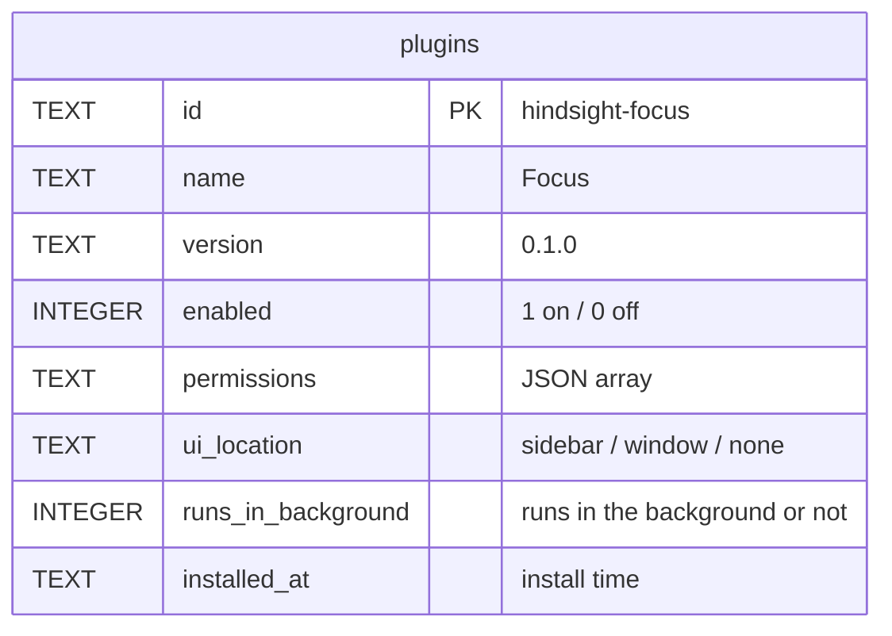
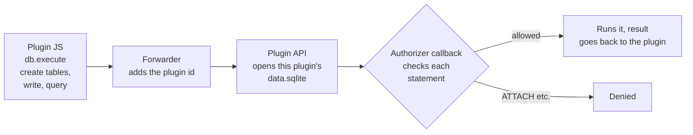

# Plugin data: the plugins table and each plugin's own database

Overview: [Plugin backend architecture](plugins-architecture.md).

**This doc designs**: where plugin data lives and who manages it. It covers two things:

- The app must remember which plugins are installed and which permissions they have. This lives in the `plugins` table in the main database, and the app manages it.
- A plugin stores its own data, such as the focus goal "6 hours" or each Pomodoro record. Each plugin gets its own SQLite database, and the plugin author designs its tables.

## The plugins table



- `name`, `ui_location` and `runs_in_background` are copied from `manifest.json` at install time. At runtime the app reads only the table, not the manifest.
- `name`: the name the plugin shows, used by the sidebar entry and the plugin list.
- `ui_location`: where the plugin page shows:
  - `sidebar`: adds an entry to the main window's sidebar
  - `window`: opens a separate window when clicked
  - `none`: no page
- `runs_in_background`: whether the plugin runs in the background.

## Each plugin's own database

```
<app data folder>/plugins/
└── hindsight-focus/
    ├── 0.1.0/            plugin code; changes when the plugin updates
    │   ├── manifest.json
    │   ├── ui/index.html
    │   └── background.js
    └── data.sqlite       plugin data; stays when the plugin updates
```



- `data.sqlite` is not in a version folder. The plugin file reader never hands it out, and the WebView cannot get it by URL.
- Before running SQL, Rust checks each statement with SQLite's authorizer callback. It denies `ATTACH`, `DETACH` and loading extensions. Otherwise a plugin could run `ATTACH '…/hindsight.db'` and read every activity record in the main database.
- Reading and writing its own database needs no permission. Permissions control reading Hindsight's data, such as `stats.read`.
- Plugin databases do not sync. They stay on this machine.

## Uninstalling

1. Delete this plugin's row from the `plugins` table in one transaction.
2. Delete the files. The user chooses whether to delete the data:
   - Delete the data: delete the whole `plugins/hindsight-focus/` folder, the code and the database together.
   - Keep the data: delete only the version folders and keep `data.sqlite`. If the same plugin is installed again later, it can keep using the data.

This works like install: the table is the source of truth. Delete the row first, then the files. If the app crashes in between, the version folders of a plugin that is not in the table are left. They are deleted the next time the plugin market opens. The data is not touched, because the user may have chosen to keep it.
