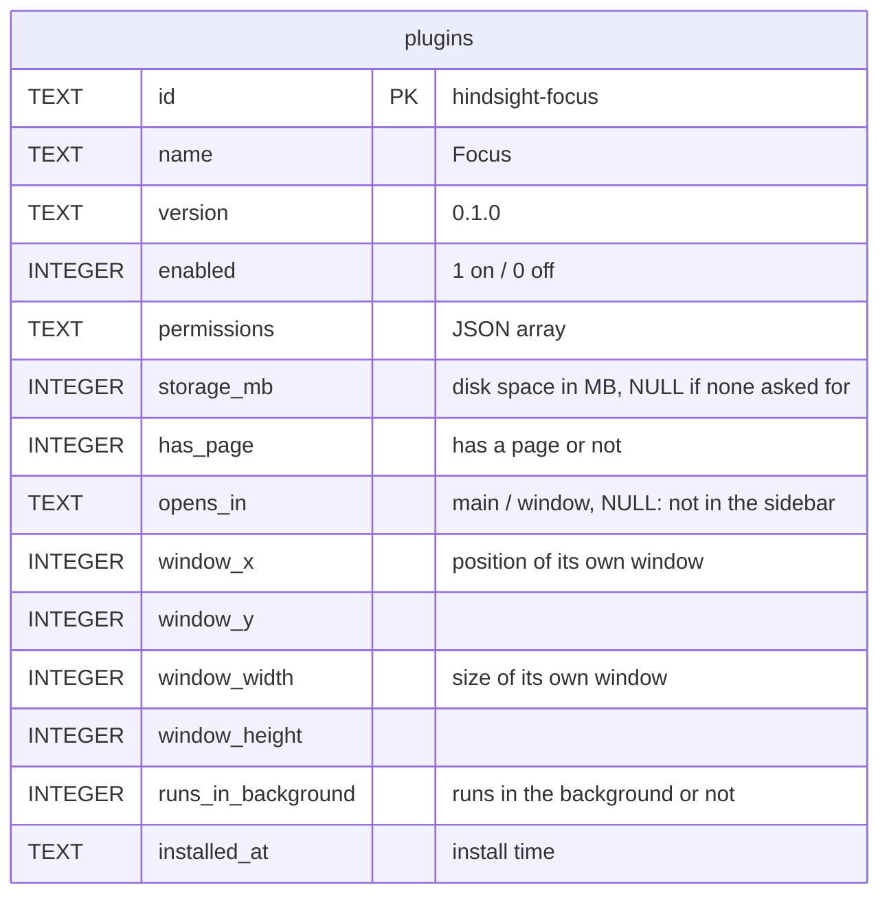
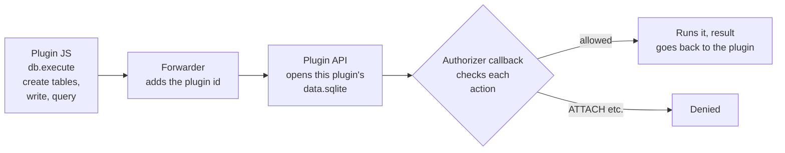

# Plugin data: the plugins table and each plugin's own database

Overview: [Plugin backend architecture](plugins-architecture.md).

**This doc designs**: where plugin data lives and who manages it. It covers two things:

- The app must remember which plugins are installed and which permissions they have. This lives in the `plugins` table in the main database, and the app manages it.
- A plugin stores its own data, such as the focus goal "6 hours" or each Pomodoro record. Each plugin gets its own SQLite database, and the plugin author designs its tables.

## The plugins table



- `permissions` and `storage_mb` hold what the user approved, not what the manifest asks for (see [① Installing plugins](install.md)).

## Each plugin's own database

```
<app data folder>/plugins/
└── hindsight-focus/
    ├── 0.1.0/            plugin code; changes when the plugin updates
    │   ├── manifest.json
    │   ├── ui/index.html
    │   └── background.js
    └── data.sqlite       plugin data; stays when the plugin updates
```



- **A plugin can reach only its own file**: Rust picks the file to open from the plugin id, and the plugin passes only SQL and parameters. When SQLite compiles a statement, the authorizer callback checks each action against an allow list. It allows only actions on tables in this database. It denies `ATTACH`, `PRAGMA`s that change settings for the whole process, and loading extensions. Otherwise a plugin could run `ATTACH '…/hindsight.db'` and read every activity record in the main database.
- **Not in a version folder**: the plugin file reader never hands it out, and the WebView cannot get it by URL. Updating the plugin does not touch the data.
- **Opened for each call and closed after it**: no file stays open, so uninstalling can delete it. For the same reason, the connection's temp database is denied too: a table in it would not outlive one call, so plugins have no use for it.
- **One statement per call**: more than one is an error. The app does not run the first one and silently drop the rest.
- **Disk space is capped at what the user approved**: the plugin asks for `storage_mb` in its manifest, and the number the user approves is stored in the plugins table. Without it, the plugin cannot use `db.*`. Reading and writing its own database needs no permission. Permissions control reading Hindsight's data, such as `stats.read`.
- **Memory and CPU are capped for each call**: plugin SQL runs in the same process as capture, and one plugin must not slow down activity recording. The size of one value, the run time and the size of the result all have limits. All plugins together open at most 4 databases at a time, and other calls wait. Intermediate results, such as for sorting, go to disk. For the values, see `plugins/api/db.rs`.
- **Limits can only go up**: if a limit goes down, rows that already hold larger values can no longer be read or changed.
- Plugin databases do not sync. They stay on this machine.

## Uninstalling

1. Delete this plugin's row from the `plugins` table in one transaction.
2. Delete the files. The user chooses whether to delete the data:
   - Delete the data: delete the whole `plugins/hindsight-focus/` folder, the code and the database together.
   - Keep the data: delete only the version folders and keep `data.sqlite`. If the same plugin is installed again later, it can keep using the data.

This works like install: the table is the source of truth. Delete the row first, then the files. If the app crashes in between, the version folders of a plugin that is not in the table are left. They are deleted the next time the plugin market opens. The data is not touched, because the user may have chosen to keep it.
