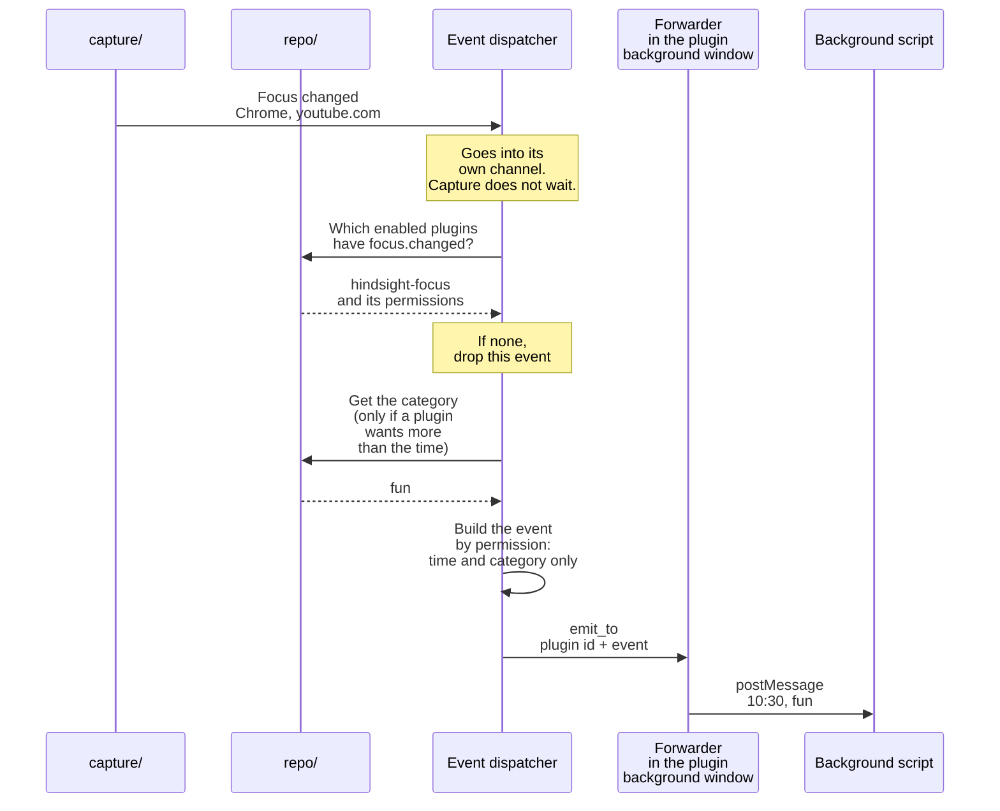

# ④ Receiving events

Overview: [Plugin backend architecture](plugins-architecture.md).

**This doc designs**: how the app pushes focus changes to plugins. The user going away also counts as a focus change. It covers three things:

- when capture sees a focus change, how it tells the event dispatcher without slowing capture down;
- which fields each plugin gets, based on its permissions;
- when something fails, how to limit the damage to one plugin and one event.

Example: notify the focus plugin when the user switches to YouTube.

- **Why the event dispatcher has its own channel**: the capture loop does not need to know that plugins exist, and it does not wait for them. Without the channel:
  - `capture/` would call `plugins/` directly;
  - the time to look up categories and permissions would count toward the capture that runs every 5 seconds;
  - an error on the plugin side would also slow down capture.
- The channel is a queue, and nothing in it is replaced: if a "went away" is lost, the plugin counts the time away toward the previous app.
- An event for a plugin lists only the fields it can get: whatever the app records later, plugins do not get it unless it is added.
- Websites are given as domains only, the same as Hindsight records: a full URL may contain login details.
- Times the statistics do not count (hidden apps, ignored windows, the user away) are pushed too, with only the time, for the same reason.
- `away` is `true` only when the user goes away. A plugin must tell "the user went away" from "the focus moved to a window the statistics do not show". For example, the Focus plugin counts time away as rest.
- Event times never go backwards, so plugins do not need to handle that.
- A window that matches a privacy keyword gets no title. This is the same check as for skipping screenshots.
- Events go only to background scripts, so a plugin that does not run in the background cannot request `focus.changed`.
- An error in one plugin affects only that plugin. Each plugin gets its own push: if the push to A fails, log it and go on to B.
- The event dispatcher must not panic. Release builds set `panic = "abort"` ([Cargo.toml:136](../../../../src-tauri/Cargo.toml#L136)), so one panic quits the whole app. Failures in the plugin lookup, the category lookup or the push all return errors. The dispatcher drops this event and waits for the next focus change.
