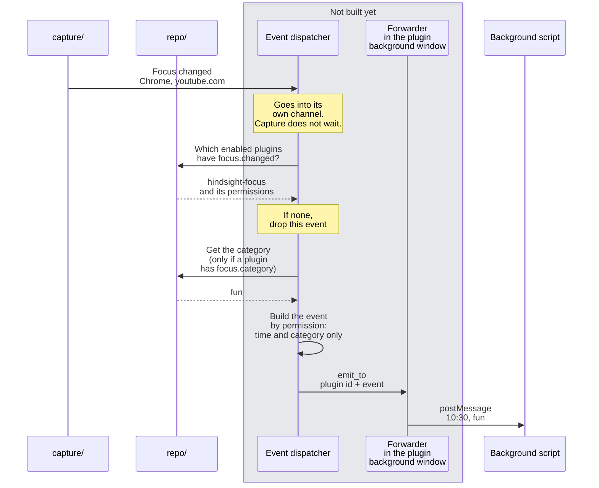

# ④ Receiving events

Overview: [Plugin backend architecture](plugins-architecture.md).

**This doc designs**: how the app pushes focus changes to plugins. It covers three things:

- when capture sees a focus change, how it tells the event dispatcher without slowing capture down;
- which fields each plugin gets, based on its permissions;
- when something fails, how to limit the damage to one plugin and one event.

Example: notify the focus plugin when the user switches to YouTube.

- **Why the event dispatcher has its own channel**: the capture loop does not need to know that plugins exist, and it does not wait for them. Without the channel:
  - `capture/` would call `plugins/` directly;
  - the time to look up categories and permissions would count toward the capture that runs every 5 seconds;
  - an error on the plugin side would also slow down capture.
- Capture gains only one line: when the focus really changes, put one item into the event dispatcher's channel.
  - Not where a new session starts. Capture also starts new sessions on a timer for screenshots, and then the focus has not changed ([service.rs:552-568](../../../../src-tauri/src/capture/service.rs#L552-L568)).
  - Do not wait when putting the item in.
  - If the dispatcher falls behind, drop the older items. Only the latest focus event matters.
- Events are built by permission in Rust. Events for plugins use a separate struct that holds only the fields the plugin may see. If internal code adds a field later, it is not pushed out unless it is added to this struct.
- An error in one plugin affects only that plugin. Each plugin gets its own push: if the push to A fails, log it and go on to B.
- The event dispatcher must not panic. Release builds set `panic = "abort"` ([Cargo.toml:136](../../../../src-tauri/Cargo.toml#L136)), so one panic quits the whole app. Failures in the plugin lookup, the category lookup or the push all return errors. The dispatcher drops this event and waits for the next focus change.
