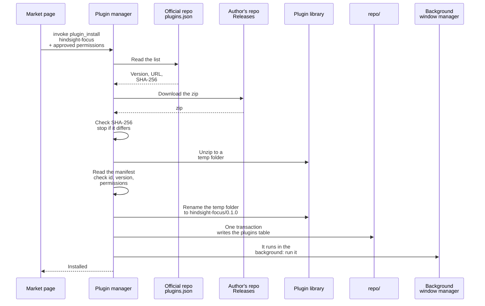
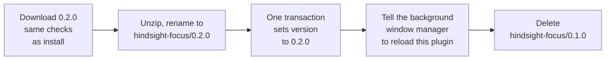

# ① Installing plugins

Overview: [Plugin backend architecture](plugins-architecture.md).

**This doc designs**: how to install a plugin on this machine and how to update it. It covers three things:

- how to check the downloaded file;
- in what order to write the files and the `plugins` table, so that a lost connection, a changed file or a crash never leaves a half-installed plugin;
- how to switch from the old version to the new one during an update.

Where plugins come from: [Plugin market](market.md).

- If the SHA-256 differs, stop and write nothing.
- **Files first, table last.**
  - If the app crashes midway, at most a folder that is not in the table is left. The next startup deletes it (see [② Running plugins](runtime.md)).
  - If the table were written first, a crash would leave a row in the table with no files.
- Unzip to a temp folder first, then rename it. On the same disk, a rename happens in one step, so the plugin library never holds a half-unzipped plugin folder.
- The market page passes in the permissions the user approved. They are compared with the downloaded manifest. If the manifest asks for more than the user approved, the plugin is not installed. The reason: the manifest the user saw and the one actually downloaded may not be the same.

## Updating

Example: the focus plugin updates from 0.1.0 to 0.2.0.

- The old and new version folders sit side by side. The `version` in the `plugins` table decides which one is used. After the table changes, the background window manager reloads this plugin. The new plugin list says 0.2.0, so the URLs point to the new version. Plugin pages that are open in the main window must reload too.
- Wherever the crash happens, the folder for the version in the table is complete:
  - Crash before the table changes: 0.1.0 is still used. The extra `0.2.0/` is deleted at the next startup.
  - Crash after the table changes: 0.2.0 is used. The leftover `0.1.0/` is deleted at the next startup.
- How updates are found: when the market page reads the list, if the list has a newer version than the installed one, it offers an update (see [Plugin market](market.md)).
