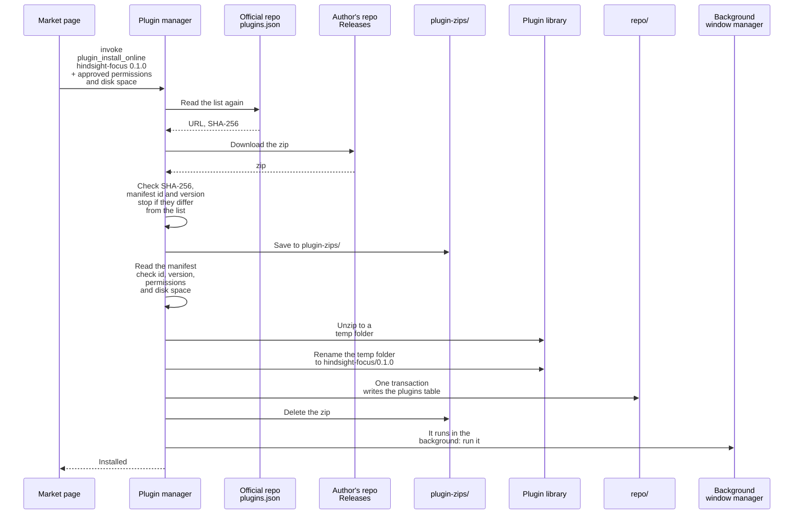
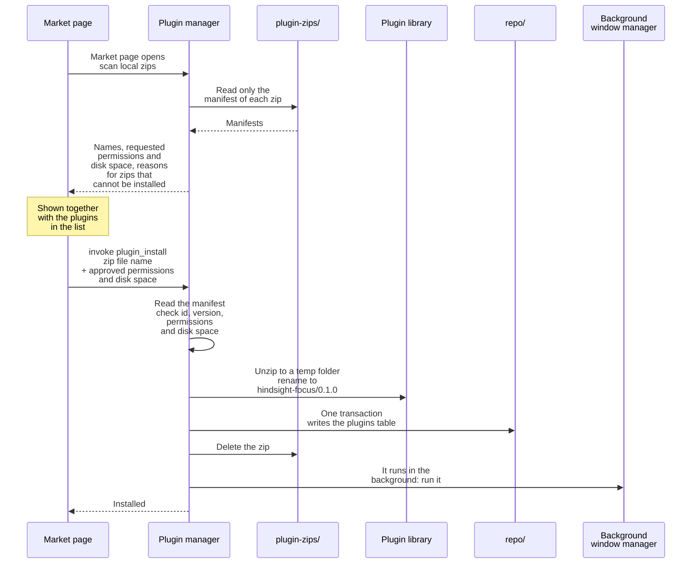
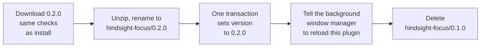

# ① Installing plugins

Overview: [Plugin backend architecture](plugins-architecture.md).

**This doc designs**: how to install a plugin on this machine and how to update it. It covers three things:

- how to check the downloaded file;
- in what order to write the files and the `plugins` table, so that a lost connection, a changed file or a crash never leaves a half-installed plugin;
- how to switch from the old version to the new one during an update.

Where plugins come from: [Plugin market](market.md). A local zip can also be installed without listing it on the market; see "Installing a local zip" below.

- The downloaded zip is saved to `plugin-zips/`. From there it takes the same path as a local zip: it is deleted after a successful install. If the install fails, it stays and is listed in the local zip column the next time the market page opens.
- **Files first, table last.**
  - If the app crashes midway, at most a folder that is not in the table is left. It is deleted the next time the plugin market opens (see "Removing leftovers" below).
  - If the table were written first, a crash would leave a row in the table with no files.
- Unzip to a temp folder first, then rename it. On the same disk, a rename happens in one step, so the plugin library never holds a half-unzipped plugin folder.
- The table stores the permissions and the disk space the user approved, passed in by the market page. They are not compared with what the manifest asks for. The plugin API and the event dispatcher check only the table, so however much the manifest asks for, the plugin cannot get what the user did not approve.
- The approved disk space comes from the frontend, so the manifest checks did not see it. The install checks again that it is between 1 MB and 10 GB.

## Installing a local zip

A plugin you wrote yourself, or a zip someone sent you, can be installed without listing it on the market: put it in the `plugin-zips/` folder in the data folder. When the market page opens, the app scans this folder once and shows the zips together with the plugins in the list.

- How it differs from a market install: there is no list, so the requested permissions and disk space can only come from the manifest in the zip. There is also no SHA-256 to check, because the user put the file there.
- Use a separate folder. Do not scan the Downloads folder: it has many unrelated zips, and going through it every time the market page opens means touching the user's files. Do not use the plugin library either: removing leftovers deletes what is not in the table.
- List zips that cannot be installed too, with the reason:
  - Broken packages, such as one with no background.js. Plugin authors can see what went wrong while testing.
  - The same version is already installed. The reason is the error the install would return: "plugin already installed: 0.1.0". If a plugin author packs the plugin again without changing the version, they can see why it cannot be installed.
- The frontend sends only the file name. The backend joins it to `plugin-zips/` and rejects a name with `/` or `..`. The zip is deleted after the install, so a full path could make it delete the wrong file.
- After the install, the zip is deleted, so `plugin-zips/` usually holds only zips that are not installed yet. If the install fails, the zip is kept. If the zip cannot be deleted, this is only logged, and the next time the market page opens, the zip is listed with the reason "already installed".
- From the manifest check on, it is the same as a market install: files first, table last.

## Updating

Example: the focus plugin updates from 0.1.0 to 0.2.0.

- The old and new version folders sit side by side. The `version` in the `plugins` table decides which one is used. After the table changes, the background window manager reloads this plugin. The new plugin list says 0.2.0, so the URLs point to the new version. Plugin pages that are open in the main window must reload too.
- Wherever the crash happens, the folder for the version in the table is complete:
  - Crash before the table changes: 0.1.0 is still used. The extra `0.2.0/` is deleted the next time the plugin market opens.
  - Crash after the table changes: 0.2.0 is used. The leftover `0.1.0/` is deleted the next time the plugin market opens.
- Installing the same version again fails with "already installed 0.1.0". A different version is an update, and a downgrade counts too.
- How updates are found: when the market page reads the list, if the list has a newer version than the installed one, it offers an update (see [Plugin market](market.md)). A local zip has no list: the user puts the zip of the new version in `plugin-zips/`.

## Removing leftovers

Each time the market page opens, the app removes leftovers first, and only then lets the user install. The table is the source of truth, and the plugin library is tidied to match it. Delete:

- the temp folder `.tmp-xxxx/` left by a crash while unzipping;
- the version folders of plugins that are not in the table (a half-done install or uninstall). The plugin's own data is not touched, because the user may have chosen to keep it when uninstalling. If the folder is empty afterwards, delete it too;
- for a plugin in the table, any folder that is not the version in the table (an old version left by an update, or a new version that was never switched to).

- Do this when the market opens, not when the app starts. Leftovers only take disk space and do not affect running plugins, and users who use no plugins never run this step.
- Install, uninstall and removing leftovers must not run at the same time, so the three share one lock. If the user clicks install, leaves before the download finishes and comes back to the market page, removing leftovers could delete the temp folder of the running install, or a new version that has been renamed but not yet written to the table.
