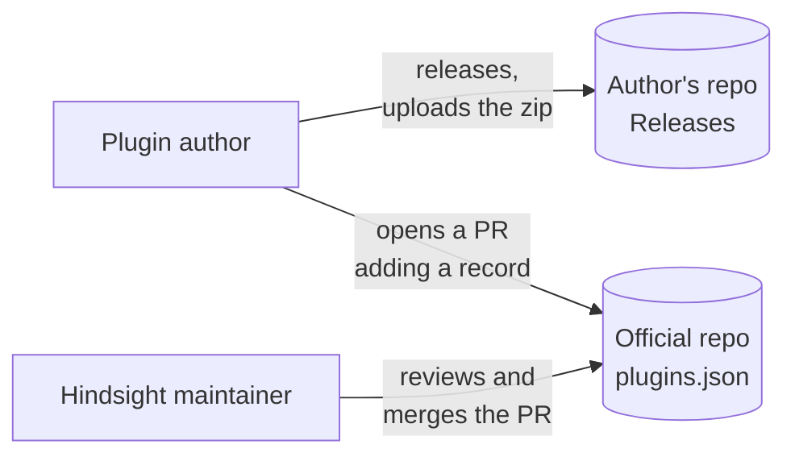
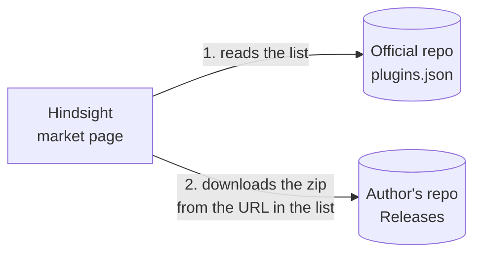

# Plugin market

Overview: [Plugin backend architecture](plugins-architecture.md).

**This doc designs**: where plugins come from. It covers three things:

- how plugin authors publish a plugin;
- where Hindsight finds plugins and downloads them;
- how to make sure downloaded files were not changed, and that plugin ids are unique.

**Publishing**



**Installing**



- The official repo holds only one list file, `plugins.json`. It holds no plugin code. The zip lives in the Releases of the author's own repo.
- The official repo is separate from the main Hindsight repo. Publishing PRs do not mix with app code and do not run the main repo's CI.
- PR review keeps plugin ids unique.
- The market page reads the list once when the user opens it. It does not fetch the list in the background on a timer.

### List file format

One record per plugin:

```json
{
  "id": "hindsight-focus",
  "name": "Focus",
  "author": "someone",
  "description": "How far you are from today's goal. Reminds you when you switch to entertainment.",
  "repo": "someone/hindsight-focus",
  "version": "0.1.0",
  "url": "https://github.com/someone/hindsight-focus/releases/download/0.1.0/hindsight-focus-0.1.0.zip",
  "sha256": "…",
  "permissions": ["stats.read", "focus.changed", "focus.category", "notifications"]
}
```

- `version`, `url` and `sha256` are in the list. Each time the author releases a new version, they open a PR to change these three fields.
- `permissions` lets the market page show the permissions to the user before the download. The ones the user approved are passed to the install and stored in the plugins table (see [① Installing plugins](install.md)).
- Hindsight compares the installed version with the one in the list. If the list has a newer version, it offers an update.
