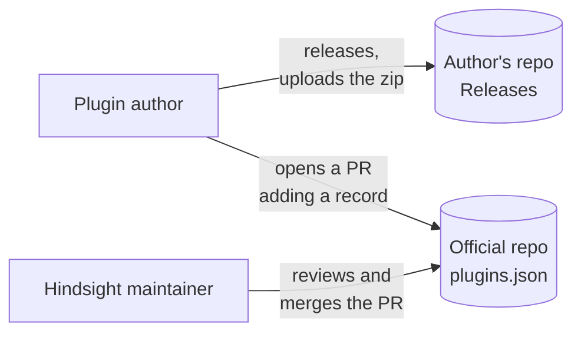
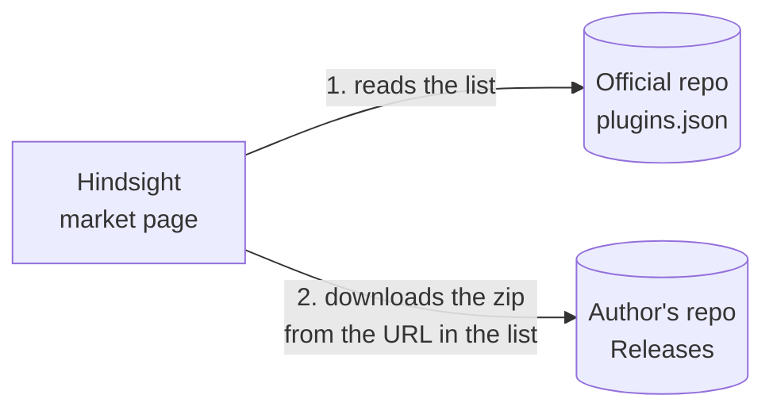

# Plugin market

Overview: [Plugin backend architecture](plugins-architecture.md).

**This doc designs**: where plugins come from. It covers three things:

- how plugin authors publish a plugin;
- where Hindsight finds plugins and downloads them;
- how to make sure downloaded files were not changed, and that plugin ids are unique.

**Publishing**



**Installing**



- The official repo holds only the list file `plugins.json` and the plugin icons `icons/<id>.png`. It holds no plugin code. The zip lives in the Releases of the author's own repo.
- The market page reads icons from the official repo, not from the authors' servers. Otherwise, opening the market page would send a request to every author's server. After install, the plugin uses `icon.png` from its package. PR review checks that the two are the same image.
- The official repo is separate from the main Hindsight repo. Publishing PRs do not mix with app code and do not run the main repo's CI.
- PR review keeps plugin ids unique.
- The market page reads the list once when the user opens it. It does not fetch the list in the background on a timer.
- If the list cannot be read (no network, a 10-second timeout, or a format it does not know), the "Downloadable" column shows the reason. The "Installed" and local zip columns are shown as usual.

### List file format

The outer level is the format version. `plugins` has one record per plugin, and `versions` has one record per version:

```json
{
  "format_version": 1,
  "plugins": [
    {
      "id": "hindsight-focus",
      "name": "Focus",
      "author": "someone",
      "description": "How far you are from today's goal. Reminds you when you switch to entertainment.",
      "repo": "someone/hindsight-focus",
      "versions": [
        {
          "version": "0.2.0",
          "url": "https://github.com/someone/hindsight-focus/releases/download/0.2.0/hindsight-focus-0.2.0.zip",
          "sha256": "…",
          "permissions": ["stats.read", "stats.today", "focus.changed", "focus.category", "notifications"],
          "storage_mb": 10
        },
        {
          "version": "0.1.0",
          "url": "https://github.com/someone/hindsight-focus/releases/download/0.1.0/hindsight-focus-0.1.0.zip",
          "sha256": "…",
          "permissions": ["stats.read", "stats.today", "focus.changed", "focus.category"]
        }
      ]
    }
  ]
}
```

- `format_version` is the version of this file's structure.
- When a plugin with the same `id` has a new version, the author opens a PR that adds a record to `versions`. Old versions can be kept.
- Each version has its own `permissions` and `storage_mb`, because different versions may ask for different ones. `storage_mb` is the disk space, in MB, that the plugin asks for its own database. A plugin that uses no database leaves it out, like 0.1.0 above. The market page shows the permissions and disk space of that version before the download. What the user approved is passed to the install and stored in the plugins table (see [① Installing plugins](install.md)).

## The three columns of the market page

| Column | What it shows | Where the data comes from |
|---|---|---|
| Installed | Installed plugins. When there is a newer version, it shows "Update to x", and the menu next to it can pick any online version | The plugins table, plus the online versions with the same id |
| Downloadable | Online plugins that are not installed | plugins.json |
| Local zips | Packages in `plugin-zips/` (see [① Installing plugins](install.md)) | The folder |

- "Downloadable" is split by id: an installed plugin is not in the "Downloadable" column, whether or not there is a newer version online.
- If an installed plugin can be updated, the update shows in "Installed".
