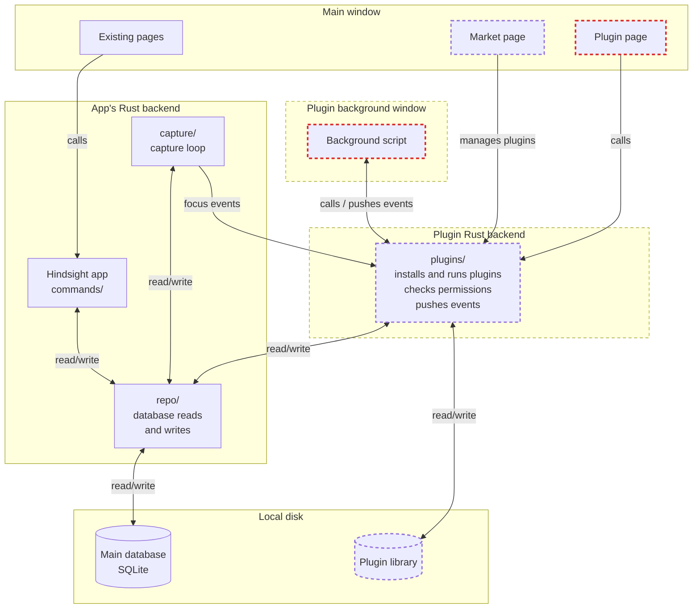
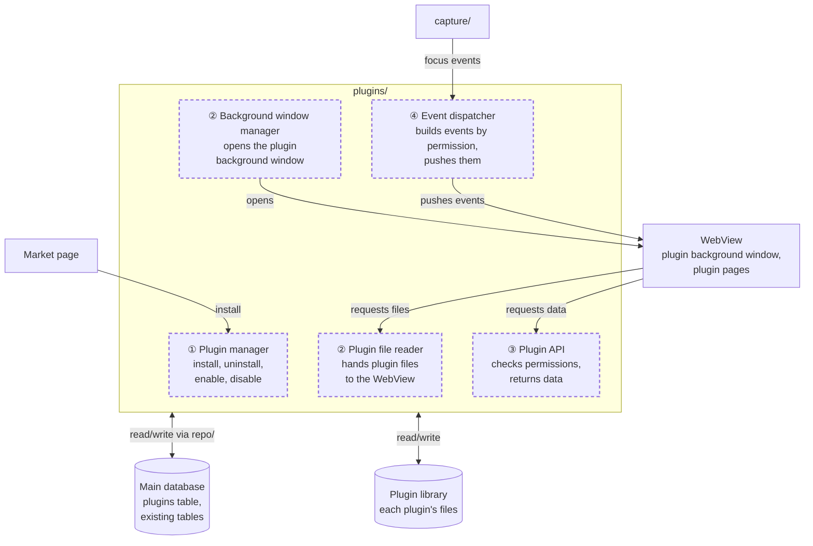
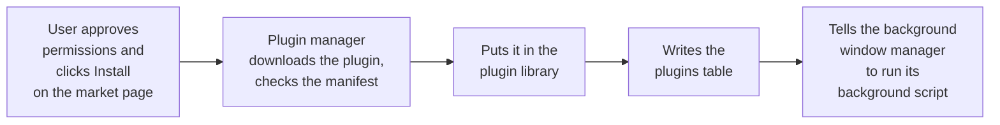
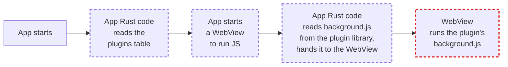
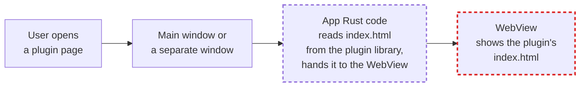
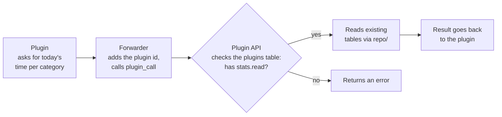
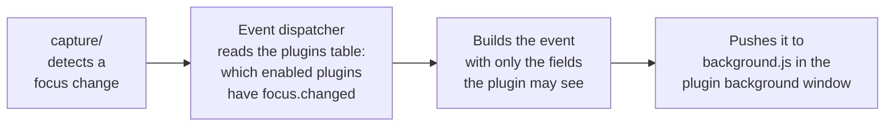

# Plugin backend architecture

This doc uses the focus plugin `hindsight-focus` as an example. It does two things:

1. **Show progress**: on the "Focus" page, show how far the user is from today's goal. For example, if the goal is 6 hours of work, the page shows how many hours and minutes are left.
2. **Switch reminder**: when the user switches to another window, such as an entertainment app, show a notification.

---

## 1. Overall structure



- Dashed box: Hindsight code for plugins (not built yet).
- Red dashed box: code written by plugin authors.
- The plugin backend code goes in a new module, `plugins/`.
- Plugin code can only call `plugins/`. It cannot call the 100+ existing commands.
- `plugins/` touches existing code in only two places:
  - it reads and writes the database through `repo/`;
  - it receives focus events from `capture/`.
- Today `chat/`, `memory/`, `sync/engine/pull.rs` and two command files also write SQL directly. For plugins we set a rule: `plugins/` writes no SQL itself. All of it goes in `repo/plugins.rs`.

---

## 2. The four jobs of plugins/

**The problem**: in Figure 1, `plugins/` is just a box. We need to decide two things: what a plugin looks like when the backend gets it, and how `plugins/` splits into parts and what each part does. Details for each job: [Plugin market](market.md), [① Installing plugins](install.md), [② Running plugins](runtime.md), [③ Requesting data](api.md), [④ Receiving events](events.md), [Plugin data](data.md), [Plugin permissions](permissions.md).

### Plugin package format

One plugin is one folder. The folder name is the plugin id, for example `hindsight-focus`. The plugin author picks the id, and it must be unique in the plugin market:

```
<plugin id>/
├── manifest.json   Manifest: id, version, permissions it asks for, where the page shows, whether it runs in the background
├── ui/index.html   Plugin page ("Plugin page" in Figure 1), shown in the main window or a separate window
└── background.js   Background script ("Background script" in Figure 1), runs all the time in the plugin background window
```

- Plugin pages and background scripts are web code (HTML, JavaScript) written by third parties. The backend opens only the approved APIs in `plugins/` to them.
- The user decides a plugin's permissions. `manifest.json` only lists what the plugin asks for. What the user approves is stored in the `plugins` table in the main database (see [Plugin data](data.md)).

### The parts of plugins/



### ① Installing plugins and approving permissions

Details: [① Installing plugins](install.md). Where plugins come from: [Plugin market](market.md).



### ② Running plugins

Details: [② Running plugins](runtime.md).

After a plugin is installed, the plugin library only holds its files. None of its code is running yet. A plugin has two pieces of code:

- Background script `background.js`: runs all the time. It must keep running when the main window is closed.
- Plugin page `index.html`: shows only when the user opens it.

Both are JavaScript. They run in a WebView (the web engine built into the OS), and a WebView lives in a window that the app opens. So the app must do two things: open the window, and hand the files in the plugin library to the WebView. Two parts of the app's Rust code do this: the background window manager and the plugin file reader.

**Flow A: when the app starts, run the background scripts**

The user can close the main window. So the app opens a separate hidden window that only runs the plugins' background scripts. This is the plugin background window. In this window each plugin has an iframe with Hindsight's own launcher, and the launcher runs `background.js` in a separate Worker thread. So one hung plugin does not stop the others (see [② Running plugins](runtime.md)).



**Flow B: when the user opens a plugin page, show the page**

A plugin page shows in the app's main window or in a separate window.



In both flows, the WebView asks for files with URLs like `hindsight-plugin://<plugin id>.localhost/<version>/<file>`. The plugin id and version come from the plugin list, which is read from the `plugins` table. The plugin file reader does not read the table. It only reads the file from that version's folder in the plugin library and hands it to the WebView. The only exception is the launcher, which is written in Rust.

Once plugin code is running, it requests data through ③ and receives events through ④.

### ③ Requesting data

Details: [③ Requesting data](api.md).



> Forwarder: the app's own JS. There is one copy in the plugin background window and one in each window that shows plugin pages. The app decides the plugin id, so a plugin cannot pretend to be another plugin to get its permissions.
>
> stats.read: read statistics (time per category and per app). No window titles or URLs.

### ④ Receiving events

Details: [④ Receiving events](events.md).



> focus.changed: get an event when the foreground app or browser URL changes, or when the user goes away. The event has only the time. This one permission decides whether a plugin gets events at all.
>
> focus.app: adds the app name to the event.
>
> focus.category: adds the category to the event.
>
> focus.title: adds the window title and website domain to the event.
