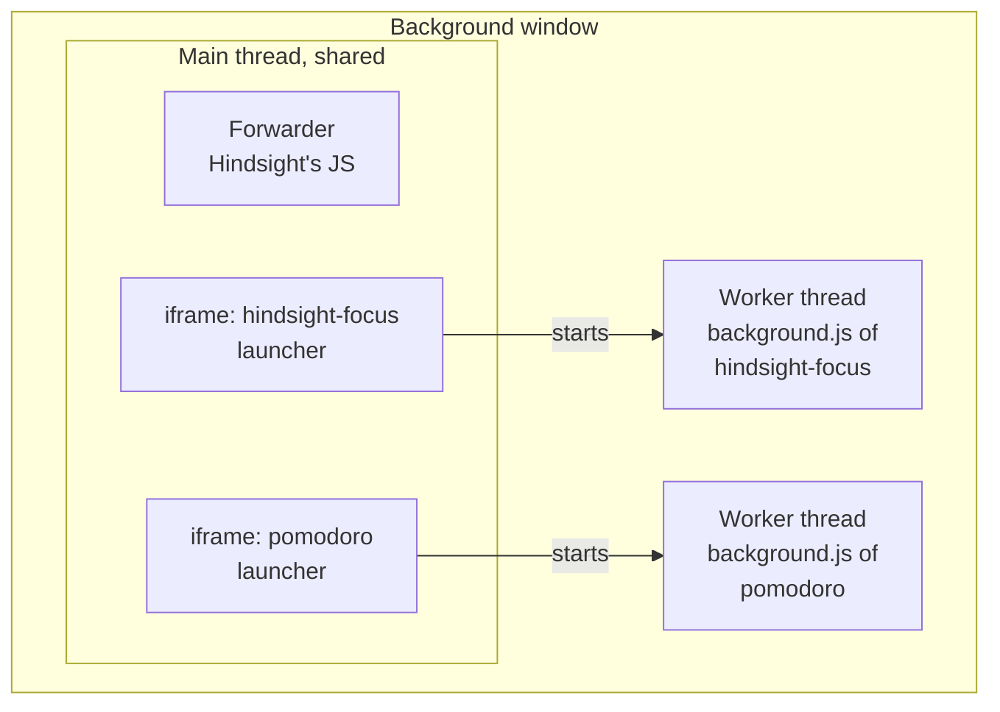
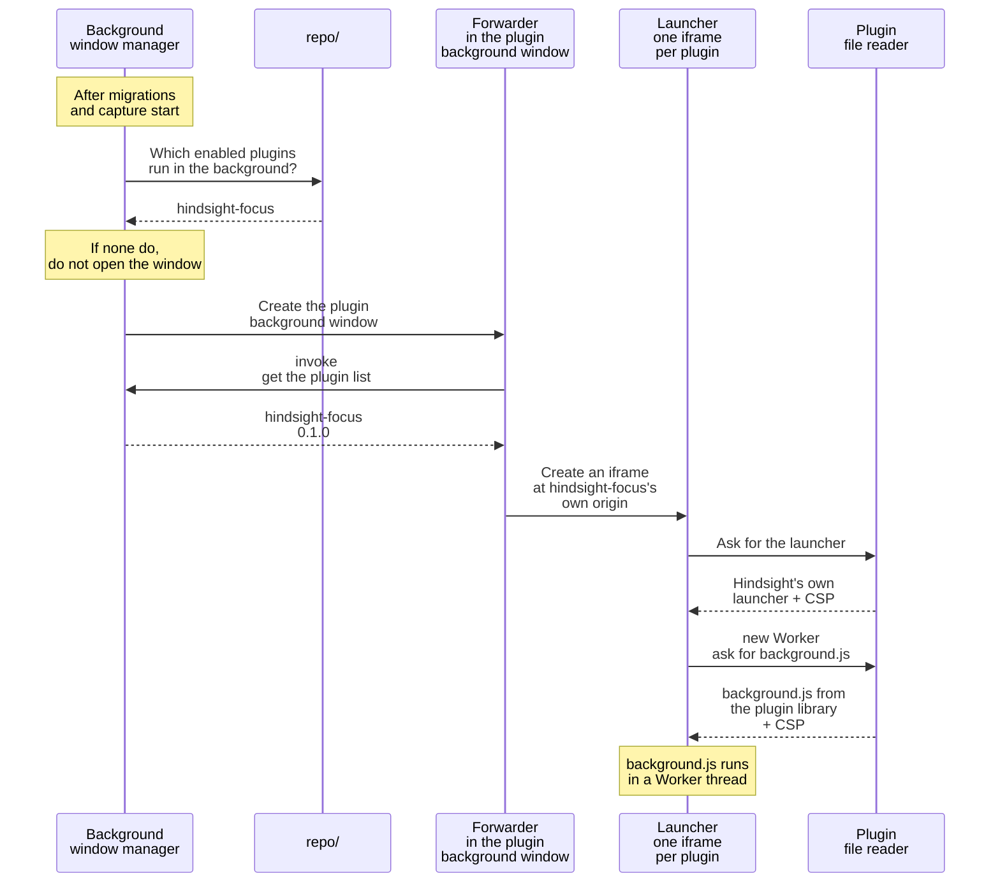
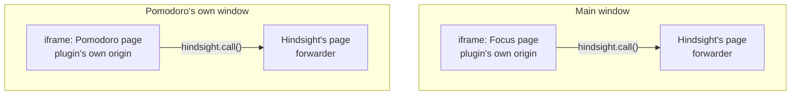

# ② Running plugins

Overview: [Plugin backend architecture](plugins-architecture.md).

**This doc designs**: how installed plugins start running. It covers four things:

- at startup, how the app opens the plugin background window and loads the plugins that run in the background;
- when one plugin hangs, how it avoids stopping the other plugins and the app;
- how plugin pages show in the main window and in their own windows;
- when the WebView asks for a plugin's file, how the plugin file reader hands it over.

## What is in the plugin background window

- **One Worker per plugin**: all iframes share one main thread, so if one plugin hangs, all of them stop. A Worker is a separate thread, so a hung Worker can be stopped on its own.
- **One iframe per plugin** (a page inside another page): a Worker can only be started with a script from the same origin. The iframe opens at the plugin's own origin, so storage is separate between plugins and between a plugin and Hindsight, and the Worker uses the CSP from the plugin file reader.
- **Hindsight provides each plugin's launcher**: the launcher runs on the shared main thread, so it cannot hold the author's code. It only starts the Worker, passes messages, and stops the Worker.
- **Heartbeat**: the launcher pings the Worker every 10 seconds, and stops it when two pings in a row get no reply. The plugin background is hidden, so when a plugin is stuck in a loop, the user cannot see which plugin is using the CPU.
- **Not one window per plugin**: each window is one process and uses several times more memory. Tauri also injects its call interface and key into each window's main page.

## At startup

> Content Security Policy (CSP): a rule sent along with a web page. It tells the WebView what the page may and may not do, for example no network access. If plugin JS tries to send data to an outside website, the WebView itself blocks the request.

## Plugin pages

- **The plugin page is in an iframe inside a Hindsight page**: the iframe opens at the plugin's own origin, so it cannot reach the call interface Tauri injects into Hindsight's pages, and its storage is separate from Hindsight's. It hands requests to the forwarder in the outer page, and the forwarder tells which plugin it is by which iframe the message came from.
- **The main window and a page's own window show the same plugin page**: only the outer page differs, so the author does not write two versions.

## Implementation details

- If no plugin runs in the background, do not open the plugin background window. Users who use no plugins do not pay the memory cost.
- When creating the window, set `background_throttling` to `Disabled`. Otherwise plugin timers stop while the window is hidden. Windows does not support this setting; test it there separately.
- Put the plugin id in the host name, so pages of different plugins have different origins. End it with `.localhost`: on Windows the URL is rewritten to `http://hindsight-plugin.hindsight-focus.localhost/…`, and only a host ending in `.localhost` counts as a secure context.
- Keep file paths inside the version folder in the URL (`<id>/<version>/`). Block paths like `../` that climb up.
- The plugin background uses four files. Their URLs are all under `hindsight-plugin://<plugin id>.localhost/<version>/`:
  - Hindsight writes three of them in Rust. For these names, the plugin file reader returns them directly and does not read the plugin library:
    1. `_launcher.html`, `_launcher.js`: the launcher (the CSP does not allow inline scripts, so it is split into two files).
    2. `_worker.js`: defines `hindsight.call()`, then loads `background.js`.
  - `background.js`: the script written by the plugin author.
- Build the plugin file reader as a Tauri custom protocol. Register it once at app startup, next to the existing `.plugin(...)` calls in `lib.rs`.
