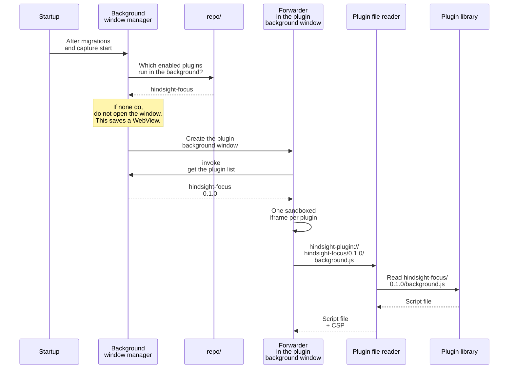

# ② Running plugins

Overview: [Plugin backend architecture](plugins-architecture.md).

**This doc designs**: how installed plugins start running. It covers three things:

- at startup, how the app opens the plugin background window and loads the plugins that run in the background;
- when the WebView asks for a plugin's file, how the plugin file reader hands it over;
- at startup, how to clean up what an interrupted install left behind.

> Content Security Policy (CSP): a rule sent along with a web page. It tells the WebView what the page may and may not do, for example no network access. If plugin JS tries to send data to an outside website, the WebView itself blocks the request.

## Implementation details

- At startup, also clean up what a crash during [① Installing plugins](install.md) left behind. Delete:
  - the temp folder `.tmp-xxxx/` left by a crash while unzipping;
  - plugin folders that are in the plugin library but not in the table;
  - for a plugin in the table, any folder that is not the version in the table (an old version left by an update, or a new version that was never switched to).
- If no plugin runs in the background, do not open the plugin background window. Users who use no plugins do not pay the memory cost.
- When creating the window, set `background_throttling` to `Disabled`. Otherwise plugin timers stop while the window is hidden. Windows does not support this setting; test it there separately.
- Keep file paths inside the version folder in the URL (`<id>/<version>/`). Block paths like `../` that climb up.
- Build the plugin file reader as a Tauri custom protocol. Register it once at app startup, next to the existing `.plugin(...)` calls in `lib.rs`.
