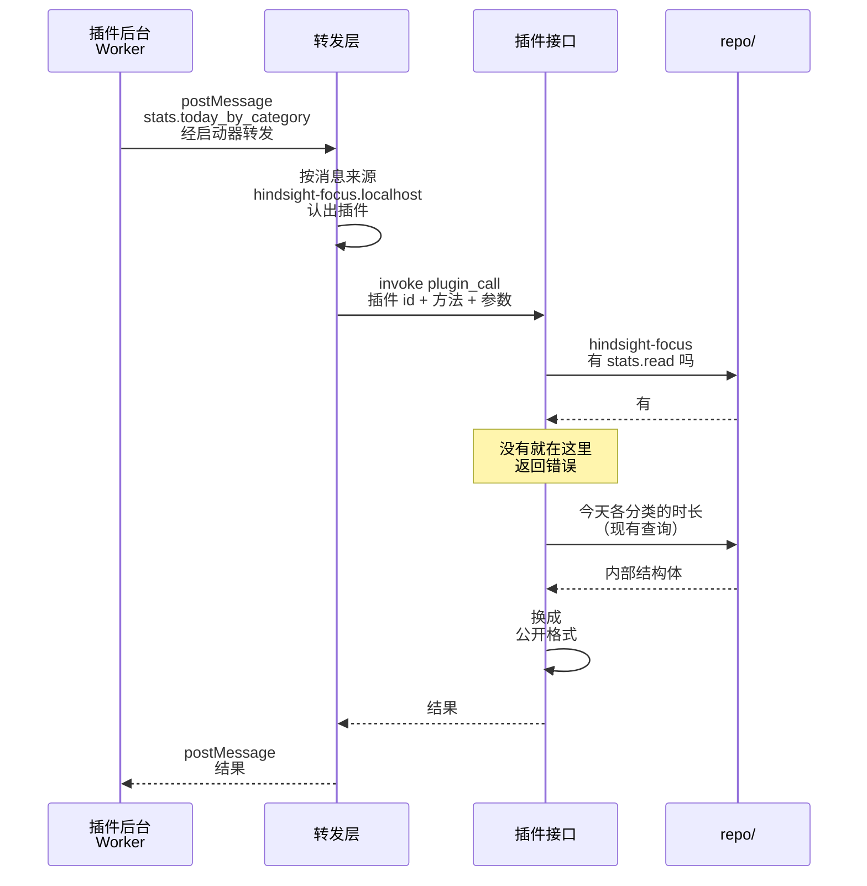

# ③ 插件请求数据

总体见 [插件后端架构](plugins-architecture.md)。

**本文旨在设计**：插件怎么向主程序请求数据。包括三件事：

- 插件的请求怎么送到 Rust；
- 怎么认出是哪个插件，不让插件冒充别的插件、绕过转发层；
- 怎么查权限，返回什么格式的数据。

例子：专注插件查「今天各分类用了多久」。

- 插件的所有调用都走一个命令 `plugin_call`，用方法名区分要做什么：
  - 读 Hindsight 的数据：`stats.today_by_category`
  - 发通知：`notifications.send`，用现有的 `tauri-plugin-notification`
  - 读写插件自己的数据库：`db.execute`、`db.query`，见 [插件的数据](data.md)
- 方法名就是对插件公开的接口。权限只在一处查，加接口也不用加命令。
- 插件 id 由转发层标，不让插件自己报。插件自己报的话，就能冒充别的插件。
- 为避免插件绕过转发层、直接调 `invoke`：加入 Tauri 的密钥。
- 查数据复用 `repo/` 现有的函数，不为插件另写一套 SQL。
- 返回前换成公开格式。内部结构体以后改名、加字段，不会弄坏已经发布的插件。