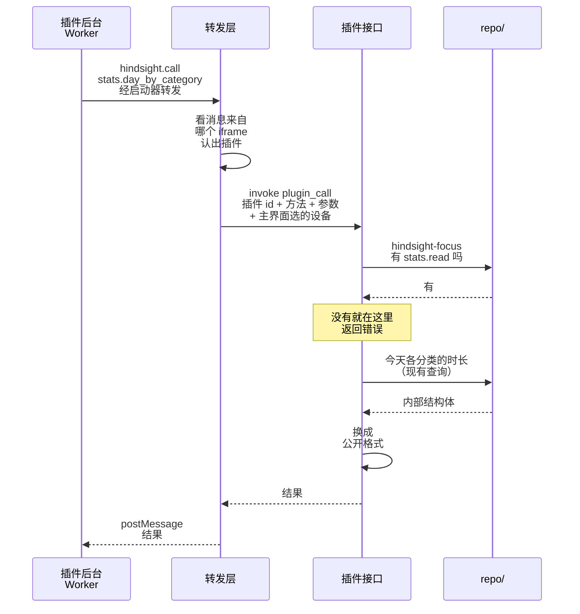

# ③ 插件请求数据

总体见 [插件后端架构](plugins-architecture.md)。

**本文旨在设计**：插件怎么向主程序请求数据。包括三件事：

- 插件的请求怎么送到 Rust；
- 怎么认出是哪个插件，不让插件冒充别的插件、绕过转发层；
- 怎么查权限，返回什么格式的数据。

例子：专注插件查「今天各分类用了多久」。

- 插件的所有调用都走一个命令 `plugin_call`，用方法名区分要做什么：
  - 读 Hindsight 的数据：`stats.day_by_category`、`categories.list`、`super_categories.list`、`categories.app.list`、`categories.site.list`
  - 改应用和网站的分类：`categories.app.write`、`categories.site.write`
  - 发通知：`notifications.send`，用现有的 `tauri-plugin-notification`
  - 读写插件自己的数据库：`db.execute`、`db.query`，见 [插件的数据](data.md)
- 方法名就是对插件公开的接口。权限只在一处查，加接口也不用加命令。
- 插件调 `hindsight.call(方法, 参数)`。这个函数由 Hindsight 先在 Worker 里定义好，再加载插件的 `background.js`。插件不用自己给消息编号，消息格式是内部细节，以后可以跟着 Hindsight 一起改。
- 插件 id 由转发层标：看消息来自哪个 iframe，这是浏览器填的，插件改不了。不让插件自己报，否则就能冒充别的插件。
- 为避免插件绕过转发层、直接调 `invoke`：加入 Tauri 的密钥。
- 查数据、改数据都复用 `repo/` 现有的函数，不为插件另写一套 SQL。
- 返回前换成公开格式。内部结构体以后改名、加字段，不会弄坏已经发布的插件。

## 方法

| 方法 | 要的权限 | 参数 | 返回 |
|---|---|---|---|
| `stats.day_by_category` | `stats.read` 加一档 | `{ "date": "2026-10-19", "devices": "selected" }`，`devices` 可以不传 | `[{ "id": "code", "name": "Coding", "color": "#a78bfa", "icon": "Code", "seconds": 12600, "superCategory": { "id": "work", "name": "Work", "color": "#8b5cf6", "icon": "Briefcase" } }]`，用时多的在前；没归入大类的，`superCategory` 是 `null` |
| `categories.list` | `categories.read` | 无 | `[{ "id": "code", "name": "Coding", "color": "#a78bfa", "icon": "Code", "superCategory": { "id": "work", "name": "Work", "color": "#8b5cf6", "icon": "Briefcase" } }]`，顺序和主界面一样；没归入大类的，`superCategory` 是 `null` |
| `super_categories.list` | `super_categories.read` | 无 | `[{ "id": "work", "name": "Work", "color": "#8b5cf6", "icon": "Briefcase" }]`，顺序和主界面一样 |
| `categories.app.list` | `categories.app.read` | 无 | `[{ "app": "Code", "categoryId": "code" }]`，最近 7 天用得多的在前；没有分类的，`categoryId` 是 `null` |
| `categories.app.write` | `categories.app.write` | `{ "app": "Code", "categoryId": "code" }`，`categoryId` 是 `null` 就是去掉分类 | 无 |
| `categories.site.list` | `categories.site.read` | 无 | `[{ "host": "docs.github.com", "categoryId": "code", "inheritedFrom": "github.com" }]`，最近 30 天用得多的在前；用的是自己的规则，`inheritedFrom` 是 `null`；没有规则的，两个都是 `null` |
| `categories.site.write` | `categories.site.write` | `{ "host": "github.com", "categoryId": "code" }`，`categoryId` 是 `null` 就是删掉规则 | 无 |
| `permissions.list` | 不要权限 | 无 | `["stats.read", "stats.today"]`，用户同意了的权限 |
| `notifications.send` | `notifications`；带提示音还要 `notifications.sound` | `{ "body": "已经看了 10 分钟 YouTube", "sound": true }`，`sound` 可以不传 | 无 |
| `db.execute` | 不要权限，要用户同意的磁盘容量 | `{ "sql": "INSERT INTO pomodoro VALUES (?, ?)", "params": ["2026-10-19", 25] }`，`params` 可以不传 | `{ "changes": 1, "lastInsertRowid": 1 }` |
| `db.query` | 同上 | `{ "sql": "SELECT date, minutes FROM pomodoro" }` | `[{ "date": "2026-10-19", "minutes": 25 }]`，每行一个对象，键是列名；最多 10 MB |
| `island.show` | `island` | 岛上放什么，格式见 [岛](island.md) | 无 |
| `island.hide` | `island` | 无 | 无 |

- 大类的时长由插件自己按 `superCategory` 加总，和主界面的算法一样。
- `categories.list`、`super_categories.list` 给插件的设置页列出全部分类和大类，让用户挑：读统计只能看到用过的分类。
- 分类和大类各要一个权限：只用大类的插件，看不到用户的全部分类。
- `app` 和 `focus.changed` 事件里的 `app` 是同一个名字。
- 还没访问过的网站也能设规则。
- `categoryId` 是 `null`：应用算进「其他」；网站跟父域名的规则走，没有就跟浏览器的分类走。
- 一次改一条，重复调用没关系。
- 下面这些情况报错，什么都不改：
  - `app` 不在 `categories.app.list` 里，「隐私」里的应用也算不在；
  - `host` 不是列表里的写法：小写，不带 `www.`、`://`、`/`、`:`；
  - `categoryId` 不存在或者已经删了；
  - 改之前或者改之后算进「隐私」（见 [插件权限](permissions.md)）。
- 能读哪些日子看档位（见 [插件权限](permissions.md)）。「今天」「本周」「本月」按本机日期算。读不到就报错，错误里是能读到这天的那一档。
- 算哪些设备由插件自己说：`devices` 不传或者是 `"this"`，只算本机；是 `"selected"`，按主界面选的设备算，要 `devices.read`，没有就报错。不会悄悄换成别的范围，插件拿到的数一定是它要的那种。
- 主界面选的设备由转发层每次转发时带上，插件改不了。
- 通知的标题固定是插件名，插件不能冒充 Hindsight 发通知。不限频率，插件刷屏的话用户可以把它关掉。
- `sound` 为 `true` 时同时播放系统提示音，只有系统默认的那一种。没有 `notifications.sound` 就报错，不弹通知，不会悄悄发成没声音的通知。不传 `sound` 时通知没有声音。