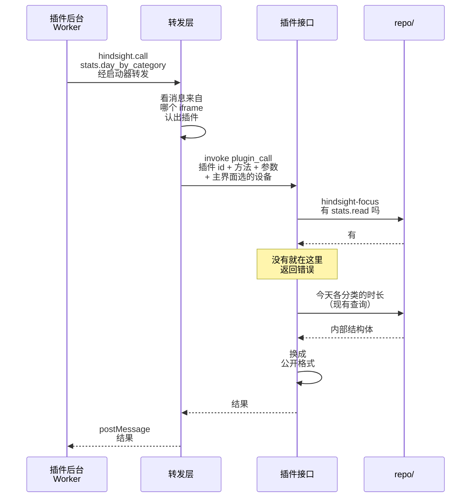

# ③ 插件请求数据

总体见 [插件后端架构](plugins-architecture.md)。

**本文旨在设计**：插件怎么向主程序请求数据。包括三件事：

- 插件的请求怎么送到 Rust；
- 怎么认出是哪个插件，不让插件冒充别的插件、绕过转发层；
- 怎么查权限，返回什么格式的数据。

例子：专注插件查「今天各分类用了多久」。

- 插件的所有调用都走一个命令 `plugin_call`，用方法名区分要做什么：
  - 读 Hindsight 的数据：`stats.day_by_category`、`categories.list`、`super_categories.list`
  - 发通知：`notifications.send`，用现有的 `tauri-plugin-notification`
  - 读写插件自己的数据库：`db.execute`、`db.query`，见 [插件的数据](data.md)
- 方法名就是对插件公开的接口。权限只在一处查，加接口也不用加命令。
- 插件调 `hindsight.call(方法, 参数)`。这个函数由 Hindsight 先在 Worker 里定义好，再加载插件的 `background.js`。插件不用自己给消息编号，消息格式是内部细节，以后可以跟着 Hindsight 一起改。
- 插件 id 由转发层标：看消息来自哪个 iframe，这是浏览器填的，插件改不了。不让插件自己报，否则就能冒充别的插件。
- 为避免插件绕过转发层、直接调 `invoke`：加入 Tauri 的密钥。
- 查数据复用 `repo/` 现有的函数，不为插件另写一套 SQL。
- 返回前换成公开格式。内部结构体以后改名、加字段，不会弄坏已经发布的插件。

## 第一版的方法

| 方法 | 要的权限 | 参数 | 返回 |
|---|---|---|---|
| `stats.day_by_category` | `stats.read` 加一档 | `{ "date": "2026-10-19", "devices": "selected" }`，`devices` 可以不传 | `[{ "id": "code", "name": "Coding", "color": "#a78bfa", "icon": "Code", "seconds": 12600, "superCategory": { "id": "work", "name": "Work", "color": "#8b5cf6", "icon": "Briefcase" } }]`，用时多的在前；没归入大类的，`superCategory` 是 `null` |
| `categories.list` | `categories.read` | 无 | `[{ "id": "code", "name": "Coding", "color": "#a78bfa", "icon": "Code", "superCategory": { "id": "work", "name": "Work", "color": "#8b5cf6", "icon": "Briefcase" } }]`，顺序和主界面一样；没归入大类的，`superCategory` 是 `null` |
| `super_categories.list` | `super_categories.read` | 无 | `[{ "id": "work", "name": "Work", "color": "#8b5cf6", "icon": "Briefcase" }]`，顺序和主界面一样 |
| `notifications.send` | `notifications` | `{ "body": "已经看了 10 分钟 YouTube" }` | 无 |
| `db.execute` | 不要权限，要用户同意的磁盘容量 | `{ "sql": "INSERT INTO pomodoro VALUES (?, ?)", "params": ["2026-10-19", 25] }`，`params` 可以不传 | `{ "changes": 1, "lastInsertRowid": 1 }` |
| `db.query` | 同上 | `{ "sql": "SELECT date, minutes FROM pomodoro" }` | `[{ "date": "2026-10-19", "minutes": 25 }]`，每行一个对象，键是列名；最多 10 MB |

- 大类的时长由插件自己按 `superCategory` 加总，和主界面的算法一样。
- `categories.list`、`super_categories.list` 给插件的设置页列出全部分类和大类，让用户挑：读统计只能看到用过的分类。
- 分类和大类各要一个权限：只用大类的插件，看不到用户的全部分类。
- 能读哪些日子看档位（见 [插件权限](permissions.md)）。「今天」「本周」「本月」按本机日期算。读不到就报错，错误里是能读到这天的那一档。
- 算哪些设备由插件自己说：`devices` 不传或者是 `"this"`，只算本机；是 `"selected"`，按主界面选的设备算，要 `devices.read`，没有就报错。不会悄悄换成别的范围，插件拿到的数一定是它要的那种。
- 主界面选的设备由转发层每次转发时带上，插件改不了。
- 通知的标题固定是插件名，插件不能冒充 Hindsight 发通知。不限频率，插件刷屏的话用户可以把它关掉。