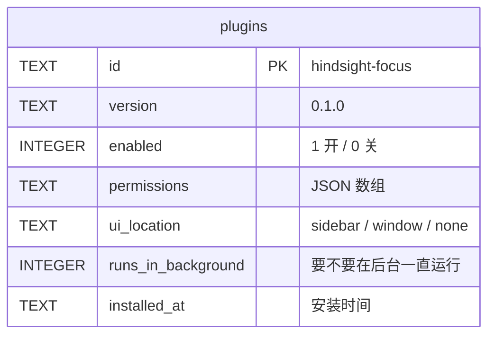
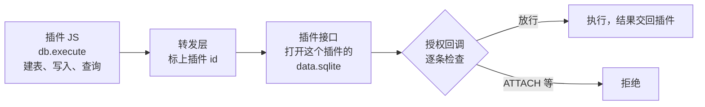

# 插件的数据：plugins 表和插件自己的数据库

总体见 [插件后端架构](plugins-architecture.md)。

**本文旨在设计**：插件相关的数据存在哪、谁来管。包括两件事：

- 主程序要记住装了哪些插件、给了哪些权限：存在主库的 plugins 表里，主程序管；
- 插件要存自己的数据，比如专注目标「6 小时」、每次番茄钟的记录：每个插件一个自己的 SQLite，表由插件作者设计。

## plugins 表



- `ui_location`、`runs_in_background` 安装时从 `manifest.json` 抄进来。运行时只查表，不再读 manifest。
- `ui_location`：控制页面显示在哪：
  - `sidebar` 在主窗口侧边栏加一个入口
  - `window` 点开时弹出独立窗口
  - `none` 没有页面
- `runs_in_background`：程序是否在后台运行。

## 插件自己的数据库

```
<应用数据目录>/plugins/
└── hindsight-focus/
    ├── 0.1.0/            插件的代码，插件更新时变动
    │   ├── manifest.json
    │   ├── ui/index.html
    │   └── background.js
    └── data.sqlite       插件的数据，插件更新时不变
```



- `data.sqlite` 不在版本文件夹里，插件文件读取模块不会交出它，WebView 用网址也拿不到。
- Rust 执行前用 SQLite 的授权回调逐条检查，拒绝 `ATTACH`、`DETACH` 和加载扩展。否则插件写一句 `ATTACH '…/hindsight.db'`，就能读到主库里的全部活动记录。
- 读写自己的数据库不需要权限。权限管的是读 Hindsight 的数据，比如 `stats.read`。
- 插件的数据库不参与同步，只留在本机。

## 卸载

1. 一个事务里删掉 plugins 表里这一行。
2. 删掉整个 `plugins/hindsight-focus/`：代码和数据库一起删。

和安装同一个道理，表说了算：先删表里的行，再删文件。崩在中间，留下的是一个表里没有的文件夹，下次启动清理时删掉。
