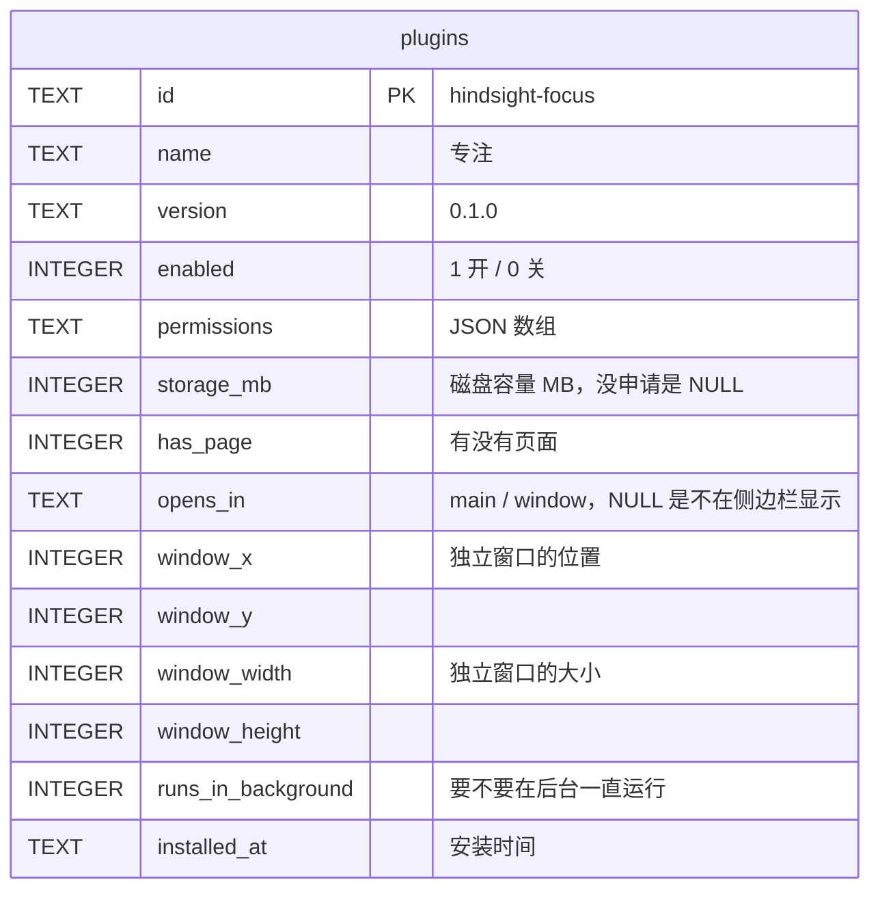
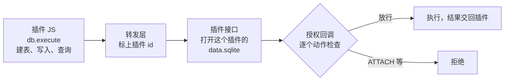

# 插件的数据：plugins 表和插件自己的数据库

总体见 [插件后端架构](plugins-architecture.md)。

**本文旨在设计**：插件相关的数据存在哪、谁来管。包括两件事：

- 主程序要记住装了哪些插件、给了哪些权限：存在主库的 plugins 表里，主程序管；
- 插件要存自己的数据，比如专注目标「6 小时」、每次番茄钟的记录：每个插件一个自己的 SQLite，表由插件作者设计。

## plugins 表



- `permissions`、`storage_mb` 存的是用户同意的，不是清单申请的（见 [① 插件安装](install.md)）。

## 插件自己的数据库

```
<应用数据目录>/plugins/
└── hindsight-focus/
    ├── 0.1.0/            插件的代码，插件更新时变动
    │   ├── manifest.json
    │   ├── ui/index.html
    │   └── background.js
    └── data.sqlite       插件的数据，插件更新时不变
```



- **只碰得到自己的文件**：打开哪个文件由 Rust 按插件 id 定，插件只传 SQL 和参数。SQLite 编译语句时，授权回调按白名单逐个动作检查，只放行用这个库里的表的动作；`ATTACH`、会改进程设置的 `PRAGMA`、加载扩展都拒绝。否则插件写一句 `ATTACH '…/hindsight.db'`，就能读到主库里的全部活动记录。
- **不在版本文件夹里**：插件文件读取模块不会交出它，WebView 用网址也拿不到；更新插件时数据不动。
- **每次调用打开一次、用完就关**：不留着打开的文件，卸载时才删得掉。所以连接自带的临时库也一起拒绝：建在里面的表活不过一次调用，插件用不上。
- **一次调用只执行一条语句**：多条就报错，不会只执行第一条、悄悄丢掉后面的。
- **磁盘按用户同意的容量封顶**：插件在清单里申请 `storage_mb`，用户同意的数存进 plugins 表，没有就用不了 `db.*`。读写自己的数据库不要权限，权限管的是读 Hindsight 的数据，比如 `stats.read`。
- **内存和 CPU 按每次调用封顶**：插件的 SQL 和采集跑在同一个进程里，一个插件不能拖慢记录活动。一个值的大小、执行时间、返回结果的大小都有上限，所有插件同时最多打开 4 个库，多的排队；排序这类中间结果落到磁盘上。具体的值见 `plugins/api/db.rs`。
- **上限只能往大放**：往小收的话，已经存过大值的行就读不出、改不了了。
- 插件的数据库不参与同步，只留在本机。

## 卸载

1. 一个事务里删掉 plugins 表里这一行。
2. 删掉文件，用户选删不删数据：
   - 删数据：删掉整个 `plugins/hindsight-focus/`，代码和数据库一起删；
   - 不删数据：只删版本文件夹，`data.sqlite` 留着。以后重装同一个插件，数据还能接着用。

和安装同一个道理，表说了算：先删表里的行，再删文件。崩在中间，留下的是表里没有的插件的版本文件夹，下次打开插件市场时删掉；数据不动，因为用户可能选了保留。
