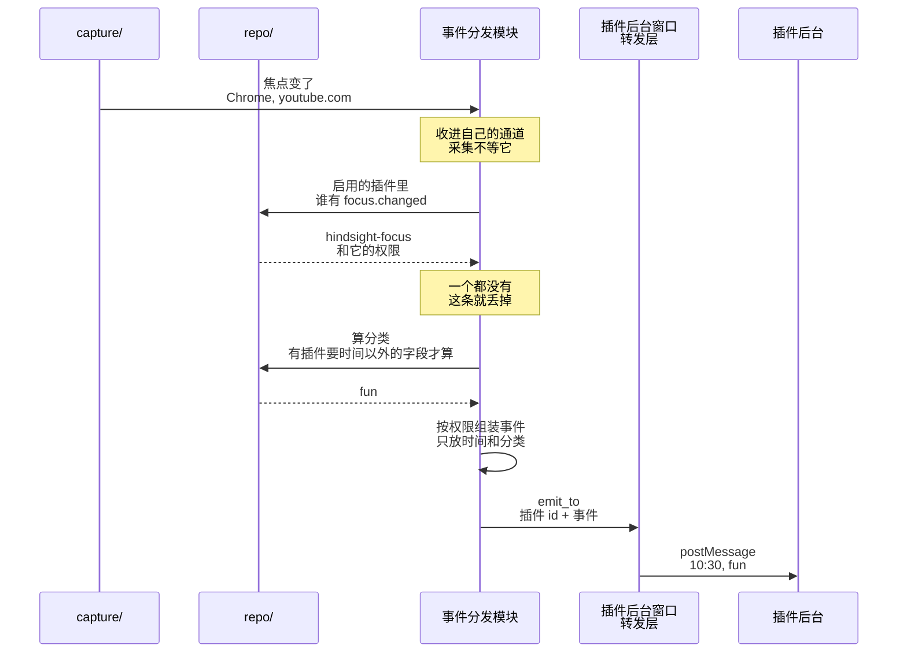

# ④ 插件接收事件

总体见 [插件后端架构](plugins-architecture.md)。

**本文旨在设计**：主程序怎么把焦点变化推给插件，用户离开也算一次焦点变化。包括三件事：

- 采集发现焦点变了，怎么通知事件分发模块，又不拖慢采集；
- 每个插件按权限能收到哪些字段；
- 出错时怎么只影响这一个插件、这一条事件。

例子：切到 YouTube 时通知专注插件。

- **为什么事件分发模块要有自己的通道**：采集循环不用知道插件存在，也不等插件。没有通道的话：
  - `capture/` 要直接调用 `plugins/`；
  - 查分类、查权限的时间都算进每 5 秒一次的采集里；
  - 插件那边出错，也会拖累采集。
- 通道排队，不覆盖：丢了「离开」，插件会把离开的时间算给上一个应用。
- 给插件的事件只列出它能拿的字段：主程序以后多记了什么，不加进去插件就拿不到。
- 网站只给域名，和 Hindsight 自己记下的一样：完整网址里可能有登录凭据。
- 统计里不计入的时段（隐藏的应用、忽略的窗口、用户离开）也推，只放时间，理由同上。
- 只有离开时 `away` 是 `true`：插件要分得清「用户走开了」和「切到了统计里看不到的窗口」，比如专注插件把离开算作休息。
- 事件的时间不倒退，插件不用自己处理。
- 命中隐私关键词的窗口不给标题，和不截图用同一个判断。
- 事件只推给后台脚本，所以不在后台运行的插件不能申请 `focus.changed`。
- 一个插件出错只影响它自己：每个插件单独推，推给 A 失败就记日志，接着推 B。
- 事件分发模块不能 panic：发布版设了 `panic = "abort"`（[Cargo.toml:136](../../../../src-tauri/Cargo.toml#L136)），一 panic 整个程序就退出。查库、算分类、推送出错都返回错误，丢掉这一条，等下一次焦点变化。
