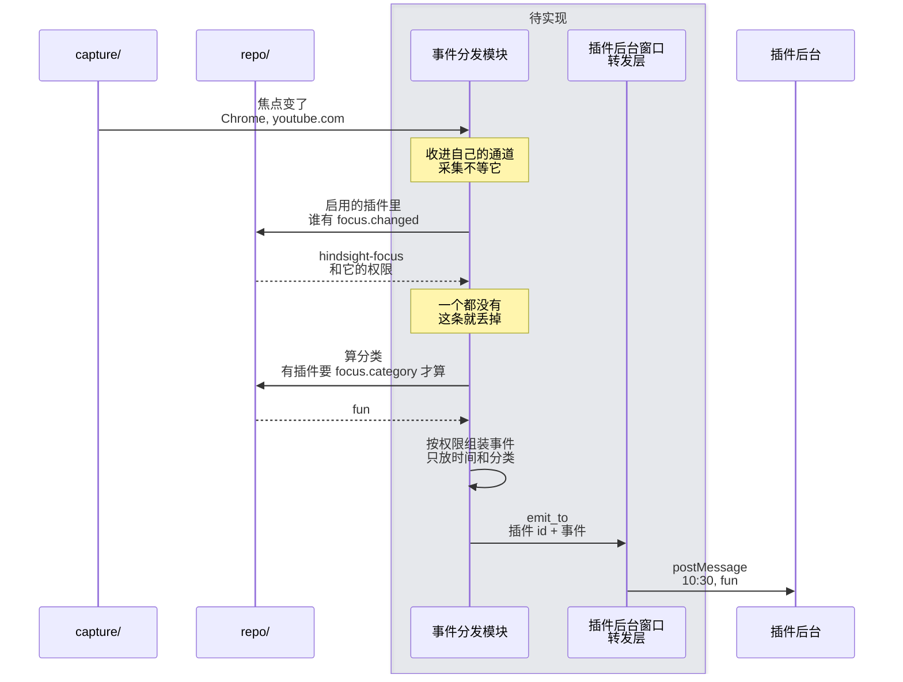

# ④ 插件接收事件

总体见 [插件后端架构](plugins-architecture.md)。

**本文旨在设计**：主程序怎么把焦点变化推给插件。包括三件事：

- 采集发现焦点变了，怎么通知事件分发模块，又不拖慢采集；
- 每个插件按权限能收到哪些字段；
- 出错时怎么只影响这一个插件、这一条事件。

例子：切到 YouTube 时通知专注插件。

- **为什么事件分发模块要有自己的通道**：采集循环不用知道插件存在，也不等插件。没有通道的话：
  - `capture/` 要直接调用 `plugins/`；
  - 查分类、查权限的时间都算进每 5 秒一次的采集里；
  - 插件那边出错，也会拖累采集。
- 采集里只加一行：焦点真的变了时，往事件分发模块的通道里放一条。
  - 不能放在「开新 session」的地方：采集为了截图也会定时开新 session，那时焦点没变（[service.rs:552-568](../../../../src-tauri/src/capture/service.rs#L552-L568)）。
  - 放的时候不等待。
  - 分发跟不上时丢掉旧的。焦点事件只有最新的有用。
- 按权限组装在 Rust 里做：给插件的事件用一个单独的结构体，只放它有权限看的字段。以后内部加了字段，不写进这个结构体就推不出去。
- 一个插件出错只影响它自己：每个插件单独推，推给 A 失败就记日志，接着推 B。
- 事件分发模块不能 panic：发布版设了 `panic = "abort"`（[Cargo.toml:136](../../../../src-tauri/Cargo.toml#L136)），一 panic 整个程序就退出。查库、算分类、推送出错都返回错误，丢掉这一条，等下一次焦点变化。
