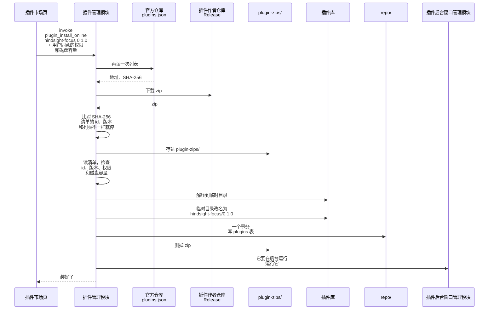
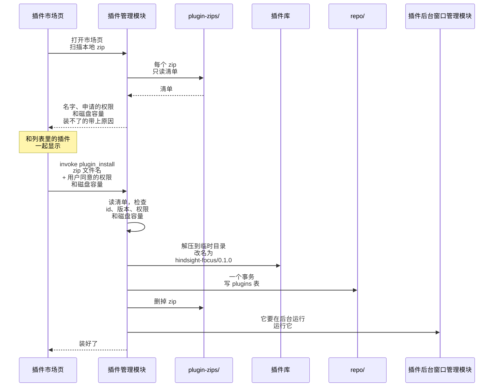
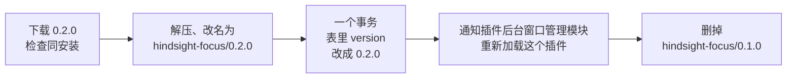

# ① 插件安装

总体见 [插件后端架构](plugins-architecture.md)。

**本文旨在设计**：怎么把插件装到本机、怎么更新。包括三件事：

- 下载到的文件怎么检查；
- 文件和 plugins 表按什么顺序写，中途断网、文件被改、程序崩溃，都不留下装了一半的插件；
- 更新时新旧版本怎么切换。

插件从哪下载见 [插件市场](market.md)。不上架也能直接装本地 zip，见下面的「本地 zip 安装」。

- 下载的 zip 存进 `plugin-zips/`，后面和本地 zip 安装是同一条路：装好后删掉；装失败留着，下次打开市场页时列在本地 zip 栏里。
- **先放文件，最后写表。**
  - 中途崩了，最多留下一个表里没有的目录，下次打开插件市场时删掉（见下面的「清理残留」）。
  - 反过来先写表的话，崩了就是表里有记录、文件却不在。
- 先解压到临时目录再改名。同一个磁盘上改名是一步完成的，插件库里不会出现解压了一半的插件文件夹。
- 表里存的是市场页传进来的、用户同意的权限和磁盘容量，不和清单里申请的比对。插件接口和事件分发模块只查表，清单申请得再多，用户没同意的也拿不到。
- 用户同意的磁盘容量是前端传来的，没经过清单检查，安装时再查一次在 1 MB 到 10 GB 之间。

## 本地 zip 安装

自己写的插件、别人直接发来的 zip，不用上架也能装：放进数据目录下的 `plugin-zips/` 文件夹。打开插件市场页时扫描一次，和列表里的插件一起显示。

- 和市场安装的区别：没有列表，申请的权限和磁盘容量只能从 zip 里的清单读；也没有 SHA-256 可比，文件是用户自己放进来的。
- 用单独的文件夹：不扫「下载」文件夹，那里有很多无关的 zip，每次打开市场页都翻一遍也碰了用户的文件。也不放进插件库：清理残留时会删掉表里没有的东西。
- 装不了的也列出来，带上原因：
  - 坏包，比如没有 background.js。插件作者调试时能看到错在哪。
  - 同一个版本已经装了，原因就是安装时会报的「已经装了 0.1.0」。插件作者没改版本号就重新打包时，能看到为什么装不了。
- 前端只传文件名，后端拼上 `plugin-zips/`，名字带 `/`、`..` 就拒绝：装好后要删 zip，传整个路径的话可能删错文件。
- 装好后删掉 zip，`plugin-zips/` 里平时只剩还没装的包；装失败 zip 不动。删不掉只记日志，下次打开市场页时它带着「已经装了」的原因列出来。
- 从检查清单开始，后面和市场安装一样：先放文件，最后写表。

## 更新

例子：专注插件从 0.1.0 更新到 0.2.0。

- 新旧版本的文件夹并排放，用哪个由 plugins 表里的 `version` 决定。改表以后，插件后台窗口管理模块重新加载这个插件，新拿到的插件列表里是 0.2.0，网址就指向新版本；主窗口里开着的插件页面也要重新加载。
- 不管崩在哪一步，表里写的那个版本的文件夹都是完整的：
  - 改表之前崩了：还用 0.1.0，多出来的 `0.2.0/` 下次打开插件市场时删掉。
  - 改表之后崩了：已经用 0.2.0，留下的 `0.1.0/` 下次打开插件市场时删掉。
- 同一个版本再装一次，报「已经装了 0.1.0」；版本不同就是更新，降级也算。
- 什么时候发现有更新：市场页读列表时，列表里的版本比已装的新，就提示更新（见 [插件市场](market.md)）。本地 zip 没有列表，用户把新版本的 zip 放进 `plugin-zips/`。

## 清理残留

每次打开插件市场页，先清理一次，清完才让用户安装。表说了算，插件库照着表收拾，删掉：

- 解压时崩了留下的临时目录 `.tmp-xxxx/`；
- 表里没有的插件的版本文件夹（装到一半、卸载到一半）。插件自己的数据不动，卸载时用户可能选了保留；文件夹删空了就一起删；
- 表里有这个插件，但不是表里那个版本的文件夹（更新时留下的旧版本或没切过去的新版本）。

- 放在打开市场时，不放在 app 启动时：残留只占磁盘，不影响插件运行；不用插件的用户也不用多跑这一步。
- 安装、卸载、清理不能同时跑，三者拿同一把锁。用户点了安装，下载还没完就切走再回到市场页，这时清理可能删掉正在安装的临时目录，或者已经改名、还没写表的新版本。
