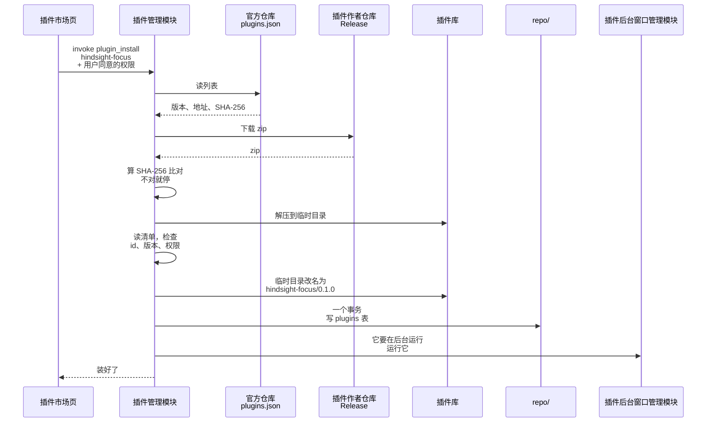
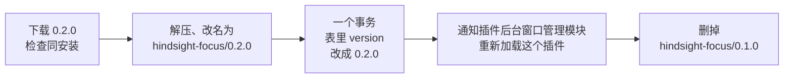

# ① 插件安装

总体见 [插件后端架构](plugins-architecture.md)。

**本文旨在设计**：怎么把插件装到本机、怎么更新。包括三件事：

- 下载到的文件怎么检查；
- 文件和 plugins 表按什么顺序写，中途断网、文件被改、程序崩溃，都不留下装了一半的插件；
- 更新时新旧版本怎么切换。

插件从哪下载见 [插件市场](market.md)。

- SHA-256 对不上就停，什么都不写。
- **先放文件，最后写表。**
  - 中途崩了，最多留下一个表里没有的目录，下次启动删掉（见 [② 运行插件程序](runtime.md)）。
  - 反过来先写表的话，崩了就是表里有记录、文件却不在。
- 先解压到临时目录再改名。同一个磁盘上改名是一步完成的，插件库里不会出现解压了一半的插件文件夹。
- 用户同意的权限由市场页传进来，和下载到的清单比对；清单要的比用户同意的多，就不装。原因是用户看到的那份清单和真正下载到的，可能不是同一份。

## 更新

例子：专注插件从 0.1.0 更新到 0.2.0。

- 新旧版本的文件夹并排放，用哪个由 plugins 表里的 `version` 决定。改表以后，插件后台窗口管理模块重新加载这个插件，新拿到的插件列表里是 0.2.0，网址就指向新版本；主窗口里开着的插件页面也要重新加载。
- 不管崩在哪一步，表里写的那个版本的文件夹都是完整的：
  - 改表之前崩了：还用 0.1.0，多出来的 `0.2.0/` 下次启动删掉。
  - 改表之后崩了：已经用 0.2.0，留下的 `0.1.0/` 下次启动删掉。
- 什么时候发现有更新：市场页读列表时，列表里的版本比已装的新，就提示更新（见 [插件市场](market.md)）。
