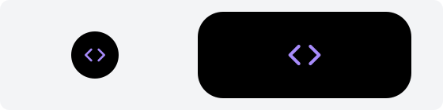

# icon：图标



左边是收起时，右边是展开时。

```json
{ "type": "icon", "name": "Code", "color": "#a78bfa" }
```

| 字段 | 必须有吗 | 说明 |
|---|---|---|
| `name` | 是 | 图标的名字，见下面 |
| `color` | 否 | `#rrggbb`，不传是白色 |

## 允许的放置位置

| 位置 | 大小 |
|---|---|
| `closed.left`、`closed.right` | 14 像素。只放一个图标的那边是圆的 |
| `open.left`、`open.right` | 22 像素 |

## 图标名

- 主界面分类图标的名字，和 `categories.list` 返回的 `icon` 一样：`Code` `Terminal` `Database` `GitBranch` `Bug` `Server` `Cloud` `Bot` `Globe` `Search` `Compass` `Newspaper` `Rss` `MessageCircle` `MessagesSquare` `Mail` `CalendarDays` `Briefcase` `FileText` `Table2` `Presentation` `NotebookPen` `PenLine` `Calculator` `ChartLine` `Brush` `Palette` `PenTool` `Box` `Image` `Camera` `Clapperboard` `Gamepad2` `Music` `Headphones` `Mic` `Film` `Video` `Tv` `GraduationCap` `BookOpen` `Languages` `Heart` `Coffee` `Dumbbell` `ShoppingCart` `Wallet` `Download` `FolderOpen` `HardDrive` `Shield` `Lock` `Activity` `Clock` `Wrench` `Sparkles` `Monitor` `MoreHorizontal` `EyeOff` `Tag`
- 给按钮用的：`Play` `Pause` `Square` `SkipForward` `RotateCcw` `Check` `X` `Plus` `Minus`
- `icon` 和 [`button`](button.md) 都能用这两组。名字和 Lucide 图标库里的一样。
- 不认识的名字显示成 `Tag`，不报错。
- 名字最长 64 字节。
