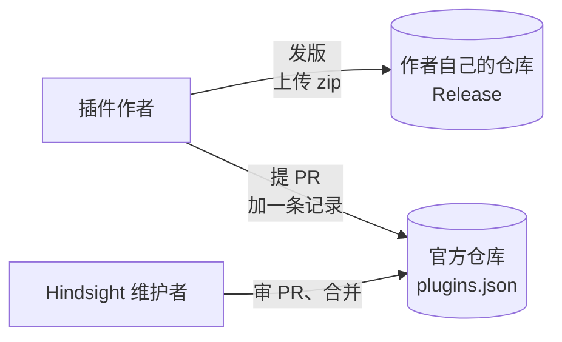
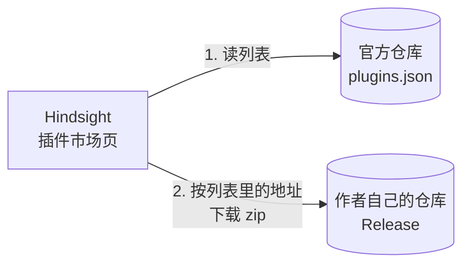

# 插件市场

总体见 [插件后端架构](plugins-architecture.md)。

**本文旨在设计**：插件从哪里来。包括三件事：

- 插件作者怎么上架；
- Hindsight 去哪找插件、从哪下载；
- 怎么保证下载到的文件没被改过、插件 id 不重复。

**上架**



**安装**



- 官方仓库只放一个列表文件 `plugins.json`，不放插件的代码。zip 放在作者自己仓库的 Release 里。
- 官方仓库单独建一个，不放进 Hindsight 主仓库：上架的 PR 不和应用代码混在一起，也不用跑主仓库的 CI。
- 插件 id 不重复，由审 PR 保证。
- 市场页只在用户打开时读一次列表，不在后台定时去拉。

### 列表文件的格式

每个插件一条记录：

```json
{
  "id": "hindsight-focus",
  "name": "专注",
  "author": "someone",
  "description": "离今天的目标还差多少，切到娱乐时提醒",
  "repo": "someone/hindsight-focus",
  "version": "0.1.0",
  "url": "https://github.com/someone/hindsight-focus/releases/download/0.1.0/hindsight-focus-0.1.0.zip",
  "sha256": "…",
  "permissions": ["stats.read", "focus.changed", "focus.category", "notifications"]
}
```

- `version`、`url`、`sha256` 写在列表里，作者每发一个新版本，都要提 PR 改这三项。
- `permissions` 让市场页在下载前就能把权限给用户看。用户同意的权限传给安装，存进 plugins 表（见 [① 插件安装](install.md)）。
- Hindsight 拿已装的版本和列表里的比，列表里的新就提示更新。
